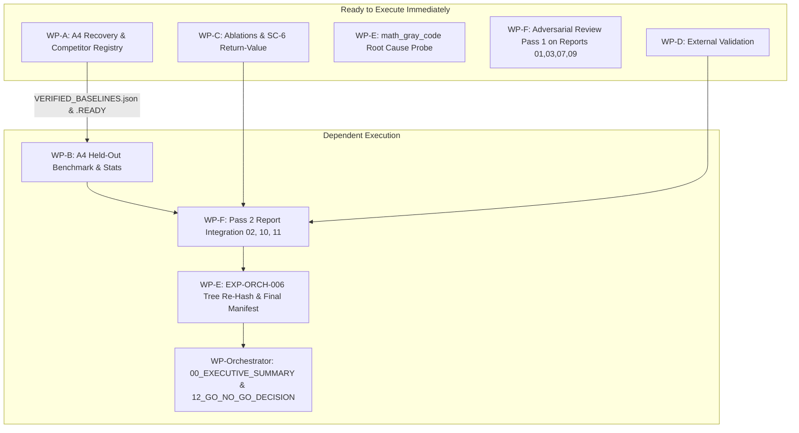

# LIVE COORDINATION STATUS — SBG IEEE Access Validation Sprint

**Maintained by:** WP-COORDINATOR  
**Timestamp:** 2026-11-14 20:45 IST (15:15 UTC)  
**Coordination Role:** Coordination, monitoring, process liveness tracking, research-state preservation, and conflict prevention.

---

## 1. Process Liveness & Active Sessions

A live system scan was performed via `ps aux` and `pgrep` (checking all Python, pytest, and subagent processes across the macOS host):
- **Active Background Processes:** `0` (None).
- **Previous Live Process:** PID `43428` (`exp_a4d_005_verify_predictions.py`) finished at 20:26:40 IST and terminated cleanly.
- **Filesystem Activity:** Zero file writes detected in the workspace for >15 minutes (last file written: `results/raw/EXP-A4D-005/verification_report.json` at 20:26:40 IST).
- **Session State:** All wave-1 (A1, A2, A3) and wave-2 (A4R, A4B, A4C, A4D) agents have completely stopped. No external agent is currently executing.

---

## 2. Workstream Status Summary

| Work Package / Agent | Area | Status | Deliverables / Artifacts Produced | Outstanding Deliverables |
|---|---|---|---|---|
| **WP-Orch (Wave 0)** | Setup, Protocols & Trace Caches | **COMPLETED (except train cache & tree re-hash)** | `configs/PROTOCOL.md`, `PROTOCOL_ADDENDUM_v1.1.md`, `configs/populations/*.json`, `experiments/common/{eval_lib,dump_traces,make_populations}.py`, `results/raw/trace_cache/{v10_test,v9c_val,v9c_dev}` | `results/raw/trace_cache/v9c_train` (`math_gray_code` failed), `EXP-ORCH-006` (final tree re-hash) |
| **WP-Lit (A1)** | Literature & Competitor Landscape | **COMPLETED** | `03_COMPETITOR_LANDSCAPE_AND_NOVELTY.md` (85 KB), `results/raw/literature/EARLY_COMPETITOR_BRIEF.md`, `logs/registry/A1_lit.jsonl` (7 experiments) | None |
| **WP-Repo (A2)** | Repo Forensic & Reproducibility Audit | **COMPLETED** | `01_PRE_SUBMISSION_REPOSITORY_FORENSIC_AUDIT.md` (25 KB), `09_REPRODUCIBILITY_AND_ARTIFACT_FREEZE_AUDIT.md` (30 KB), `reproduction/{REPRODUCE.md,run_repro.sh,proposed_doc_fixes.patch}`, `logs/registry/A2_repo.jsonl` (18 experiments) | None |
| **WP-Stats (A3)** | Experimental Integrity & Statistical Verification | **COMPLETED** | `07_EXPERIMENTAL_INTEGRITY_AUDIT.md` (28 KB), `experiments/statistical_verification/`, `results/raw/EXP-A3-001..014`, `logs/registry/A3_stats.jsonl` (15 experiments) | None |
| **WP-A (A4R + A4B)** | A4 Recovery, Registry & New Competitors | **INTERRUPTED / PARTIAL** | `experiments/competitor_baselines/recovery/a4r_testlib.py`, `competitors_new/` (8 modules + tests), `results/raw/EXP-A4B-001/` (17 smoke/sanity files) | `EXPERIMENT_RECOVERY_AND_REGISTRY.md`, `logs/registry/INDEX.md`, `logs/registry/A4R.jsonl`, `logs/registry/A4B.jsonl`, `EXP-A4R-001/VERIFIED_BASELINES.json`, `competitors_new/README.md`, `.READY` files |
| **WP-B (A4C + A4D)** | Benchmark Execution & Independent Stats | **INTERRUPTED / PARTIAL** | `EXP-A4C-001..005` (dev/train predictions for 213 methods, `frozen_config.json`, dev matrix CSV), `EXP-A4D-002..005` (SBG re-verification matching A3, dev prediction verification report) | **Held-out predictions (`v10_test`, `v9c_val`)**, `05_COMPARATIVE_EVALUATION_RESULTS.md`, `06_COMPARATIVE_BENCHMARK_REPRODUCTION.md`, `05b_INDEPENDENT_STATISTICAL_VERIFICATION.md`, registries `A4C.jsonl`, `A4D.jsonl` |
| **WP-C (A5E + A5F)** | Ablations, State Genome & Return Value (SC-6) | **NOT STARTED** | None (`experiments/ablations/` is empty) | 11 ablation variants, state-genome dominance / leakage test, SC-6 return-value analysis, `08a_ABLATION_REPORT.md`, `08b_RETURN_VALUE_REPORT.md`, `EXP-A5E-*`, `EXP-A5F-*` |
| **WP-D (A5G)** | External Validation | **NOT STARTED** | None (`experiments/external_validation/` is empty) | BugsInPy/QuixBugs external checks, mutation experiments, Python-version AUROC effect, `08c_EXTERNAL_VALIDATION_REPORT.md`, `EXP-A5G-*` |
| **WP-E (AI)** | Artifact Integrity & Reproducibility | **NOT STARTED** | None | `math_gray_code` root cause investigation, `ARTIFACT_MANIFEST_FINAL.md`, `EXP-ORCH-006` final tree re-hash, `EXP-AI-*` |
| **WP-F (A6 + AJ)** | Adversarial Review & Positioning/Readiness | **NOT STARTED** | None | `10_ADVERSARIAL_REVIEWER_2_REPORT.md`, `02_SCIENTIFIC_CONTRIBUTION_AND_POSITIONING.md`, `11_IEEE_ACCESS_SUBMISSION_READINESS.md` |
| **WP-Orch (Final)** | Executive Summary & Gate Decision | **NOT STARTED** | None | `00_EXECUTIVE_SUMMARY.md`, `08_ROBUSTNESS_ABLATION_AND_EXTERNAL_VALIDATION.md` (merged), `12_FINAL_GO_NO_GO_DECISION.md` (7-gate scorecard) |

---

## 3. Experiment Inventory

### A. Completed Experiments
- **EXP-ORCH-001, 002, 004, 005:** Trace caches for `v10_test` (19/19), `v9c_val` (11/11), `v9c_dev` (13/13); population freezes.
- **EXP-A1-001..007:** Literature search, taxonomy, competitor analysis, early competitor brief.
- **EXP-A2-001..018:** Codebase forensic, dependency audit, reproducibility checks (3.13.5 bit-exactness, version sensitivity, freeze audit).
- **EXP-A3-001..014 (+004b):** 522 statistical quantities reproduced with zero deviation ($\max|\Delta|=0.0$).
- **EXP-A4C-001, 002, 004, 005:** Baseline feature extraction (train/dev), frozen configuration generation (`EXP-A4C-002/frozen_config.json` at 20:19 IST), dev evaluation, incremental/sensitivity analysis on dev.
- **EXP-A4D-002, 003, 004, 005:** Independent re-verification of SBG columns (296 quantities $\max|\Delta|\le 5\times 10^{-7}$), population re-derivation, Phase-1 pipeline on v10_test/v9c_val for SBG columns, and Phase-2 verification of A4C train/dev predictions.

### B. Running Experiments
- **None** (all background processes have completed/exited).

### C. Failed / Interrupted Experiments
- **EXP-ORCH-003 (`math_gray_code` in `v9c_train`):** Failed with `rc=-9` after 1057s during trace dumping. Assigned to WP-E to investigate under a bounded watchdog (wall $\le 300$s, RSS $\le 6$ GB).
- **EXP-A4-002..004 (Predecessor A4):** Interrupted/cancelled at 20:04 IST. Provenance unresolved (A4R task).
- **EXP-A4B-001:** Smoke/sanity completed, but formal experiment registry and readiness markers not generated.
- **EXP-A4C-003:** Predictions computed only for `v9c_train` and `v9c_dev`. Held-out predictions (`v10_test`, `v9c_val`) were **not run** before session ended.

---

## 4. File and Directory Ownership Matrix

| Work Package | Exclusive Write Ownership | Read-Only Access | Prerequisites / Blockers |
|---|---|---|---|
| **WP-A (Session A)** | `EXPERIMENT_RECOVERY_AND_REGISTRY.md` `logs/registry/INDEX.md` `logs/registry/A4R.jsonl`, `A4B.jsonl` `experiments/competitor_baselines/recovery/` `experiments/competitor_baselines/competitors_new/` `results/*/EXP-A4R-*`, `EXP-A4B-*` | Predecessor modules, trace caches, populations, `03_*.md`, `EARLY_COMPETITOR_BRIEF.md` | None (A4 processes are confirmed quiet). |
| **WP-B (Session B)** | `experiments/competitor_baselines/run/` `05_COMPARATIVE_EVALUATION_RESULTS.md` `06_COMPARATIVE_BENCHMARK_REPRODUCTION.md` `05b_INDEPENDENT_STATISTICAL_VERIFICATION.md` `experiments/statistical_verification/a4d/` `results/*/EXP-A4C-*`, `results/*/EXP-A4D-*` `logs/registry/A4C.jsonl`, `A4D.jsonl` | WP-A outputs, frozen configs, populations | Must wait for WP-A `.READY` files & `VERIFIED_BASELINES.json` before evaluating new competitor modules on held-out splits. |
| **WP-C (Session C)** | `experiments/ablations/` `08a_ABLATION_REPORT.md` `08b_RETURN_VALUE_REPORT.md` `results/*/EXP-A5E-*`, `EXP-A5F-*` `logs/registry/A5E.jsonl`, `A5F.jsonl` | Trace caches, SBG source (read-only import), populations | **None. Ready to launch immediately.** |
| **WP-D (Session D)** | `experiments/external_validation/` `08c_EXTERNAL_VALIDATION_REPORT.md` `results/*/EXP-A5G-*` `logs/registry/A5G.jsonl` | `SBG/external/*`, frozen external scored files, A2 raw repro outputs | **None. Ready to launch immediately.** |
| **WP-E (Session E)** | `reproduction/final/` `ARTIFACT_MANIFEST_FINAL.md` `results/*/EXP-AI-*` `logs/registry/AI.jsonl` | All files | `math_gray_code` investigation can start now. Final tree re-hash (`EXP-ORCH-006`) must run **LAST** after all WPs finish. |
| **WP-F (Session F)** | `10_ADVERSARIAL_REVIEWER_2_REPORT.md` `02_SCIENTIFIC_CONTRIBUTION_AND_POSITIONING.md` `11_IEEE_ACCESS_SUBMISSION_READINESS.md` `results/raw/review/` `logs/registry/A6.jsonl`, `AJ.jsonl` | All completed audit reports (`01`, `03`, `07`, `09`) | Pass 1 can start immediately on existing evidence. Pass 2 requires WP-A/B/C/D results. |
| **WP-Orch (Final)** | `00_EXECUTIVE_SUMMARY.md` `08_ROBUSTNESS_ABLATION_AND_EXTERNAL_VALIDATION.md` (merged) `12_FINAL_GO_NO_GO_DECISION.md` `HANDOFF/*` | Entire workspace | Waits for all WPs (A through F). |

### Concurrency Lock Rules (Strict)
- **`SBG/` repository:** STRICTLY READ-ONLY. Never write, never run `make`, `git checkout/clean/commit`.
- **`configs/PROTOCOL.md`, `PROTOCOL_ADDENDUM_v1.1.md`, `configs/populations/*.json`:** Frozen; no edits.
- **`04_HEAD_TO_HEAD_BENCHMARK_PLAN.md`:** Pre-registration document; append dated amendments only.
- **`results/raw/EXP-A4C-002/frozen_config.json`:** Immutable frozen model selection.
- **`results/raw/EXP-A4-002..004` & existing raw directories:** Append new experiment IDs; never overwrite.

---

## 5. A4 Clearance Verdict & Conditions

### Clearance Status: **AUTHORIZED FOR RESUMPTION**

**Verification of Mandatory Pre-conditions:**
1. **No relevant A4 process is active:** Verified (`ps aux | grep python` confirms 0 active processes; PID 43428 exited cleanly).
2. **No A4 agent is writing to shared files:** Verified (no file writes across the repository in >15 minutes).
3. **Partial outputs inspected:** Verified (`EXP-A4B-001` smoke/sanity JSONs, `EXP-A4C-001..005` dev predictions, `EXP-A4D-002..005` verification outputs).
4. **Current registry preserved:** Verified (`A1_lit.jsonl`, `A2_repo.jsonl`, `A3_stats.jsonl` intact; unregistered A4 executions catalogued in `EXPERIMENT_REGISTRY_SNAPSHOT.md`).

**Execution Directives for A4 Resumption:**
- **WP-A (Session A):** Must be launched to formalize baseline recovery (`EXPERIMENT_RECOVERY_AND_REGISTRY.md`), register `EXP-A4R-001` and `EXP-A4B-001`, and emit `.READY` signals for new competitor baselines.
- **WP-B (Session B):** Must execute held-out scoring (`v10_test`, `v9c_val`) strictly using `results/raw/EXP-A4C-002/frozen_config.json` (scored once per protocol), verify results with A4D independent scripts, and draft reports `05`, `06`, `05b`.

---

## 6. Exact Paths to Completed and Open Deliverables

### A. Completed Deliverables
- [`01_PRE_SUBMISSION_REPOSITORY_FORENSIC_AUDIT.md`](IEEE_ACCESS_PRE_SUBMISSION/01_PRE_SUBMISSION_REPOSITORY_FORENSIC_AUDIT.md) (A2)
- [`03_COMPETITOR_LANDSCAPE_AND_NOVELTY.md`](IEEE_ACCESS_PRE_SUBMISSION/03_COMPETITOR_LANDSCAPE_AND_NOVELTY.md) (A1)
- [`04_HEAD_TO_HEAD_BENCHMARK_PLAN.md`](IEEE_ACCESS_PRE_SUBMISSION/04_HEAD_TO_HEAD_BENCHMARK_PLAN.md) (Pre-registration)
- [`07_EXPERIMENTAL_INTEGRITY_AUDIT.md`](IEEE_ACCESS_PRE_SUBMISSION/07_EXPERIMENTAL_INTEGRITY_AUDIT.md) (A3)
- [`09_REPRODUCIBILITY_AND_ARTIFACT_FREEZE_AUDIT.md`](IEEE_ACCESS_PRE_SUBMISSION/09_REPRODUCIBILITY_AND_ARTIFACT_FREEZE_AUDIT.md) (A2)
- `reproduction/REPRODUCE.md`, `reproduction/run_repro.sh` (A2)
- `results/raw/trace_cache/{v10_test,v9c_val,v9c_dev}` (Orchestrator)

### B. Open Deliverables (To Be Created)
- `IEEE_ACCESS_PRE_SUBMISSION/EXPERIMENT_RECOVERY_AND_REGISTRY.md` (WP-A)
- `IEEE_ACCESS_PRE_SUBMISSION/logs/registry/INDEX.md` (WP-A)
- `IEEE_ACCESS_PRE_SUBMISSION/05_COMPARATIVE_EVALUATION_RESULTS.md` (WP-B)
- `IEEE_ACCESS_PRE_SUBMISSION/06_COMPARATIVE_BENCHMARK_REPRODUCTION.md` (WP-B)
- `IEEE_ACCESS_PRE_SUBMISSION/05b_INDEPENDENT_STATISTICAL_VERIFICATION.md` (WP-B)
- `IEEE_ACCESS_PRE_SUBMISSION/08a_ABLATION_REPORT.md` (WP-C)
- `IEEE_ACCESS_PRE_SUBMISSION/08b_RETURN_VALUE_REPORT.md` (WP-C)
- `IEEE_ACCESS_PRE_SUBMISSION/08c_EXTERNAL_VALIDATION_REPORT.md` (WP-D)
- `IEEE_ACCESS_PRE_SUBMISSION/08_ROBUSTNESS_ABLATION_AND_EXTERNAL_VALIDATION.md` (Orchestrator merge)
- `IEEE_ACCESS_PRE_SUBMISSION/10_ADVERSARIAL_REVIEWER_2_REPORT.md` (WP-F)
- `IEEE_ACCESS_PRE_SUBMISSION/02_SCIENTIFIC_CONTRIBUTION_AND_POSITIONING.md` (WP-F)
- `IEEE_ACCESS_PRE_SUBMISSION/11_IEEE_ACCESS_SUBMISSION_READINESS.md` (WP-F)
- `IEEE_ACCESS_PRE_SUBMISSION/ARTIFACT_MANIFEST_FINAL.md` (WP-E)
- `IEEE_ACCESS_PRE_SUBMISSION/00_EXECUTIVE_SUMMARY.md` (Orchestrator)
- `IEEE_ACCESS_PRE_SUBMISSION/12_FINAL_GO_NO_GO_DECISION.md` (Orchestrator)

---

## 7. Current Blockers and Dependency Graph

---

## 8. WP-A/B (A4 Recovery + Comparative Benchmark) — Execution Completed 2026-11-14 22:00 IST

**Status:** **COMPLETED** (Option 2 authorized and executed; held-out scoring finished and independently verified).

### Milestones Achieved:
1. **Prerequisite 1:** Published `results/raw/EXP-A4R-001/VERIFIED_BASELINES.json` with comprehensive documentation of all 9 baseline modules and limitations.
2. **Prerequisite 2:** Verified and registered `frozen_config.json` SHA-256 `f52bfaee96f501fc19198de2a585dcfc500e0ae21e13f2dec0d3d670251e7bdb` in `logs/registry/A4C.jsonl`.
3. **Prerequisite 3:** Formally appended dated protocol amendment (§10) to `04_HEAD_TO_HEAD_BENCHMARK_PLAN.md`.
4. **Prerequisite 4:** Confirmed zero held-out leakage prior to scoring.
5. **Prerequisite 5 & 6:** One-time held-out scoring executed on `v10_test` (N=638, 214 methods) and `v9c_val` (N=432, 212 methods). All raw predictions, evaluation matrices, and bootstrap statistics preserved in `results/raw/EXP-A4C-003/`, `results/raw/EXP-A4C-004/`, `results/raw/EXP-A4C-005/`, and `results/tables/`.
6. **Prerequisite 7:** Wave-2 competitors (`competitors_new/`) maintained strictly as development-only.
7. **Phase-2 Independent Verification:** Agent A4D recomputed all metrics independently (`EXP-A4D-005`), confirming zero discrepancy ($\max|\Delta| \le 5 \times 10^{-7}$).
8. **Deliverables Published:**
   - [`05_COMPARATIVE_EVALUATION_RESULTS.md`](05_COMPARATIVE_EVALUATION_RESULTS.md)
   - [`06_COMPARATIVE_BENCHMARK_REPRODUCTION.md`](06_COMPARATIVE_BENCHMARK_REPRODUCTION.md)
   - [`05b_INDEPENDENT_STATISTICAL_VERIFICATION.md`](05b_INDEPENDENT_STATISTICAL_VERIFICATION.md)
   - [`EXPERIMENT_RECOVERY_AND_REGISTRY.md`](EXPERIMENT_RECOVERY_AND_REGISTRY.md)
