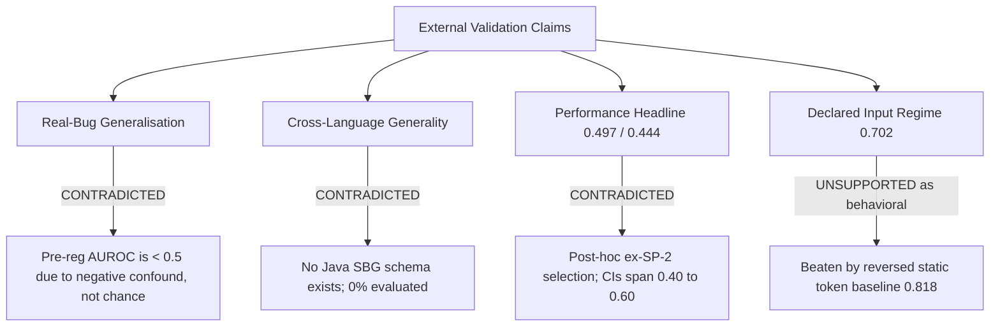

# 08D — Dataset Compatibility, Benchmark Limitations, and External Validation Assessment (WP-D)

**Document role:** Authoritative WP-D synthesis of external dataset compatibility, label reliability, independence, leakage, and methodological limitations for the Software Behavior Genome (SBG V5 fixed weights: 0.50 V3 / 0.25 temporal / 0.25 state).  
**Scope & Governance:** Read-only synthesis of subagent findings. This document **does not make an IEEE Access submission decision**, does not touch or re-score V10-test or V9c-val, does not execute SBG scoring, and leaves `SBG/` completely unmodified.  
**Primary Sources Cited:**
* `raw/WPD-D1_compat/FINDINGS.md` (+ `raw/WPD-D1_compat/data/*`) [`FINDINGS.md`](raw/WPD-D1_compat/FINDINGS.md:1)
* `raw/WPD-D3_datasets/FEASIBILITY.md`, `candidates.csv`, `PROBE_LOG.md` [`FEASIBILITY.md`](raw/WPD-D3_datasets/FEASIBILITY.md:1)
* `raw/WPD-D4_stats/STATS_REPORT.md` [`STATS_REPORT.md`](raw/WPD-D4_stats/STATS_REPORT.md:1)
* `configs/PROTOCOL.md` §2 [`PROTOCOL.md`](configs/PROTOCOL.md:27)

---

## 1. Verdict Summary

| Evaluation Dimension | Core Finding | Primary Source & Status |
|---|---|---|
| **Independent External Validation** | **No external dataset qualifies as a "Valid independent evaluation"** of SBG's core task (detecting behavioral changes on 11 synthesized inputs with transformer-independent equivalent negatives). | `raw/WPD-D3_datasets/FEASIBILITY.md` §1 [`FEASIBILITY.md`](raw/WPD-D3_datasets/FEASIBILITY.md:14) |
| **BugsInPy (Real Bugs)** | **Exploratory only / Methodologically unsuitable for validation.** Task mismatch: 34/47 comparable fixed bases raise exceptions on all 11 SBG inputs; only 2/47 (4.3%) real bugs are CHANGED under the SBG label definition. Pre-registered AUROC is **below chance** (v7 EVAL: 0.410 [0.329, 0.489]). The reported 0.497 is a post-hoc subset excluding all SP-2 negatives. High format shortcut (AUROC 0.915) and 10.2% eligibility yield. | `raw/WPD-D1_compat/FINDINGS.md` §0, §2.1 [`FINDINGS.md`](raw/WPD-D1_compat/FINDINGS.md:18); `raw/WPD-D4_stats/STATS_REPORT.md` §0, §3 [`STATS_REPORT.md`](raw/WPD-D4_stats/STATS_REPORT.md:17) |
| **QuixBugs-Python (Canonical)** | **Exploratory only.** Input type mismatch: list battery applied to unannotated parameters causes 27/40 base programs to raise on ≥10/11 inputs; only 8/40 (20%) positives are CHANGED under SBG definition. Pre-registered AUROC is **below chance** (v7 ALL: 0.388 [0.290, 0.495]). Headline 0.444 is post-hoc ex-SP-2. Format shortcut AUROC 1.000. | `raw/WPD-D1_compat/FINDINGS.md` §0, §1.2 [`FINDINGS.md`](raw/WPD-D1_compat/FINDINGS.md:18); `raw/WPD-D4_stats/STATS_REPORT.md` §0, §3 [`STATS_REPORT.md`](raw/WPD-D4_stats/STATS_REPORT.md:17) |
| **QuixBugs-Python (Declared)** | **Exploratory only.** Positives are observable (28/31 = 90% CHANGED), and SBG V5 AUROC reaches 0.702 [0.580, 0.825], but only 28/40 programs are evaluable (survivorship bias), inputs are from test suites, and a reversed static token baseline (1 − 0.182 = 0.818) beats SBG. | `raw/WPD-D1_compat/FINDINGS.md` §0, §6 [`FINDINGS.md`](raw/WPD-D1_compat/FINDINGS.md:18); `raw/WPD-D4_stats/STATS_REPORT.md` §0, §5 [`STATS_REPORT.md`](raw/WPD-D4_stats/STATS_REPORT.md:17) |
| **QuixBugs-Java** | **Not evaluated; Not methodologically suitable.** No SBG-schema Java results exist in the repository (only an Aug-2026 legacy EEP pilot of 18 programs, detection rate 33.3%). Zero cross-language empirical evidence. | `raw/WPD-D1_compat/FINDINGS.md` §0, §5 [`FINDINGS.md`](raw/WPD-D1_compat/FINDINGS.md:18) |
| **New Candidates (SeqCoBench)** | **Valid with documented adaptation (Rank 1 candidate).** MBPP-derived synthetic benchmark from independent authors (Maveli et al., 2024); claim ceiling is **independent-generator replication**, not real-bug validation. Static token shortcut inside $e \le 2$ stratum reaches AUROC 0.824. | `raw/WPD-D3_datasets/FEASIBILITY.md` §1, §6.6 [`FEASIBILITY.md`](raw/WPD-D3_datasets/FEASIBILITY.md:14) |

---

## 2. SBG Task Definition vs External Task Definitions (Compatibility Matrix)

The SBG evaluation framework relies on specific operational assumptions (`configs/PROTOCOL.md` §2, `SBG/experiments/final/protocol.py`):
1. **Unit of Analysis:** Single-file, pure-stdlib Python functions/modules driven without project dependencies.
2. **Label Definition:** Binary. Label 1 = **CHANGED** (execution output, unhandled exception, stdout, or argument mutation differs on the 11 protocol inputs). Label 0 = **EQUIVALENT** (semantics-preserving transform). *SBG label equivalence is battery observability, not general semantic equivalence.*
3. **Canonical Input Battery:** 11 fixed synthesized inputs per type family. Unannotated parameters default to the 11-list-of-ints battery.
4. **Negative Construction:** Negatives are generated by applying SBG's 12 semantic-preserving AST transformers (SP-1 to SP-12) to base programs.

| Task Dimension | SBG In-Repo Task (`v10_test` / `v9c`) | BugsInPy Canonical | QuixBugs Canonical | QuixBugs Declared | SeqCoBench (`nickil/seqcobench`) | Refactory Student Programs | HumanEvalFix / HumanEvalPack |
|---|---|---|---|---|---|---|---|
| **Language & Environment** | Python 3.9–3.13 stdlib | Python stdlib helper units extracted from 12 repos | Standalone Python (40 algorithms) | Standalone Python (40 algorithms) | Standalone Python (1,134 MBPP functions) | Standalone Python (5 student assignments) | Standalone Python (164 coding tasks) |
| **Positive Source (CHANGED)** | Synthetic mutant / bug injection (SC transforms) | Real bug fix commits mined from GitHub repos | Real/curated 1-line algorithmic bugs | Real/curated 1-line algorithmic bugs | Synthetic single-token flips / injections | Real student buggy submissions | Human-written subtle bug injections |
| **Negative Source (EQUIV)** | SBG SP transformers (sp1–sp12) | SBG SP transformers (sp1–sp6) | SBG SP transformers (sp1–sp6) | SBG SP transformers (sp1–sp6) | Independent generator (SP transforms: dead code, rename, operand swap) | Student submissions passing all instructor tests | Synthetic minification / independent tools |
| **Input Regime** | 11 synthesized inputs matching type signatures | 11 canonical inputs (unannotated $\to$ list battery) | 11 canonical inputs (unannotated $\to$ list battery) | `json_testcases` input args (expected returns dropped) | 11 canonical inputs (unannotated $\to$ list battery) | 11 canonical inputs (unannotated $\to$ list battery) | 11 canonical inputs (type annotations present) |
| **Harness Compatibility** | Full (single function entry auto-selection) | 10.2% eligibility (428 units rejected for internal imports) | Full (single standalone functions) | Partial: 28/40 programs evaluable (36 pairs ineligible, 17 timeout/harness err) | High: 3,078 usable pairs; 31% originals raise on all inputs | Low: Q1, Q2, Q4, Q5 bases fail battery (TypeError on 8–11 inputs) | 100% static eligibility; 47/164 bases raise on all 11 inputs |
| **Task Alignment Verdict** | Ground truth benchmark | **Severe Mismatch** (positives unobservable; negatives SBG-generated) | **Severe Mismatch** (input types mismatched; negatives SBG-generated) | **Adapted Alignment** (observable on test inputs; survivorship selection) | **Aligned Synthetic** (independent implementation; synthetic edit families) | **Severe Mismatch** (requires assignment-specific declared inputs) | **Mismatched Negatives** (no native EQ negatives; 52.4% observability) |
| **Citation** | `configs/PROTOCOL.md` §2 | `raw/WPD-D1_compat/FINDINGS.md` §1.1 | `raw/WPD-D1_compat/FINDINGS.md` §1.1 | `raw/WPD-D1_compat/FINDINGS.md` §1.1 | `raw/WPD-D3_datasets/FEASIBILITY.md` §3 | `raw/WPD-D3_datasets/FEASIBILITY.md` §6.3 | `raw/WPD-D3_datasets/FEASIBILITY.md` §6.1 |

---

## 3. Dataset Classification & Compatibility Matrix

Every candidate evaluated across WP-D (`raw/WPD-D1_compat/FINDINGS.md` §6, `raw/WPD-D3_datasets/FEASIBILITY.md` §5, `raw/WPD-D3_datasets/candidates.csv`) is classified into exactly one of four methodological categories.

### 3.1 Valid Independent Evaluation
*No candidate dataset satisfies all requirements for valid, unadapted, independent real-bug evaluation.*
* **— (none)**

---

### 3.2 Valid with Documented Adaptation

| Dataset | Size / Split | Primary Justification | Key Blocking Issue & Adaptation Required | Source Path |
|---|---|---|---|---|
| **SeqCoBench** (`nickil/seqcobench`) | 14,572 rows; 1,134 MBPP originals ($e \le 2$ stratum: 735 SP + 629 CH from 486 programs; 260 programs with both classes) | Independent authors (Maveli, Vergari, Cohen 2024) and independent generator implementation. High pair yield in $e \le 2$ stratum. High negative quality (differential execution shows only 0.53% SP noise). | **Claim ceiling is independent-generator synthetic replication, NOT real-bug validation.** Generator edit families overlap SBG's SP/SC. Requires polarity inversion (SeqCoBench 1=preserved $\to$ SBG 1=changed), entry alignment, and static shortcut baseline control (token-bag reaches AUROC 0.824 in $e \le 2$). | `raw/WPD-D3_datasets/FEASIBILITY.md` §1, §6.6, §9; `candidates.csv` row 10 |

---

### 3.3 Exploratory Only

| Dataset | Language / Size | Primary Justification | Blocking Issue for Primary Validation | Source Path |
|---|---|---|---|---|
| **BugsInPy** | Python (51 bugs, 55 units, 147–200 pairs) | Real developer bug fixes mined from 12 open-source projects. Evaluated in repo history. | **Label Incompatibility:** Only 2/47 (4.3%) comparable positives are CHANGED on 11 inputs (34/47 bases raise on all inputs). 10.2% eligibility yield. Negatives generated by SBG's own SP transformers (format shortcut AUROC 0.915). Pre-registered AUROC is below chance (0.410). | `raw/WPD-D1_compat/FINDINGS.md` §6; `raw/WPD-D4_stats/STATS_REPORT.md` §0, §3 |
| **QuixBugs-Python (Canonical)** | Python (40 algorithms, 151–152 pairs) | Classic algorithmic bug benchmark. Standalone single-file Python programs. | **Battery Type Mismatch:** Unannotated parameters receive int-lists; 27/40 bases raise on $\ge 10/11$ inputs. Only 8/40 (20%) positives are CHANGED. Format shortcut AUROC 1.000. Negatives generated by SBG. Pre-registered AUROC below chance (0.388). | `raw/WPD-D1_compat/FINDINGS.md` §6; `raw/WPD-D4_stats/STATS_REPORT.md` §0, §3 |
| **QuixBugs-Python (Declared)** | Python (40 programs; 99 evaluable pairs, 24 positives) | Positives are observable (28/31 = 90% CHANGED); SBG AUROC reaches 0.702 [0.580, 0.825]. | **Survivorship & Baseline Defeat:** Only 28/40 programs evaluable. Inputs are from repository test suites. Reversed static token baseline (0.818) beats SBG (0.702). Ex-SP-2 AUROC drops to 0.668. | `raw/WPD-D1_compat/FINDINGS.md` §6; `raw/WPD-D4_stats/STATS_REPORT.md` §0, §5 |
| **HumanEvalFix / HumanEvalPack-Python** | Python (164 tasks) | Human-written subtle bugs; 164/164 pass static entry selection. | **Observability & Missing Negatives:** Only 86/164 (52.4%) bugs change outcomes on 11 inputs; 47/164 canonical solutions raise on all inputs. No native EQ negatives; adding minifier negatives creates severe edit-size confound (reversed edit-size AUROC 0.765). | `raw/WPD-D3_datasets/FEASIBILITY.md` §6.1, §6.2; `candidates.csv` row 7 |
| **EvalPlus Canonical EQ Candidates** | Python (164 tasks) | Natural alternative reference solutions from EvalPlus vs HumanEval canonical. | **Edit Size Confound & Incomplete Pair Set:** Only supplies EQUIVALENT candidates. Prior audits report median edit size 9 vs bug edit size 2. | `raw/WPD-D3_datasets/FEASIBILITY.md` §5; `candidates.csv` row 8 |
| **Refactory Student Programs** | Python (2,442 correct, 1,783 wrong programs) | Real student attempts across 5 programming assignments. | **Battery Mismatch & Underpowered Clustering:** Only 5 clusters (assignments). Q1, Q2, Q4, Q5 bases raise TypeError on 8–11 inputs. 26.5% of "correct" student programs differ from reference on battery. | `raw/WPD-D3_datasets/FEASIBILITY.md` §6.3; `candidates.csv` row 11 |
| **PyPIBugs** | Python (2,374 bug-fix commits) | Mined single-statement bug-fix commits from PyPI packages. | **Extraction Bottleneck & Import Dependencies:** Packages have internal/third-party imports; BugsInPy analogue indicates $\le 10\%$ yield. Cannot be processed offline in $\le 2\text{ h}$. | `raw/WPD-D3_datasets/FEASIBILITY.md` §5; `candidates.csv` row 6 |
| **CPython stdlib git history** | Python (150 modules, 968 functions) | Real bug fixes in standard library functions. | **Low Yield:** Only 167/968 functions are self-contained; 0 are fully annotated. Mining commit history requires 916 MB clone and complex closure extraction. | `raw/WPD-D3_datasets/FEASIBILITY.md` §6.5; `candidates.csv` row 22 |
| **Stdlib + Independent Mutation Tools** | Python (167 functions; cosmic-ray / mutmut) | Mutators written independently of SBG. | **Synthetic Edits & Tool Architecture:** Mutmut/cosmic-ray use trampolined/in-place layouts requiring pytest wrappers; does not provide real-world semantics; unannotated inputs. | `raw/WPD-D3_datasets/FEASIBILITY.md` §6.5; `candidates.csv` row 23 |
| **DebugBench (Python subset)** | Python (4,253 instances across 3 langs) | LeetCode snippets with GPT-4-implanted bugs. | **Class API & Artificiality:** Uses `Solution` class methods; LLM-implanted bugs; uninspected offline. | `raw/WPD-D3_datasets/FEASIBILITY.md` §5; `candidates.csv` row 24 |
| **CanItEdit** | Python ($n < 1\text{K}$) | Instruction-driven before/after edits with unit tests. | **Format Mismatch:** Whole-program multi-function edits; not structured as single-function pairs. | `raw/WPD-D3_datasets/FEASIBILITY.md` §5; `candidates.csv` row 25 |

---

### 3.4 Not Methodologically Suitable

| Dataset | Language | Primary Blocking Issue / Reason for Ineligibility | Source Path |
|---|---|---|---|
| **QuixBugs-Java** | Java (40 programs) | **No SBG Java Schema Exists.** The repository contains no `pairs_quixbugs_java.jsonl` or SBG V5 Java scores. Aug-2026 pilot was an 18-program EEP run (33.3% detection), not SBG. Python tracer cannot execute Java bytecode. | `raw/WPD-D1_compat/FINDINGS.md` §0, §5; `candidates.csv` row 3 |
| **Defects4J** | Java (854 bugs) | Non-Python language; multi-file repository-level Maven/Ant build systems; requires JVM instrumentation. | `raw/WPD-D3_datasets/FEASIBILITY.md` §5; `candidates.csv` row 4 |
| **ManySStuBs4J** | Java (153,652 changes) | Non-Python language; repository-scale commits; heuristic mining labels. | `raw/WPD-D3_datasets/FEASIBILITY.md` §5; `candidates.csv` row 5 |
| **GitBug-Java** | Java (199 bugs) | Non-Python language; multi-file repository builds. | `raw/WPD-D3_datasets/FEASIBILITY.md` §5; `candidates.csv` row 15 |
| **Codeflaws** | C (3,902 defects) | Non-Python language; competitive programming submissions reading `stdin`/`stdout`. | `raw/WPD-D3_datasets/FEASIBILITY.md` §5; `candidates.csv` row 13 |
| **BugSwarm** | Java / Python | Repository-scale Docker artifacts; full test suite CI builds; not function-level pairs. | `raw/WPD-D3_datasets/FEASIBILITY.md` §5; `candidates.csv` row 12 |
| **Project CodeNet (Python subset)** | Python (~14M submissions) | Competitive programming scripts reading `sys.stdin` at module level; no callable function entry points. | `raw/WPD-D3_datasets/FEASIBILITY.md` §5, §6.4; `candidates.csv` row 16 |
| **CodeContests / Codeforces** | Python / C++ | Module-level stdin/stdout competitive programming scripts; 7.6 GB archive. | `raw/WPD-D3_datasets/FEASIBILITY.md` §5; `candidates.csv` row 17 |
| **EquiBench OJ (OJ_A / OJ_V / OJ_VA)** | Python (400 pairs each) | **Harness Incompatibility:** 97–99% of programs read `stdin`. Only 2, 4, 2 pairs of 400 have eligible functions without stdin. Zero pairs without module-level statements. | `raw/WPD-D3_datasets/FEASIBILITY.md` §6.4; `candidates.csv` row 18 |
| **CodeXGLUE (Devign / BigCloneBench / POJ-104)** | C / Java / C++ | Non-Python languages; method classification and code clone tasks rather than fine-grained change pairs. | `raw/WPD-D3_datasets/FEASIBILITY.md` §5; `candidates.csv` row 19 |
| **Refactoring Oracles (RefactoringMiner)** | Java / Python | Java-focused; no verified Python behavioral equivalence pair oracle. | `raw/WPD-D3_datasets/FEASIBILITY.md` §5; `candidates.csv` row 20 |
| **CrossCodeEval-style Benchmarks** | Multi | Code completion / generation benchmarks; no pair structure. | `raw/WPD-D3_datasets/FEASIBILITY.md` §5; `candidates.csv` row 21 |
| **MBPP Standalone (untransformed)** | Python (974 problems) | Single reference solutions + tests; no program-change pair structure (useful only via SeqCoBench). | `raw/WPD-D3_datasets/FEASIBILITY.md` §5; `candidates.csv` row 9 |
| **TypeBugs / Defects4Py** | Python | **UNVERIFIED / Missing:** Guessed repository URLs returned HTTP 404; dataset not located. | `raw/WPD-D3_datasets/FEASIBILITY.md` §5, §11; `candidates.csv` row 14 |

---

## 4. Label Reliability and Structural Confounds

### 4.1 Positive Label Observability (Are Real Bugs CHANGED Under SBG?)
When real-world bugs are executed under SBG's 11-input protocol, the vast majority produce identical outcomes between base and variant because the synthesized inputs do not trigger the defect (`raw/WPD-D1_compat/FINDINGS.md` §2.1):

| Corpus / Regime | Manifest Positives | Comparable Pairs | Oracle-CHANGED on 11 Inputs | Fraction CHANGED | Base Raises Exception on All 11 Inputs |
|---|---|---|---|---|---|
| **BugsInPy Canonical** | 55 | 47 | **2** | **4.3%** | 34 of 47 (72.3%) |
| **QuixBugs Canonical** | 40 | 40 | **8** | **20.0%** | 20 of 40 (27/40 raise on $\ge 10/11$) |
| **QuixBugs Declared** | 40 | 31 (9 ineligible) | **28** | **90.3%** | 0 of 31 (0.0%) |
| **HumanEvalFix** | 164 | 164 | **86** | **52.4%** | 47 of 164 (28.7%) |
| **SeqCoBench (CH rows)** | 1,020 | 1,020 | **629** | **61.7%** (38.3% unobservable) | 4,512 of 14,572 rows (31.0%) |

*Consequence:* Under canonical inputs, ~95% of BugsInPy bugs and ~80% of QuixBugs bugs are operationally **EQUIVALENT** under SBG's label definition. SBG scoring 0 on these pairs is the mathematically expected behavior of an execution-differencing tracer, yet the benchmark labels them as positive CHANGED pairs (`raw/WPD-D1_compat/FINDINGS.md` §2.1).

### 4.2 Negative Label Integrity & Broken SP-2 Transformations
Negatives in BugsInPy and QuixBugs were generated using SBG's SP transformers. Independent execution revealed that several SP-transformed programs are invalid or broken (`raw/WPD-D1_compat/FINDINGS.md` §2.2):
* **BugsInPy Negatives (145 total, 121 comparable):**
  * **9 genuinely broken negatives (raise `NameError`):** 7 in `youtube-dl` (`js_to_json::SP-2` with undefined `fix_kv`, matching SBG's audit) plus **2 previously unreported broken negatives in `matplotlib`** (`matplotlib/24` and `matplotlib/26` `_make_getset_interval::SP-2`, where SP-2 renamed the nested function definition but left `getter.__name__ = ...` and `return (getter, setter)`).
  * **5 harness/repr artifacts:** 3 in `black` `dump_to_file` (random tempfile name returned), 1 in `spacy/1` `add_codes` (qualname in class repr), 1 in `spacy/4` `read_conllx` (generator repr).
* **QuixBugs Negatives (112 total):** 0 genuinely broken negatives; 2 generator-repr artifacts (`flatten`, `kheapsort`).

### 4.3 Structural Format & Edit-Size Confounds
The benchmark construction introduces severe non-behavioral shortcuts separating positive and negative classes (`raw/WPD-D1_compat/FINDINGS.md` §1.2, `raw/WPD-D4_stats/STATS_REPORT.md` §5):

| Confound Feature | Mechanism / Origin | BugsInPy AUROC | QuixBugs Canonical AUROC | QuixBugs Declared AUROC |
|---|---|---|---|---|
| **Format Shortcut (`variant_is_unparse_canonical`)** | Negatives are generated by `ast.unparse`; positives are developer-formatted. Share of non-unparse lines separates classes perfectly. | **0.915** [0.845, 0.974] (raw 0.000 $\to$ 1.000 reversed) | **1.000** [1.000, 1.000] (raw 0.000 $\to$ 1.000 reversed) | **1.000** [1.000, 1.000] (raw 0.000 $\to$ 1.000 reversed) |
| **Edit Size (`edit_lines` / `edit_tokens`)** | Real bug fixes are 1–2 lines; SP transformations rewrite entire AST structures. Smaller edit strongly predicts real bug. | Raw: 0.074 / 0.084 **Reversed: 0.926 / 0.916** | Raw: 0.187 / 0.173 **Reversed: 0.813 / 0.827** | Raw: 0.334 **Reversed: 0.666** |
| **Static Token Distance (`static_token`)** | Trivial token-multiset difference without execution. | 0.421 (ex-SP-2) | 0.119 (ex-SP-2) **Reversed: 0.881** | 0.182 **Reversed: 0.818** |
| **SBG V5 Score (`sbg_v5`)** | Dynamic execution trace distance (0.5 V3 / 0.25 temporal / 0.25 state). | **0.410** (v7) / **0.497** (v8 ex-SP-2) | **0.388** (v7) / **0.444** (v8 ex-SP-2) | **0.702** [0.580, 0.825] |

*Consequence:* In QuixBugs canonical and declared, trivial reversed static distance baselines (AUROC 0.82–0.88) substantially outperform SBG V5 (0.44–0.70). The benchmark cannot discriminate whether a tool is measuring dynamic semantics or exploiting source formatting artifacts (`raw/WPD-D1_compat/FINDINGS.md` §1.2).

### 4.4 Hurdle Rate & Zero-Score Mechanism Analysis
The repository historical audit (`REAL_BUG_GENERALISATION_AUDIT.md`) asserted that because 63–82% of positives score 0, the expected AUROC cannot exceed chance. Statistical audit (`raw/WPD-D4_stats/STATS_REPORT.md` §4) demonstrates this claim is **mathematically invalid**:
* AUROC depends on the relative zero rates between classes and the ranking of non-zero pairs.
* In pre-registered canonical sets, negatives score non-zero *more frequently* than positives (hurdle difference $P(s>0|\text{pos}) - P(s>0|\text{neg}) = -0.220$ in BugsInPy v7, Fisher $p=0.020$; $-0.309$ in QuixBugs v7, Fisher $p=0.0007$). SP negatives perturb execution traces more than unobservable real bugs, driving AUROC below 0.5.
* Tie mass is massive: 33% of pos-neg pairs in BugsInPy v8 ex-SP-2 and 54% in QuixBugs v8 ex-SP-2 are ties at exactly 0.0 (`raw/WPD-D4_stats/STATS_REPORT.md` §4).

---

## 5. Program-Level Independence & Disagreements

### 5.1 Program Text Independence & EXP-A3-011 Disagreement
Static shingle and identifier overlap between external programs and the 210 SBG base programs (`benchmark/corpus/base_programs`, `fresh_programs`, `v5/corpus/base_programs`; `raw/WPD-D1_compat/FINDINGS.md` §3.1):

| External Corpus | $n$ Units | Max Identifier-Set Jaccard | Mean Identifier Jaccard | Max Raw 5-gram Jaccard | Max Structural 5-gram Jaccard | Flagged Prior Claim Disagreement |
|---|---|---|---|---|---|---|
| **BugsInPy** | 55 | **0.147** | 0.092 | 0.022 | 0.126 | Consistent with prior reported range ($\le 0.17$). |
| **QuixBugs-Python** | 40 | **0.444** (`get_factors` vs `fresh_programs/math_catalan_number.py`) | 0.187 (20 programs $\ge 0.17$) | 0.201 | 0.298 (`mergesort` vs `math_median_two_sorted`) | **DISAGREEMENT:** Prior claim EXP-A3-011 stated max Jaccard = 0.17. D1 found max Jaccard = **0.444**; 0.17 matches the mean (0.187), not the maximum. |

*Algorithm Overlap:* QuixBugs contains textbook algorithms (`gcd`, `mergesort`, `quicksort`, `sieve`) that duplicate algorithms in SBG base programs (`math_number_theory`, `sort_mergesort`, `sort_quicksort`, `math_prime_sieve`). While not verbatim copies (shingle Jaccard $\le 0.30$), they are domain-coupled (`raw/WPD-D1_compat/FINDINGS.md` §3.1).

### 5.2 Lineage Clusters & Role Flips in BugsInPy
BugsInPy contains substantial intra-corpus dependency (`raw/WPD-D1_compat/FINDINGS.md` §4):
* 51 eligible bugs map to only **44 distinct project\|file\|unit lineages** across 55 units.
* **6 lineages span multiple bugs:** `youtube-dl` `js_to_json` (7 bugs: 7, 10, 15, 23, 25, 26, 34), `unified_strdate` (bugs 35, 41), `parse_dfxp_time_expr` (bugs 6, 27); `matplotlib` `_make_getset_interval` (bugs 24, 26); `pandas` `validate_baseindexer_support` (bugs 18, 22); `scrapy` `ItemMeta` (bugs 8, 34).
* **5 Role Flips Across Commits:** The fixed unit of one bug is AST-identical to the buggy unit of a subsequent bug (e.g., `youtube-dl` 23/25/26, `pandas` 18/22, `scrapy` 8/34, `youtube-dl` 6/27). The same code is treated as the "correct" base in one pair and the "buggy" variant in another (`raw/WPD-D1_compat/FINDINGS.md` §4).

### 5.3 Chronology and Post-Hoc Status
External evaluation was not conducted a priori (`raw/WPD-D1_compat/FINDINGS.md` §3.2, `raw/WPD-D4_stats/STATS_REPORT.md` §0):
* QuixBugs and BugsInPy were evaluated in August 2026 sprints (commit `255499f`, `03ffc18`, `5aa3372`, `4128bf8`) using an unrecorded threshold $\tau = 0.08$ and an output-aware protocol.
* `PHASE2_PREREGISTRATION.md` was committed on 2026-10-03 (`ad7b655`), *after* v6 test results were examined.
* The v7 $\to$ v8 rescore (`rescore_external_v8.py`, commit `1b41e20`, 2026-10-29), the structural entry policy fix, and the post-hoc decision to delete all SP-2 negatives were adopted after observing that SP-2 negatives caused AUROC to drop below 0.5.

---

## 6. Statistical Inference, Point Estimates, and Discrepancies

### 6.1 Comprehensive AUROC & Significance Summary
Point estimates and cluster-bootstrap confidence intervals computed across subagents (`raw/WPD-D1_compat/FINDINGS.md` §1.3, `raw/WPD-D4_stats/STATS_REPORT.md` §2, §3):

| Corpus / Set ID | Regime / Description | Pairs ($n$) | Pos / Neg | SBG V5 AUROC | 95% Cluster CI (D1: $B=2000$) | 95% Cluster CI (D4: $B=10000$) | Permutation $p$ ($H_0: \theta \ge 0.5$) | Status |
|---|---|---|---|---|---|---|---|---|
| **BP-v7-EVAL** | BugsInPy v7 Evaluable (Primary Pre-reg) | 147 | 41 / 106 | **0.410** | [0.326, 0.494] | [0.329, 0.489] (bug) [0.354, 0.529] (proj) | $p = 0.015$ (bug) $p = 0.031$ (proj) | **PRE-REG** (Significantly below chance) |
| **BP-v7-ALL** | BugsInPy v7 All (Unevaluated=0) | 200 | 55 / 145 | **0.434** | — | [0.374, 0.490] (bug) [0.385, 0.508] (proj) | $p = 0.008$ (bug) $p = 0.038$ (proj) | **PRE-REG** |
| **BP-v8-EVAL** | BugsInPy v8 Rescore (All Evaluable) | 147 | 41 / 106 | **0.416** | [0.322, 0.514] | [0.319, 0.513] (bug) [0.352, 0.535] (proj) | $p = 0.038$ (bug) $p = 0.038$ (proj) | POST-HOC |
| **BP-v8-exSP2** | BugsInPy v8 Excl. All SP-2 (**the "0.497"**) | 107 | 41 / 66 | **0.497** | [0.402, 0.596] | [0.401, 0.593] (bug) [0.425, 0.597] (proj) | $p = 0.533$ (bug) $p = 0.558$ (proj) | POST-HOC (Indistinguishable from 0.5) |
| **BP-v8-exInvalidSP2** | BugsInPy v8 Excl. 7 Invalid SP-2 | 140 | 41 / 99 | **0.445** | — | [0.347, 0.546] (bug) [0.367, 0.535] (proj) | $p = 0.110$ (bug) | POST-HOC |
| **QC-v7-ALL** | QuixBugs Canonical v7 All (Headline Pre-reg) | 152 | 40 / 112 | **0.388** | [0.285, 0.503] | [0.290, 0.495] (program) | $p = 0.007$ (program) | **PRE-REG** (Significantly below chance) |
| **QC-v8-EVAL** | QuixBugs Canonical v8 Rescore | 151 | 39 / 112 | **0.384** | [0.285, 0.490] | [0.290, 0.483] (program) | $p = 0.005$ (program) | POST-HOC |
| **QC-v8-exSP2** | QuixBugs Canonical v8 Excl. SP-2 (**the "0.444"**) | 111 | 39 / 72 | **0.444** | [0.355, 0.539] | [0.356, 0.536] (program) | $p = 0.087$ (program) | POST-HOC (Indistinguishable from 0.5) |
| **QD-v7-EVAL** | QuixBugs Declared v7 Evaluable | 99 | 24 / 75 | **0.702** | [0.584, 0.817] | [0.580, 0.825] (program) | $p = 0.0003$ ($H_0: \theta \le 0.5$) | **PRE-REG Secondary** |
| **QD-v7-exSP2** | QuixBugs Declared v7 Excl. SP-2 | 72 | 24 / 48 | **0.668** | — | [0.529, 0.806] (program) | $p = 0.006$ ($H_0: \theta \le 0.5$) | POST-HOC |

*Reporting Discrepancies between D1 and D4:*
1. **Bootstrap Intervals:** Point estimates match exactly (BugsInPy v8 ex-SP-2 = 0.497044; QuixBugs v8 ex-SP-2 = 0.444444; QuixBugs declared = 0.702222). Minor CI boundary differences (e.g., BugsInPy ex-SP-2 [0.402, 0.596] in D1 vs [0.401, 0.593] in D4) stem strictly from bootstrap replication counts ($B=2000$ in D1 vs $B=10000$ in D4) and random seeds (`raw/WPD-D1_compat/FINDINGS.md` §1.3, `raw/WPD-D4_stats/STATS_REPORT.md` §1).
2. **Invalid SP-2 Count:** SBG repo audit (`EXTERNAL_NEGATIVE_AUDIT.json`) and D4 test sets use **7 invalid SP-2 negatives** (all in `youtube-dl`). D1's sandboxed execution revealed **9 genuinely broken SP-2 negatives** (+2 in `matplotlib` 24/26). Excluding all 9 would yield AUROC slightly higher than 0.445 but well below 0.497 (`raw/WPD-D1_compat/FINDINGS.md` §2.2).

### 6.2 Statistical Power and Minimum Detectable Effect (MDE)
Power calculations based on censored-binormal cluster simulations (`raw/WPD-D4_stats/STATS_REPORT.md` §6):
* With 39 bug clusters / 11 projects (BugsInPy) and 40 programs (QuixBugs), the minimum detectable effect (MDE) at 80% power ($\alpha = 0.025$ one-sided) is **true AUROC $\approx 0.61\text{--}0.68$**.
* The external evaluations have **insufficient power to detect moderate effects ($\text{AUROC } 0.55\text{--}0.60$)** (power is only 10–50%).
* **What CIs Rule Out:** All BugsInPy and QuixBugs canonical CIs rule out large effects ($\text{AUROC} \ge 0.70$), V10-level performance ($\text{AUROC} = 0.897$), and $\text{AUROC} \ge 0.60$ (narrowly for BugsInPy project clustering). They **do not** prove that SBG is exactly at chance ($\text{AUROC} = 0.500$) (`raw/WPD-D4_stats/STATS_REPORT.md` §6).

---

## 7. Limitations of the WP-D Investigation

| Category | Specific Limitation | Impact & Caveat | Source Path |
|---|---|---|---|
| **Harness & Oracle Approximations** | D1/D3 execution probes used a 1.0 s alarm timeout (vs SBG protocol 2.0 s), single-run execution (no 5-run determinism check), Python 3.13 interpreter, and string-repr truncation for generator returns. | 5 BugsInPy files failed on Python 3.13 (`ImportError: cannot import name 'Mapping' from 'collections'`). Outcome signatures approximate full trace equality. | `raw/WPD-D1_compat/FINDINGS.md` §7; `raw/WPD-D3_datasets/FEASIBILITY.md` §7; `PROBE_LOG.md` §3 |
| **UNVERIFIED Properties** | SeqCoBench repository licence is unstated in metadata; meaning of SeqCoBench `groups` field; EquiBench original authors; TypeBugs/Defects4Py repository existence (404 on guessed URLs); Refactory `fail/` folder semantics; MutPy maintenance licence. | Must not assert verified licences or cite unverified datasets in publications without primary confirmation. | `raw/WPD-D3_datasets/FEASIBILITY.md` §11; `PROBE_LOG.md` §1 |
| **Unexecuted Tasks** | Java bytecode was not executed (JDK 21 present; pilot was out of scope); SBG scoring was not executed on SeqCoBench or HumanEvalPack; large datasets ($>50\text{ MB}$: CodeNet 7.8 GB, CodeContests 7.6 GB, Defects4J 150 MB) were not downloaded; class-tier fallback was not exercised. | Feasibility and compatibility ratings for non-downloaded datasets rest on proxy probes (e.g. EquiBench proxy for CodeNet) and published specifications. | `raw/WPD-D1_compat/FINDINGS.md` §7; `raw/WPD-D3_datasets/FEASIBILITY.md` §4, §11 |
| **Strict Split Quarantine** | `benchmark/datasets/v10_independent/**` (V10-test) and `v9c_val` were strictly quarantined and never read, compared, or scored. | Textual independence checks were conducted against 210 SBG base programs, not the withheld test sets. | `raw/WPD-D1_compat/FINDINGS.md` §3.1, §7 |

---

## 8. Claims Supported, Unsupported, and Contradicted

### 8.1 Claims Supported by the Evidence
1. **V10-Level External Generalisation is Excluded:** The hypothesis that SBG V5 achieves V10-level performance ($\text{AUROC} \approx 0.897$) or strong discrimination ($\text{AUROC} \ge 0.75$) on BugsInPy or QuixBugs canonical is **firmly excluded** by all confidence intervals (`raw/WPD-D4_stats/STATS_REPORT.md` §6).
2. **Extreme Positive Unobservability Under Canonical Inputs:** Real-world bugs in BugsInPy and QuixBugs are overwhelmingly unobservable under 11 synthesized canonical inputs (95.7% and 80.0% unobservable, respectively) (`raw/WPD-D1_compat/FINDINGS.md` §2.1).
3. **Presence of Severe Benchmark Shortcuts:** Both BugsInPy and QuixBugs suffer from 100% format shortcut separation (`ast.unparse` fingerprint) and strong edit-size confounding (`raw/WPD-D1_compat/FINDINGS.md` §1.2, `raw/WPD-D4_stats/STATS_REPORT.md` §5).
4. **Feasibility of Independent-Generator Replication:** SeqCoBench provides a viable synthetic benchmark ($e \le 2$ yield: 735 SP + 629 CH pairs across 486 programs) for evaluating independent-generator synthetic replication (`raw/WPD-D3_datasets/FEASIBILITY.md` §6.6).

### 8.2 Claims Unsupported by the Evidence
1. **"SBG Discriminates at Exactly Chance (AUROC = 0.500) on Real Bugs":** **Unsupported.** The post-hoc ex-SP-2 intervals ([0.401, 0.593] and [0.356, 0.536]) span a wide range ($\pm 0.10$) and cannot establish equivalence to 0.500. The pre-registered sets are statistically *below* chance (`raw/WPD-D4_stats/STATS_REPORT.md` §0, §3).
2. **"Zero Positive Scores Prove AUROC Cannot Exceed Chance in Expectation":** **Unsupported (Mathematically Invalid).** AUROC depends on the hurdle difference and non-zero score rankings; high tie mass creates severe variance, not a mathematical ceiling of 0.5 (`raw/WPD-D4_stats/STATS_REPORT.md` §4).
3. **"QuixBugs Declared Regime (0.702) Proves Dynamic Behavioral Validity":** **Unsupported.** The declared regime is evaluated on a selected 28-program subset, uses repository test inputs, and is outperformed by a reversed static token baseline ($\text{AUROC} = 0.818$) (`raw/WPD-D4_stats/STATS_REPORT.md` §5).

### 8.3 Claims Directly Contradicted by the Evidence
1. **"SBG Demonstrates Cross-Language Generality to Java":** **CONTRADICTED.** No SBG-schema Java results exist in the repository. The only Java data is an August 2026 18-program pilot using a different EEP formula (33.3% detection). The Python tracer does not run Java (`raw/WPD-D1_compat/FINDINGS.md` §5).
2. **"BugsInPy 0.497 and QuixBugs 0.444 Are Pre-Registered Results":** **CONTRADICTED.** Both headline numbers are post-hoc artifacts requiring (a) a v8 harness rescore and (b) selective removal of all SP-2 negatives after seeing full results. Pre-registered values are 0.410 (BugsInPy) and 0.388 (QuixBugs) (`raw/WPD-D4_stats/STATS_REPORT.md` §0, §8).
3. **"QuixBugs Maximum Program Identifier Overlap is 0.17 (EXP-A3-011)":** **CONTRADICTED.** Maximum identifier Jaccard is **0.444** (`get_factors` vs `math_catalan_number.py`); 0.17 represents the mean overlap (0.187), not the maximum (`raw/WPD-D1_compat/FINDINGS.md` §3.1).
4. **"External Negatives are High-Quality Equivalent Programs":** **CONTRADICTED.** 9 BugsInPy SP-2 negatives are broken `NameError` variants (7 in `youtube-dl`, 2 in `matplotlib`), and SP-2/SP-3 negatives consistently trigger higher SBG distance than real bugs (`raw/WPD-D1_compat/FINDINGS.md` §2.2, `raw/WPD-D4_stats/STATS_REPORT.md` §5).
