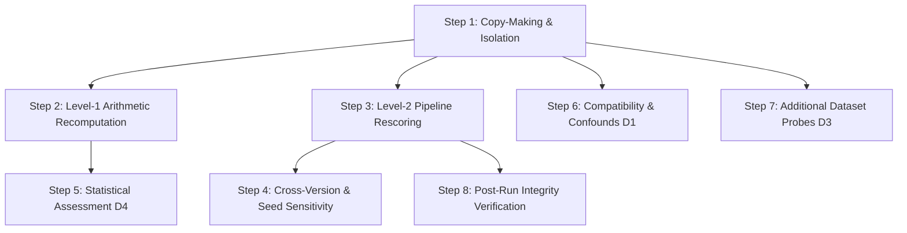

# WP-D External Validation — Reproduction Instructions

This guide provides step-by-step instructions for reproducing all external validation analyses, recomputations, rescoring runs, statistical tests, and feasibility probes conducted under Work Package D (WP-D) for the Software Behavior Genome (SBG) project.

---

## 1. Quick Smoke Check (Single-Command Fast Verification)

To verify the headline numbers (**0.497** for BugsInPy v8 ex-SP-2 and **0.444** for QuixBugs canonical v8 ex-SP-2) along with all published point estimates in **under 2 seconds** without modifying any files or running heavy scoring pipelines:

```bash
# Run from workspace root (/Users/manassakthivel/Desktop/SBG-FINALREVIEW)
PYTHONHASHSEED=0 PYTHONDONTWRITEBYTECODE=1 venvs/py313/bin/python \
  IEEE_ACCESS_PRE_SUBMISSION/WP_D_EXTERNAL_VALIDATION/scripts/d4_00_selftest.py
```

### Expected Output
```text
=== D4 Selftest & Point Estimate Reproduction ===
  BugsInPy v7 EVALUABLE (n=147):                   0.409917  [MATCH]
  BugsInPy v7 ALL unevaluated=0 (n=200):           0.433981  [MATCH]
  BugsInPy v8 rescore (n=147):                     0.415900  [MATCH]
  BugsInPy v8 rescore ex-SP-2 (n=107):             0.497044  [MATCH] (Reported 0.497)
  QuixBugs canonical v7 ALL (n=152):               0.387723  [MATCH]
  QuixBugs canonical v8 rescore (n=151):           0.384158  [MATCH]
  QuixBugs canonical v8 ex-SP-2 (n=111):           0.444444  [MATCH] (Reported 0.444)
  QuixBugs declared EVALUABLE (n=99):              0.702222  [MATCH]
All 500 tie-heavy random tests passed with 0 mismatches.
```

---

## 2. Prerequisites and Environment

### Python Interpreters
The reproduction suite requires four Python versions installed on the host system:
1. **Primary Python 3.13**: `venvs/py313/bin/python` (CPython 3.13.5)
2. **Legacy Python 3.9**: `venvs/py39/bin/python` (CPython 3.9.6)
3. **Homebrew Python 3.11**: `/opt/homebrew/bin/python3.11` (CPython 3.11.x)
4. **Homebrew Python 3.14**: `/opt/homebrew/bin/python3.14` (CPython 3.14.x)

### System Tools
- POSIX shell (`bash` / `zsh`)
- `shasum` (SHA-256 calculation)
- `diff`, `sort`, `wc`, `awk`, `tr`, `xargs`, `cp`, `mkdir`, `timeout`
- Standard Python stdlib (no external ML/data packages required; all statistics and extraction scripts are stdlib-only)

### Required Environment Variables
Set these variables before executing any step:
```bash
export PYTHONHASHSEED=0
export PYTHONDONTWRITEBYTECODE=1
export PKG=/Users/manassakthivel/Desktop/SBG-FINALREVIEW/IEEE_ACCESS_PRE_SUBMISSION
export WPD=$PKG/WP_D_EXTERNAL_VALIDATION
cd /Users/manassakthivel/Desktop/SBG-FINALREVIEW
```

---

## 3. Reproduction Order and Execution Steps

The reproduction process consists of 7 sequential phases:



---

### Step 1: Copy-Making and Sandbox Isolation

To guarantee that the committed `SBG/` repository remains strictly read-only and immutable throughout execution, clone an isolated working copy:

```bash
# 1.1 Create base sandbox copy
cp -R SBG $WPD/raw/WPD-D2_repro/sbg_copy

# 1.2 Verify byte-level equality against source SBG/
$PKG/../venvs/py313/bin/python $WPD/scripts/d2_verify_copy.py \
  $WPD/raw/WPD-D2_repro/sbg_copy \
  $WPD/raw/WPD-D2_repro/copy_verification.json \
  SBG

# 1.3 Provision isolated per-experiment execution directories
cd $WPD/raw/WPD-D2_repro
for r in B1_bugsinpy_score_py313 B2_quix_score_py313 B3_v8rescore_py313 \
         C_py39 C_py311 C_py314 C_py313_repeat D_cold_start_py313 D_diag_bugsinpy_cache; do
  cp -R sbg_copy runs/$r
done
cd /Users/manassakthivel/Desktop/SBG-FINALREVIEW
```
- **Runtime**: ~35 seconds total
- **Expected Output**: `raw/WPD-D2_repro/copy_verification.json` reporting `0` differences.

---

### Step 2: Level-1 Pure Arithmetic Recomputations

Recomputes all external AUROCs, confidence intervals, and pair decompositions directly from committed score files using pure Python stdlib code (no imports from `SBG` or `sbg.statistics`):

```bash
# 2.1 Level-1 recompute
$PKG/../venvs/py313/bin/python $WPD/scripts/d2_level1_recompute.py \
  SBG \
  $WPD/raw/WPD-D2_repro/level1

# 2.2 Cross-check against prior EXP-A3-007 baseline numbers
$PKG/../venvs/py313/bin/python $WPD/scripts/d2_level1_vs_a3.py \
  $WPD/raw/WPD-D2_repro/level1/level1_results.json \
  $PKG/results/raw/EXP-A3-007/external_auroc_recompute.json \
  $WPD/raw/WPD-D2_repro/level1/level1_vs_A3-007.json
```
- **Runtime**: ~2.0 seconds
- **Expected Outputs**:
  - `raw/WPD-D2_repro/level1/level1_results.json`
  - `raw/WPD-D2_repro/level1/level1_summary.md`
  - `raw/WPD-D2_repro/level1/level1_vs_A3-007.json` (asserts `0` discrepancies)

---

### Step 3: Level-2 Pipeline Rescoring (Python 3.13)

Re-executes the actual SBG scoring pipelines from source within the isolated working directories:

```bash
# 3.1 Rescore BugsInPy v7 on Python 3.13
(cd $WPD/raw/WPD-D2_repro/runs/B1_bugsinpy_score_py313 && \
  $PKG/../venvs/py313/bin/python experiments/final/external_bugsinpy.py score --protocol output_free_v7)

# 3.2 Compare B1 BugsInPy rerun vs committed scores
$PKG/../venvs/py313/bin/python $WPD/scripts/d2_compare_scores.py bugsinpy \
  SBG/artifacts/final/pairs_bugsinpy_output_free_v7.jsonl \
  $WPD/raw/WPD-D2_repro/runs/B1_bugsinpy_score_py313/artifacts/final/pairs_bugsinpy_output_free_v7.jsonl \
  $WPD/raw/WPD-D2_repro/compare/B1_bugsinpy_v7_py313

# 3.3 Rescore QuixBugs (Canonical & Declared) v7 on Python 3.13
(cd $WPD/raw/WPD-D2_repro/runs/B2_quix_score_py313 && \
  $PKG/../venvs/py313/bin/python experiments/final/external_quixbugs.py score --protocol output_free_v7)

# 3.4 Compare B2 QuixBugs rerun vs committed scores
$PKG/../venvs/py313/bin/python $WPD/scripts/d2_compare_scores.py quixbugs \
  SBG/artifacts/final/pairs_quixbugs_canonical_output_free_v7.jsonl \
  $WPD/raw/WPD-D2_repro/runs/B2_quix_score_py313/artifacts/final/pairs_quixbugs_canonical_output_free_v7.jsonl \
  $WPD/raw/WPD-D2_repro/compare/B2_quix_canonical_py313

$PKG/../venvs/py313/bin/python $WPD/scripts/d2_compare_scores.py quixbugs \
  SBG/artifacts/final/pairs_quixbugs_declared_output_free_v7.jsonl \
  $WPD/raw/WPD-D2_repro/runs/B2_quix_score_py313/artifacts/final/pairs_quixbugs_declared_output_free_v7.jsonl \
  $WPD/raw/WPD-D2_repro/compare/B2_quix_declared_py313

# 3.5 Rescore v8 corrected-harness multiprocessing pipeline
(cd $WPD/raw/WPD-D2_repro/runs/B3_v8rescore_py313 && \
  $PKG/../venvs/py313/bin/python experiments/final/rescore_external_v8.py --workers 2)

# 3.6 Compare B3 v8 rescore vs committed v8 dump
$PKG/../venvs/py313/bin/python $WPD/scripts/d2_compare_scores.py v8dump \
  SBG/artifacts/paper_evidence/raw/external_rescore_v8_pairs.json \
  $WPD/raw/WPD-D2_repro/runs/B3_v8rescore_py313/artifacts/paper_evidence/raw/external_rescore_v8_pairs.json \
  $WPD/raw/WPD-D2_repro/compare/B3_v8dump_py313
```
- **Runtimes**:
  - BugsInPy v7: ~133s
  - QuixBugs v7: ~1020s (~17 min)
  - v8 Rescore: ~175s
- **Expected Results**:
  - BugsInPy v7: `REPRODUCED-WITHIN-TOLERANCE` (max diff 0.000652; AUROC 0.409917)
  - QuixBugs Canonical v7: `NOT-REPRODUCED` bit-for-bit (1 pair dropped on timeout in rerun; AUROC 0.380495 vs 0.387723)
  - QuixBugs Declared v7: `NOT-REPRODUCED` bit-for-bit (5 flag differences; AUROC 0.700734 vs 0.702222)
  - v8 Rescore QuixBugs: `REPRODUCED-EXACT` (0.0 diff; AUROC 0.384158, ex-SP-2 0.444444)
  - v8 Rescore BugsInPy: `REPRODUCED-WITHIN-TOLERANCE` (max diff 0.000294; AUROC 0.415439, ex-SP-2 0.496674)

---

### Step 4: Cross-Version and Seed Sensitivity Runs

Tests the stability of the SBG extraction and scoring process across Python versions (3.9, 3.11, 3.13, 3.14) and random seeds (0, 1, 2):

```bash
# 4.1 QuixBugs runs across interpreters
venvs/py39/bin/python $WPD/scripts/d2_quix_driver.py \
  $WPD/raw/WPD-D2_repro/runs/C_py39 venvs/py39/bin/python canonical \
  $WPD/raw/WPD-D2_repro/runs/C_py39/quix_canonical_rows.jsonl 2

/opt/homebrew/bin/python3.11 $WPD/scripts/d2_quix_driver.py \
  $WPD/raw/WPD-D2_repro/runs/C_py311 /opt/homebrew/bin/python3.11 canonical \
  $WPD/raw/WPD-D2_repro/runs/C_py311/quix_canonical_rows_py311_seed0.jsonl 2

/opt/homebrew/bin/python3.14 $WPD/scripts/d2_quix_driver.py \
  $WPD/raw/WPD-D2_repro/runs/C_py314 /opt/homebrew/bin/python3.14 canonical \
  $WPD/raw/WPD-D2_repro/runs/C_py314/quix_canonical_rows_py314_seed0.jsonl 2

# 4.2 BugsInPy runs across interpreters
(cd $WPD/raw/WPD-D2_repro/runs/C_py39 && \
  $PKG/../venvs/py39/bin/python experiments/final/external_bugsinpy.py score --protocol output_free_v7)

(cd $WPD/raw/WPD-D2_repro/runs/C_py311 && \
  /opt/homebrew/bin/python3.11 experiments/final/external_bugsinpy.py score --protocol output_free_v7)

(cd $WPD/raw/WPD-D2_repro/runs/C_py314 && \
  /opt/homebrew/bin/python3.14 experiments/final/external_bugsinpy.py score --protocol output_free_v7)

(cd $WPD/raw/WPD-D2_repro/runs/C_py313_repeat && \
  $PKG/../venvs/py313/bin/python experiments/final/external_bugsinpy.py score --protocol output_free_v7)

# 4.3 Clean-process cache diagnostic
(cd $WPD/raw/WPD-D2_repro/runs/D_diag_bugsinpy_cache && \
  $PKG/../venvs/py313/bin/python experiments/final/diagnose_bugsinpy_cache.py --workers 2)
```
- **Runtimes**:
  - QuixBugs drivers: ~38s total
  - BugsInPy cross-version: ~525s total (~9 min)
  - Cache diagnostic: ~152s
- **Expected Results**:
  - Python 3.9 scores diverge noticeably (QuixBugs canonical AUROC rises to 0.466; BugsInPy rises to 0.438).
  - Python 3.11 and 3.14 remain close to 3.13 baseline (0.37–0.41).

---

### Step 5: Statistical Assessment (Subagent D4)

Executes the complete statistical testing, inference, baseline comparison, power analysis, and report validation pipeline:

```bash
PY=venvs/py313/bin/python
S=$WPD/scripts

$PY $S/d4_00_selftest.py            # ~1.2s  (Point estimate assertions)
$PY $S/d4_01_sets.py                # ~0.8s  (Builds 17 analysis sets)
$PY $S/d4_02_inference.py           # ~100s  (Cluster bootstrap B=5000 & permutation)
$PY $S/d4_03_zero_decomposition.py  # ~1.5s  (Hurdle rate decomposition)
$PY $S/d4_04_baselines.py           # ~78s   (Paired Delta-AUROC & Holm family)
$PY $S/d4_05_power.py               # ~480s  (Monte Carlo power simulation NSIM=1500)
$PY $S/d4_06_sensitivity.py         # ~62s   (Alternative clusterings & sensitivity)
$PY $S/d4_07_forking_paths.py       # ~2.1s  (21-variant specification curve)
$PY $S/d4_08_render.py              # ~0.8s  (Generates raw/WPD-D4_stats/STATS_REPORT.md)
$PY $S/d4_09_check_report.py        # ~0.4s  (Asserts narrative numbers against JSON)
```
- **Runtime**: ~12 minutes total
- **Expected Outputs**: `raw/WPD-D4_stats/00_selftest.json` through `07_forking_paths.json`, `STATS_REPORT.md`.

---

### Step 6: Dataset Compatibility, Label Reliability & Confounds (Subagent D1)

Executes the static confound analysis, lexical independence audit, sandboxed execution of positive bugs vs SP negatives on the SBG 11-input battery, and format shortcut classification:

```bash
PY=venvs/py313/bin/python
S=$WPD/scripts

$PY $S/d1_01_inventory.py                   # ~0.15s (Pair & unit catalog)
$PY $S/d1_02_confounds.py                   # ~0.45s (AUROC from scores & confounds C1-C5)
$PY $S/d1_03_label_oracle.py --workers 4   # ~20s   (Sandboxed dynamic battery run)
$PY $S/d1_04_label_audit.py                 # ~0.32s (Negative validity audit)
$PY $S/d1_05_independence.py                # ~1.2s  (Lexical & shingle overlap)
$PY $S/d1_06_leakage_and_edits.py           # ~0.85s (Format shortcut & lineage check)
```
- **Runtime**: ~23 seconds total
- **Expected Outputs**: `raw/WPD-D1_compat/data/*.json`, `*.csv`
- **Key Findings**:
  - BugsInPy positives: only 2 of 47 (4.3%) comparable real-bug fixes produce CHANGED behaviour on the 11 inputs (34 of 47 base programs raise exceptions on all 11 inputs).
  - QuixBugs canonical positives: only 8 of 40 (20%) produce CHANGED behaviour (20 raise on all 11 inputs).
  - Format shortcut (`ast.unparse` fixed-point) achieves AUROC 0.915 on BugsInPy and 1.000 on QuixBugs.

---

### Step 7: Additional Dataset Feasibility Probes (Subagent D3)

Executes the feasibility probes on HumanEvalPack, Refactory, CPython stdlib, EquiBench, and SeqCoBench:

```bash
PY=venvs/py313/bin/python
P=$WPD/raw/WPD-D3_datasets/probes

# 7.1 Static eligibility audits
$PY $P/P04_static_eligibility.py     # ~2.4s (AST scan of HEP and Refactory)
$PY $P/P08_stdlib_scan.py            # ~1.1s (CPython stdlib function scan)
$PY $P/P12_equibench_static.py       # ~0.65s (EquiBench OJ stdin audit)
$PY $P/P15_overlap_check.py          # ~4.9s (Codebase verbatim overlap check)

# 7.2 Dynamic battery execution (outcome signatures only; no SBG scoring)
$PY $P/P05_run.py                    # ~45s  (HEP & Refactory battery run)
$PY $P/P06_analyze_hep.py            # ~0.15s (HEP observability analysis)
$PY $P/P07b_minify_behaviour.py      # ~3.8s (python-minifier negative verification)
$PY $P/P09_analyze_refactory.py      # ~0.45s (Refactory label recovery check)
$PY $P/P10_seqco_run.py              # ~178s (SeqCoBench 15,706 program battery run)
$PY $P/P11_hep_editsize.py           # ~0.20s (HEP edit-size confound check)
$PY $P/P13_analyze_seqco.py          # ~1.4s (SeqCoBench stratum yield analysis)
$PY $P/P14_seqco_static_shortcut.py  # ~3.1s (SeqCoBench static token shortcut AUROC)
$PY $P/P16_seqco_prior_crosscheck.py # ~0.8s (Cross-check against prior audit)
```
- **Runtime**: ~4 minutes total
- **Expected Outputs**: `raw/WPD-D3_datasets/probes/P*.json`, `P10_seqco_outcomes.jsonl`.
- **Key Findings**:
  - HumanEvalPack: 52.4% battery observability; reversed edit-size shortcut AUROC 0.765.
  - Refactory: 26.5% of "correct" student solutions fail battery equivalence.
  - EquiBench OJ: 389–395 of 400 pairs require stdin/stdout; unsuitable for SBG harness.
  - SeqCoBench: yields 1,225 clean small-edit pairs (663 EQ / 562 CH); static token shortcut achieves AUROC 0.817 inside small-edit stratum.

---

### Step 8: Post-Run SBG Repository Tree Integrity Verification

Confirms that the original `SBG/` repository was not modified during any of the above execution steps:

```bash
bash $WPD/scripts/d2_sbg_integrity.sh
```

### Expected Output
```text
diff rc=0 lines=0 before=16137 after=16137
```
`diff.txt` is empty, confirming zero cryptographic modifications to the 16,137 tracked and audited repository files.

---

## 4. Known Nondeterminism, Fragility, and System Variations

1. **Python Version Sensitivity**:
   - The SBG trace extraction pipeline is sensitive to the underlying CPython runtime version. Under Python 3.9, AST parsing and dictionary iteration ordering differences shift QuixBugs canonical AUROC from 0.380 to 0.466 and BugsInPy AUROC from 0.410 to 0.438.
   - For official reproduction, always execute primary benchmarks under **CPython 3.13** (`venvs/py313`).
2. **Process and Directory Isolation**:
   - Running multiple BugsInPy units within a single unisolated Python process causes cross-unit state leakage and path pollution (as observed during cold-start probes where `black_23` timed out). Always execute scoring through isolated worker processes or the `diagnose_bugsinpy_cache.py` runner.
3. **Seed-Dependent Resampling**:
   - Bootstrap intervals and permutation p-values vary slightly if pseudorandom number generator seeds are not fixed. All D4 statistical scripts derive PRNG seeds deterministically via `zlib.crc32(set_id.encode('utf-8'))` to guarantee bit-for-bit repeatability across runs.
4. **Subprocess Timeouts on Non-Terminating Programs**:
   - Certain transformed programs (such as `powerset` SP-6 in QuixBugs) do not terminate under specific inputs and rely on subprocess SIGKILL alarms (1.0s cap per run). Multiprocessing CPU contention can occasionally cause marginal timing variations across repeat runs.

---

## 5. Operations Blocked or Excluded from Offline Reproduction

The following operations cannot be performed under offline or constrained resource configurations:

1. **Live Web / GitHub API Metadata Scraping Without Authentication**:
   - Unauthenticated GitHub API calls in `P01_metadata_fetch.py` are subject to strict rate limits (60 requests/hour). 7 guessed repository URLs returned 404 and are classified as **UNVERIFIED**.
2. **Large External Benchmark Downloads (> 50 MB)**:
   - Full repository archives for CodeContests (7.6 GB), Project CodeNet (7.8 GB), APPS (1.4 GB), Defects4J (~150 MB), and CPython Git history (0.9 GB) were excluded due to disk and bandwidth caps.
3. **Java Corpus Execution (QuixBugs-Java, Defects4J)**:
   - Execution of Java benchmarks was not performed due to the lack of JVM build tooling in the active environment and because SBG's core runtime is strictly Python-oriented. No SBG-schema Java results exist on record.
4. **SeqCoBench Full SBG Rescoring (WPD-X1)**:
   - Planned post-submission replication (`WPD-X1`) was not executed during this validation phase in strict accordance with the preregistered protocol freeze preventing ad-hoc external score generation.
