# LITERATURE FOLLOWUP: Value Spectra (Xie & Notkin 2005) vs. SBG State Genome

**Investigation Date:** 2026-11-14  
**Investigator:** WP-LITERATURE-FOLLOWUP  
**Target Work:** Tao Xie & David Notkin, *"Checking Inside the Black Box: Regression Testing by Comparing Value Spectra"*, IEEE Transactions on Software Engineering (TSE), Vol. 31, No. 10, pp. 869–883, October 2005.

---

## 1. Verified Bibliographic Metadata & DOI Verification

| Attribute | Verified Value | Evidence Source |
|---|---|---|
| **Title** | *Checking inside the black box: regression testing by comparing value spectra* | Crossref, OpenAlex `W2132478304` |
| **Authors** | Tao Xie, David Notkin | University of Washington / IEEE Computer Society |
| **Journal** | IEEE Transactions on Software Engineering (TSE) | Volume 31, Issue 10, pp. 869–883 |
| **Publication Date** | October 2005 | Verified (Crossref print: 2005-10) |
| **DOI** | `10.1109/TSE.2005.107` | **Verified Correct** (Resolves to IEEE Xplore: `https://doi.org/10.1109/TSE.2005.107`) |
| **Citation Impact** | 62 citations (OpenAlex), 44 (Crossref) | High-impact foundational regression testing literature |
| **Access Level** | **ABSTRACT-ONLY** (Primary text IEEE paywalled); full context verified from OpenAlex abstract, Crossref reference graph, forward citations, and related program spectra literature (Harrold et al. 1998/2000, Reps et al. 1997, Daikon 2002/2005). |

---

## 2. Technical Scope of Value Spectra (Xie & Notkin 2005)

### Core Methodology in Xie & Notkin:
1. **Motivation:** Traditional regression testing relies on black-box program outputs. Internal behavioral deviations often do not propagate to observable output differences ("latent regressions" or unobservable state changes).
2. **Definition of Value Spectra:** A program spectrum that instruments and records internal variable values (program states) at method/function entry and exit points.
3. **Approximation & Path Spectra:** Also evaluates path spectra (execution sequences / branch profiles) to approximate execution state.
4. **Differential Analysis:** Compares the value spectra of program version $P$ and modified version $P'$ on identical test inputs.
5. **Propagation & Root-Cause Localization:** Constructs a **Deviation-Propagation Call Tree** tracing how internal state differences arise at specific functions and propagate across callers, utilizing two root-cause heuristics to pinpoint triggering faults.
6. **Key Empirical Finding:** Evaluated on 8 C programs; demonstrated that internal behavioral differences can be detected with high precision **even when program outputs are identical**.

---

## 3. Detailed Comparison: Value Spectra vs. SBG State-Transition Genome

```mermaid
flowchart TD
    subgraph Xie_Notkin_2005 [Xie & Notkin 2005: Value Spectra]
        XN_in[Test Inputs] --> XN_exec[Execute Old & New Versions]
        XN_exec --> XN_pts[Capture Values at Function Entry/Exit]
        XN_pts --> XN_diff[Set/Frequency Difference of Value Tuples]
        XN_diff --> XN_tree[Deviation-Propagation Call Tree & Fault Localization]
    end

    subgraph SBG_State_Genome [SBG: State-Transition Genome]
        SBG_in[Synthesised Inputs] --> SBG_trace[sys.settrace Event Tracing]
        SBG_trace --> SBG_abs[Abstract Domain Mapping: sign/size/type]
        SBG_abs --> SBG_trans[Transition Tuples: func, pre, event, post]
        SBG_trans --> SBG_graph[Transition Frequency Graph & Jaccard Distance]
    end
```

| Technical Dimension | Xie & Notkin (2005) Value Spectra | SBG State-Transition Genome (V5) |
|---|---|---|
| **Goal** | Regression fault detection & root-cause localization (debugging aid). | Pairwise distance measurement $d(P_A, P_B) \in [0, 1]$ for semantic classification (CHANGED vs. EQUIVALENT). |
| **Capture Points** | Function entry and exit boundaries (call/return interfaces). | Step-by-step execution trace events (call, line, return, exception) captured via `sys.settrace`. |
| **Value Representation** | Concrete values / structured object snapshots; value ranges. | **Abstract Value Domains:** Qualitative abstraction mapping locals to discrete buckets (`sign`, `magnitude`, `collection_shape`, `type`). |
| **State Evolution** | Snapshot comparisons across versions at matching points. | **Transition Tuples:** Explicit directed 4-tuples `(func_name, pre_state, event, post_state)` capturing state transitions. |
| **Comparison Metric** | Set difference, spectra diff counts, tree propagation analysis. | Vectorized / graph-based **frequency-weighted Jaccard distance** integrated into composite distance. |
| **Target Language** | C programs (GCC instrumentation / gcov / Daikon-style probes). | Python (CPython bytecode tracing). |

---

## 4. Defensible Distinction Assessment

### What is Established Prior Art (Cannot Claim Novelty):
* **Output-Free Dynamic Behavior Comparison:** Using internal execution traces rather than black-box outputs to detect version differences was fully introduced and validated by Xie & Notkin (2005).
* **Variable State Tracking Across Versions:** Profiling variable states at runtime to identify differences between program versions is established in Xie & Notkin (2005), Daikon (Ernst et al.), and BERT (Jin et al. 2010).

### What Constitutes a Defensible Incremental Contribution:
1. **Domain Abstraction:** Transforming raw variable values into normalized qualitative abstract domains to achieve rename- and scale-invariant distance metrics.
2. **Transition-Graph Formulation:** Modeling execution as a continuous state-transition graph rather than discrete entry/exit value multisets.
3. **Metric Normalization:** Embedding state-transition graph differences into a bounded $[0, 1]$ metric suitable for rank-based statistical discrimination (AUROC / AUPRC).

### Mandatory Framing for IEEE Access Manuscript:
The manuscript **must not** claim that SBG is the first technique to compare program versions without reading outputs. Instead, it must explicitly cite Xie & Notkin (2005), Harrold et al. (1998, 2000), and Reps et al. (1997), positioning SBG's state-transition genome as a *qualitative abstraction and metric-space formulation* within the value-spectra lineage.
