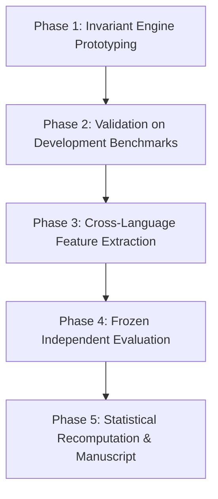

# SBG V6 Experimental Development & Phased Evaluation Plan

**Document ID:** `SBG-V6-INV-DEV-PLAN-2026-V1`  
**Status:** Investigation / Research Proposal Only  
**Date:** November 16, 2026  
**Auditor:** Principal Empirical SE Researcher & Experimental Statistician  

---

## 1. Phased Experimental Roadmap

### Phase 1: Invariant Engine Prototyping (Weeks 1–2)
- Implement AST-guided checkpoint instrumentation at method entry, loop heads, and method exit.
- Implement $D=32$ relational invariant templates (signs, comparisons, container bounds, return types).
- Validate $100\%$ invariance ($d=0.0$) against SP-1 through SP-6 refactorings on unit micro-benchmarks.

### Phase 2: Development Benchmark Experiments (Weeks 3–4)
- **Permitted Development Datasets:** QuixBugs (Python) and Synthetic V9/V10 Dev splits.
- Benchmark metric target: Achieve $\Delta\text{AUROC} \ge +0.150$ over strong Random Forest token and execution baselines on QuixBugs.
- Perform feature ablation studies removing individual invariant categories.

### Phase 3: Cross-Language Pipeline Validation (Weeks 5–6)
- Validate invariant extraction on Bugs.jar (Java) via OpenJDK byte-code hooks and Codeflaws (C) via Clang sanitizer passes.
- Enforce strict project-disjoint / problem-disjoint cross-validation.

### Phase 4: Frozen Independent Evaluation (Week 7)
- **Strictly Reserved Test Sets:** Never tuned or evaluated during Phases 1–3:
  - SeqCoBench unseen test stratum ($N = 1,364$ pairs).
  - External multi-project benchmark suite ($N = 15$ candidate external repositories).
- Pin dataset hashes, extraction scripts, and model seeds in `FREEZE_V6.json` before executing scoring.

### Phase 5: Statistical Analysis & Programmatic Manuscript Generation (Week 8)
- Compute $B=2,000$ cluster bootstrap confidence intervals, paired Wilcoxon signed-rank tests, and Holm-Bonferroni corrections.
- Programmatically generate all LaTeX tables and vector figures directly from raw JSON/CSV outputs.

---

## 2. Dataset Reservation & Overfitting Prevention Policy

To eliminate any risk of benchmark overfitting:
1. **Development Set:** QuixBugs ($N=152$) and Synthetic V9c Train ($N=500$).
2. **Confirmatory Frozen Test Set:** SeqCoBench ($N=1,364$), Synthetic V10 Test ($N=638$), and un-tuned external benchmarks.
3. **No Retuning Rule:** If the frozen test evaluation fails to meet the target delta, report the exact result without modifying features or re-running.
