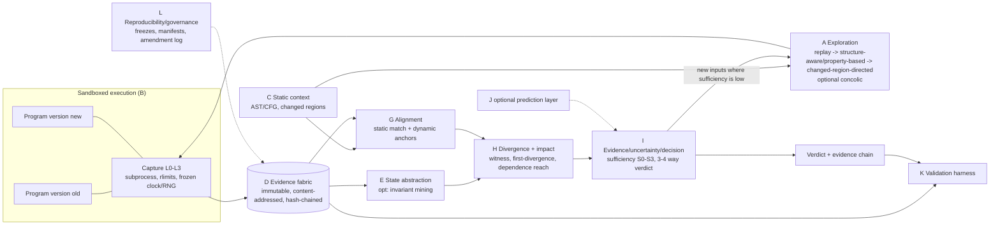

# SBG V7 Architecture Master Plan

Status: design only. No code written, no holdout run, V5/V6 untouched (tag `v6-holdout-complete`, branch `feature/sbg-v7-architecture`).
Detail lives in the twelve companion documents; this file fixes the **reconciled decisions** where the authors disagreed with the initial spine (`_sources/_DESIGN_SPINE.md`).

## 1. What V7 is
A **witness-based, sufficiency-aware cross-version behaviour comparison system**, not a learned scorer. V6 showed that hand-built trace-distance features generalise weakly (0.505 on BugsInPy, losses to conventional features) and that the dominant failure is *observation* (28.5% coverage, unactivated changes, return-blind channel), not modelling. V7 therefore invests in: controlled execution, adaptive exploration, explicit sufficiency, replayable witnesses and independent ground truth.

## 2. Reconciled decisions (authors' disagreements with the spine, accepted)
| # | Decision | Source of the objection |
|---|---|---|
| 1 | Verdict set: `DIVERGENT_OBSERVABLE` (output/exception/declared side-effect differs; sound by replay relative to the harness), `DIVERGENT_INTERNAL_ONLY` (outputs equal on the witness, internal state/trace differs; advisory until validated), `NO_DIVERGENCE_OBSERVED` at sufficiency S0-S3, `INSUFFICIENT` with reason code. There is no `EQUIVALENT` verdict. | roadmap, protocol, schema, math spec |
| 2 | **F (multi-view graph engine) is not a subsystem.** Control/call/dependence views survive as three projection functions inside G and H. | module contracts |
| 3 | E is split: state abstraction = core; invariant mining = optional extension. | module contracts |
| 4 | The existing tracer/runner (in-process threads + `sys.settrace`, no rlimits, no network denial, zombie threads after timeout) is **not acceptable for V7 claims**. It is retained only as a `v6_compat` profile; isolation is rebuilt (subprocess per run, rlimits, process-group kill, tiered seccomp/container). This corrects the spine. | module contracts (code-read), roadmap (grep only: verify in P1) |
| 5 | Capture is tiered L0-L3 with explicit completeness, not a full event log always. | module contracts |
| 6 | Alignment anchors use call context and external events only, never the compared payload (avoids circularity). First-divergence index is an upper bound relative to the alignment. | math spec |
| 7 | Labels are structurally excluded from A-I. | module contracts |
| 8 | Synthetic suites for P3 need an independent generator plus fingerprint audit (V6 circularity). | roadmap |
| 9 | Witness validity is a correctness gate, not a performance metric; false-assurance rate is always paired with a coverage floor (0.60). | protocol |
| 10 | Budget unit = CPU-seconds including all V7 overhead. | protocol |
| 11 | J (learned prediction) optional, off by default, tested on its own sealed holdout. | roadmap, contracts |

## 3. Architecture

Core: A, B, C, D, G, H, I, K, L, state-abstraction half of E. Optional: invariant mining, concolic, J, formal bounded tier. Removed as subsystem: F.

Module interaction (one comparison): C extracts changed regions -> A proposes inputs -> B runs both versions per input with determinism repeats -> D appends hash-chained evidence -> G aligns traces -> H finds first divergence and witness -> I computes sufficiency and verdict, and requests more exploration while budget remains. Per-module contracts: `SBG_V7_MODULE_CONTRACTS.md`; schema and worked JSON examples: `SBG_V7_DATA_AND_EVIDENCE_SCHEMA.md`.

## 4. Document map
Research/novelty (`RESEARCH_AND_NOVELTY_REVIEW`), failures to requirements (R-01..R-31, `FAILURE_TO_REQUIREMENT_MATRIX`), alternatives (`COMPETING_ARCHITECTURES`), mathematics (`MATHEMATICAL_SPECIFICATION`), schema, contracts, protocol (H1-H10), gates (G0-G8), roadmap (P0-P9, kill checkpoints K1-K5), risks (38). Repo inventory: `SBG_V7_REPO_INVENTORY.md`.

## 5. Known inconsistencies to close in P0 (documents were written in parallel)
- Math spec and schema may still say a single `DIVERGENT`; the verdict split in §2 must be propagated.
- Thresholds in the protocol and gates are judgment calls, untuned; they must be frozen only after a development split.
- References are metadata-verified at most; DOIs marked (3p) are unchecked. No document was cross-read by another author.
- Mermaid diagrams were never rendered.
