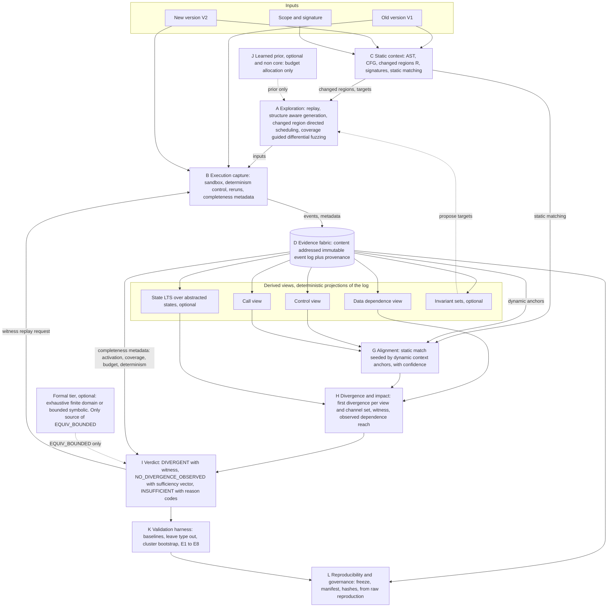

# SBG V7: Competing Central Architectures

Status: design analysis. No code. Companion: SBG_V7_MATHEMATICAL_SPECIFICATION.md. Shared brief: _DESIGN_SPINE.md.

Evidence tags used throughout:
- [SPINE] a fact taken from _DESIGN_SPINE.md (V5/V6 repo results); not re-verified by this document.
- [LIT] published result cited from memory; names given for lookup, effect sizes deliberately omitted because not re-checked.
- [HYP-En] a hypothesis. It is untested and names the experiment En (defined in section 8) that would test it.
- [JUDGEMENT] my reasoned opinion, not evidence.

Notation for costs: N = number of explored inputs; n = events in one trace; t1, t2 = native run times of old/new version; |G| = nodes+edges of a graph; q = states of an abstract LTS; m = transitions of an LTS; D = edit distance between two sequences; v = variables in scope at a program point.

---

## 1. What problem the architecture must serve

Per (old, new, scope), answer: did observable behaviour diverge, where first, and how sure are we that "no divergence" means anything? The dominant V5/V6 failures were observational ([SPINE]): BugsInPy coverage 28.5% (nondeterminism 60, unsupported signature 49, import 4), 36 QuixBugs declared pairs with no inputs, 69 NOT_ACTIVATED on v8test, and a learned feature scorer that gave no independent information beyond conventional features (BugsInPy 0.505, QuixBugs 0.666/0.691). Where outputs were observable, plain output differencing was already strong (v10 0.995, QuixBugs evaluable 0.976). So the architecture must be judged mainly on: can it get activation and observation, can it emit replayable evidence, and does it add anything beyond output equality.

---

## 2. Alternative (a): multi-view code/behaviour graph (CPG / ProGraML style) with graph comparison

- Represented: static graph per version: AST + CFG + data-dependence (+ call graph) fused into one property graph (code property graph, [LIT] Yamaguchi et al.), or an IR-level program graph (ProGraML, [LIT] Cummins et al., LLVM IR). Optional dynamic annotations (hit counts) overlaid.
- Comparison operator: graph differencing. Exact graph edit distance is NP-hard; practical operators are tree/graph matching heuristics (GumTree-like top-down/bottom-up matching, [LIT] Falleri et al.), Weisfeiler-Leman subtree kernels, or learned graph embeddings with a distance.
- Cost: build O(|code|). Matching: roughly O(n^2) worst case for tree matchers, near-linear in practice; WL kernel O(h * |G|) for h refinement rounds. Practically seconds per pair. No execution needed.
- Failure modes mapped to V5/V6:
  - Edit-size shortcut: graph-diff magnitude is a strong proxy for edit size, which already predicts labels (reversed edit-size AUROC 0.771 DEV, 0.847 BugsInPy, 0.325 QuixBugs) [SPINE]. A graph metric would most likely reproduce that shortcut. [HYP-E2]
  - Generator fingerprinting: structural diffs encode which mutation operator was applied (GBM 0.972 -> 0.742 leave-type-out) [SPINE]. Structural features are even better fingerprints than traces.
  - Structural difference does not imply behavioural difference: SP-8 (47 pairs) not behaviour-preserving and 357/1332 changed pairs show no output difference [SPINE] show label and structure decouple in both directions.
  - Refactors produce large graph diffs with zero behaviour change.
- Can assert: INFERENCE only ("structurally different here"). Never an observation of behaviour, never proof.
- Infrastructure: per-language parser/frontend (tree-sitter, Joern-class tools, or LLVM for compiled languages). Pair matching. No sandbox.
- Validation test (E2): leave-mutation-type-out AUROC of graph-diff features versus edit-size, token-diff and AST-diff baselines on the same splits, with program-cluster bootstrap. It is "worth keeping as a predictor" only if it beats the conventional baselines with a CI excluding 0. Expectation, hypothesis only: it will not.
- Strongest case (kept in the design for this reason): it is the only alternative that reasons about code that no input has executed, and unactivated code is the largest single V5/V6 failure. It is also cheap, deterministic and gives structural localisation. It therefore survives as module C (static context) and as the guide for changed-region-directed exploration, not as the verdict engine.

## 3. Alternative (b): labelled transition system over abstracted states (behavioural model inference)

- Represented: LTS M = (Q, labels, transitions, initial states). Q = abstract program states (heap/locals under abstraction alpha with declared depth and precision); labels = (event kind, location class). Built from executions; optionally generalised (k-tails style, [LIT] Biermann-Feldman; active automata learning L*, [LIT] Angluin; both generalise beyond observed behaviour).
- Comparison operator: for observed-only LTS, set difference of transitions or label sequences under the correspondence map; for generalised models, simulation/bisimulation or language inclusion. Partition refinement bisimulation is O(m log q) ([LIT] Paige-Tarjan). Model learning cost is dominated by obtaining counterexamples, which in a black-box setting is itself testing (equivalence queries cannot be answered exactly).
- Cost: O(N * n) to build from traces plus state abstraction per sampled state point (abstraction is O(reachable heap up to depth d)). Comparison itself cheap. Practical risk is state-space blow-up at fine alpha and over-merging at coarse alpha.
- Failure modes mapped to V5/V6:
  - Representation artefacts: V6's SP-11 (42 pairs, repr artefact) [SPINE] is exactly what unnormalised state abstraction would produce (addresses, repr, dict order) -> false divergence.
  - Over-abstraction yields masked divergences (cf. the 180 pairs internally masked) in reverse: two different states collapsed, divergence invisible.
  - Few inputs (BugsInPy, QuixBugs-declared) mean sparse LTS; "transition absent in the other LTS" is then indistinguishable from "not yet sampled". Observed-only LTS is an under-approximation, so absence is never evidence of infeasibility.
  - Nondeterminism: LTS can represent it natively as branching (a real strength), but from sampled runs it cannot separate true nondeterminism from unexplored input dependence.
- Can assert: OBSERVATION for "this transition occurred in this run"; INFERENCE for any generalised model claim; no proof.
- Infrastructure: tracer with state snapshotting, canonical alpha, normaliser, LTS store, simulation checker. Reuses the V6 sandboxed tracer partly.
- Witness-producing: weak. A distinguishing abstract transition is not by itself an input; it must be mapped back to a concrete (x, E) replay, which is exactly what the event-log design (c) already has.
- Validation test (E3): on the masked-internally set and on new curated mutants with known internal-only divergences, compare LTS-difference detection rate versus output-only differencing and versus aligned-trace state comparison, at equal input budget; also measure false divergence on a verified behaviour-preserving refactor set (not SP-8, which is known not to be preserving).
- Strongest case: models, not single traces, are the right object to compare when behaviour is nondeterministic or protocol-like (stateful APIs); bisimulation is a principled equivalence notion with a mature theory; it gives a compact, human-readable summary of behavioural change across many inputs. For stateful, multi-call scopes this may be genuinely better than per-input trace diff. Kept as a derived view (module E/F), not the spine.

## 4. Alternative (c): structured event log with aligned-trace diff (the hybrid spine)

- Represented: immutable, content-addressed log of events e = (id, kind, loc, payload, t) per run, with run metadata (input, environment, harness, determinism evidence, completeness). All views (control, call, data-dependence, state LTS) are deterministic projections computed from the log.
- Comparison operator: align the two traces of the same input under a view using the static/dynamic correspondence, then find the first non-conforming aligned step under an observation equivalence parametrised by channels (return, exception, side effects, state). Alignment by dynamic programming (Needleman-Wunsch style O(n1 * n2)) or Myers diff O(n + D^2) when mostly identical ([LIT] Myers 1986); anchoring at calls/IO splits the problem into segments and reduces cost to the sum of segment products.
- Cost: capture overhead dominated by tracing (for a Python line tracer typically an order of magnitude or more over native; exact factor [HYP-E7], measure with the existing V6 tracer). Storage O(N * n) events, mitigated by hashing payloads and deduplicating. Diff O(n + D^2) typical. Practical bottleneck: long traces and loops; mitigated by loop compression and event budgets (which then enter the sufficiency score).
- Failure modes mapped to V5/V6:
  - Alignment errors under refactoring produce spurious "first divergence" (V5/V6 had no alignment; this is a new risk). [HYP-E5]
  - Payload-abstraction artefacts (SP-11 analogue) -> needs a declared normaliser.
  - Nondeterminism: not solved, only detected (rerun comparison) and gated; BugsInPy 60 nondeterministic cases remain INSUFFICIENT unless the environment can be controlled.
  - Does not itself solve activation; depends on module A. If nothing activates, it reports NOT_ACTIVATED honestly rather than a score.
  - Edit-size and fingerprint shortcuts apply only if a learned scorer is layered on; verdicts here are witnesses, not scores, so they are not shortcut-exposed in the same way [JUDGEMENT]. Any numeric feature derived from the log must still pass leave-type-out evaluation.
- Can assert: OBSERVATION (witness: input, environment, divergent aligned events, replay count); INFERENCE (alignment, localisation, first-divergence locus, dependence-based impact); never proof.
- Infrastructure: sandboxed runner/tracer (reuse extraction.py / observe.py), event schema + canonicalisation, content-addressed store, aligner, replayer, determinism harness.
- Validation test (E1 primary, E5, E7, E8): at equal input budget versus plain differential testing: (i) detection of masked divergences, (ii) time-to-first-divergence, (iii) false assurance (NDO verdicts on pairs later shown divergent by an independent oracle), (iv) false divergence on behaviour-preserving refactors, (v) overhead.
- Strongest case: highest reuse of existing, tested V5/V6 assets; the only alternative that yields replayable witness plus precise locus plus a place to hang sufficiency metadata; layered design lets each cheaper alternative (output diff) be a strict subset (channels = {return, exception}), so it cannot do worse than the baseline on observable pairs except by cost.

## 5. Alternative (d): invariant-set comparison (Daikon style)

- Represented: for each program point (function entry/exit, loop head), the set of likely invariants (relations over variables such as x > 0, a <= b, len(s) == n) that held on all sampled executions ([LIT] Ernst et al., Daikon; numeric variants exist for Python-like settings, not verified here).
- Comparison operator: set difference Inv(V1) \ Inv(V2) and Inv(V2) \ Inv(V1) at corresponded program points; an invariant of V1 violated by a V2 run is a candidate divergence.
- Cost: invariant template instantiation is polynomial in variables per point (unary O(v), binary O(v^2), ternary O(v^3) templates) times samples checked: O(N * sum over points of templates(v)). Practically moderate for small scopes, heavy for wide scopes.
- Failure modes mapped to V5/V6:
  - Invariants are statistical inferences from samples; with few inputs (BugsInPy, QuixBugs declared) most reported invariants are artefacts of the sample, and change between versions for reasons unrelated to the edit. [HYP-E4]
  - Needs a program-point correspondence between versions (same dependency on alignment as (c)).
  - Nondeterministic values yield flaky invariant sets; unactivated code yields no invariants at all (the point is never reached).
  - Sample-driven invariant churn is also a shortcut generator: more varied inputs -> fewer invariants, correlating with exploration effort rather than with behaviour change.
- Can assert: INFERENCE ("likely invariant changed"). A violating concrete input, if found, is an OBSERVATION witness; the invariant alone is not.
- Infrastructure: invariant miner per language, point mapping, state snapshots (shares alpha with (b)).
- Validation test (E4): on a curated set with known behavioural regressions and known refactors, compare precision/recall of "invariant set changed" versus output diff and versus state-channel divergence, at equal budget, with permutation controls (shuffle versions) to measure churn baseline.
- Strongest case: invariant differences can point at behaviour change that no single output reveals, and they summarise change across all inputs compactly; as an oracle generator they can direct search ("find an input that violates a V1 invariant in V2"), which could help the unactivated-code problem. Kept optional as module E, used to propose targets for module A, never as a verdict.

## 6. Alternative (e): learned embedding / GNN scorer (V6-like feature learner)

- Represented: fixed-length feature vectors (V6: 10 hand-built trace-distance features) or learned embeddings of code/trace graphs; output is a score for "behaviour changed".
- Comparison operator: embedding distance or classifier over feature differences; abstention by confidence.
- Cost: training O(dataset * model); inference near free. Practical cost is the labelled data and the evaluation discipline, not compute.
- Failure modes mapped to V5/V6 (all documented [SPINE]):
  - Labels are a pure function of the mutation generator; learner can fit the generator (GBM 0.972 -> 0.742 leave-type-out; V6 alone about 0.52 leave-type-out).
  - Edit-size shortcut; duplicates (596 groups, 1713/2392 pairs) inflate scores.
  - Output-free channel blind to return values (SC-6 0.31-0.54).
  - No gain over conventional features: BugsInPy LR -0.103, QuixBugs canonical GBM -0.123; the pre-declared claim of independent information was NOT SUPPORTED.
  - Real-world transfer: BugsInPy 0.505 (chance).
  - Large GNNs would add data hunger and more room for the same shortcuts; unquantified here. [HYP-E2]
- Can assert: PROBABILISTIC ESTIMATE only. No witness, no locus (beyond post-hoc attribution), no observation.
- Infrastructure: labelled dataset, feature pipeline, freeze/manifest discipline (reusable), calibration.
- Validation test: pre-registered leave-type-out and leave-program-out against conventional baselines; any claim must beat them with CI excluding 0 (the V6 criterion it already failed).
- Strongest case: it is the only approach that returns something when observation is impossible (no inputs, nondeterminism, unsupported signature) and it is nearly free per pair, which matters at scale; a good triage ranker could allocate exploration budget. The V10 result (0.851) shows it is not useless on synthetic data. But the repo evidence says the information it extracts is not independent of cheap features and does not transfer. Demoted to optional module J: allowed only as a budget-allocation prior, never in the verdict path.

## 7. Alternative (f): pure differential testing with coverage-guided fuzzing (the baseline)

- Represented: pairs (input, output) per version; outputs compared by equality after normalisation; coverage (edges/lines) as feedback for input generation.
- Comparison operator: output equality of (return value, exception type, optionally stdout). Coverage-guided differential fuzzing: keep inputs that increase coverage or the disagreement rate ([LIT] McKeeman differential testing; AFL/libFuzzer-style guidance; differential variants exist).
- Cost: O(N * (t1 + t2)); no heavy tracing (coverage instrumentation only), the cheapest of all alternatives per input. Quality is limited by input generation, not comparison.
- Failure modes mapped to V5/V6:
  - Nothing activated/observable: BugsInPy delta_out 0.502 [SPINE].
  - 180 internally masked pairs by definition produce no output difference.
  - Nondeterminism (60) and unsupported signatures (49) block it as they block everything dynamic.
  - Needs typed input generation; for dynamic languages without annotations this is hard (QuixBugs declared 36 pairs have no inputs).
  - Cannot localise beyond the divergent output (delta debugging could narrow inputs, not code).
- Can assert: OBSERVATION (witness with input and divergent outputs). Absence of output difference is OBSERVATION of agreement on N inputs, never equivalence.
- Infrastructure: sandboxed runner (reuse), input generators, coverage feedback. Smallest.
- Validation test: it is the baseline; its numbers are the bar: v10 0.995, v8 0.775, QuixBugs evaluable 0.976 [SPINE]. All other designs must beat it at equal budget (E1).
- Strongest case for choosing it as the whole architecture: it already scores near ceiling wherever outputs are observable, has zero abstraction risk (no alpha, no normaliser beyond output canonicalisation, no alignment), is trivially explainable, and produces the strongest kind of evidence (a replayable witness). The spine's own strongest counter-argument is that V7 reduces to it. I regard that as a live possibility, not a strawman. [HYP-E1]

---

## 8. Experiments referenced (to be run before any claim of V7 superiority)

| id | question | decisive comparison | kill criterion for the added complexity |
|---|---|---|---|
| E1 | Does internal-state aligned divergence add information beyond output differential testing at equal budget? | (f) vs (c) with identical inputs/budget; metrics: masked-divergence detection, time-to-first-divergence, false-assurance rate, false-divergence on verified refactors | no statistically supported gain (program-cluster bootstrap CI includes 0) -> V7 = (f) + sufficiency reporting only |
| E2 | Do graph/embedding features beat edit-size, token and AST-diff baselines leave-type-out and leave-program-out? | (a),(e) vs conventional | CI includes 0 -> not used as predictor |
| E3 | Does LTS difference detect divergences that aligned-trace state comparison misses? | (b) vs (c) on masked/stateful set | no gain -> LTS stays a visualisation |
| E4 | Is invariant churn separable from behaviour change? | (d) with version-shuffle null | churn baseline indistinguishable -> drop |
| E5 | Alignment accuracy and false-divergence rate on verified behaviour-preserving refactors; ground-truth alignment on hand-labelled pairs | (c) with static-only vs static+dynamic anchors | false-divergence above declared tolerance -> restrict (c) to anchored segments |
| E6 | Is sufficiency predictive of false assurance? (NDO pairs later shown divergent by an independent oracle, per sufficiency stratum) | calibration table, Clopper-Pearson bounds, cluster bootstrap | no monotone relation -> sufficiency reported as descriptive only, not as confidence |
| E7 | Tracing and storage overhead per pair on the existing tracer | measure | exceeds declared budget -> sampled/anchored tracing |
| E8 | Fraction of nondeterminism controllable (seed, clock, hash seed, scheduling) versus residual | rerun harness on the 60 BugsInPy nondeterministic cases | little gain -> accept INSUFFICIENT for those |

Prerequisite for all experiments: independent labels. The existing label is a function of the generator [SPINE]; E1/E6 need ground truth from sources other than that generator (independent mutation tools, real fix/regression commits with independent test oracles, hand-verified refactors). Without them the comparison between (c) and (f) is not scientifically meaningful.

---

## 9. Scoring on explicit criteria

Scale 0-3 (0 = poor or absent, 3 = strong). Criteria are oriented so that higher is better: "cost" 3 = cheapest, "risk" 3 = lowest risk, "reuse" 3 = most reuse of V5/V6. Scores are [JUDGEMENT] informed by the [SPINE] facts, not measurements; the justification column is the audit trail.

| criterion | (a) graph | (b) LTS | (c) event log + aligned diff | (d) invariants | (e) learned | (f) diff-test + fuzz | Selected composite (f)+(c)+(a as static context) |
|---|---|---|---|---|---|---|---|
| witness-producing | 0 | 1 | 3 | 1 | 0 | 3 | 3 |
| localisation | 2 | 1 | 3 | 2 | 0 | 1 | 3 |
| handles nondeterminism | 3 (static) | 2 | 2 (detect+gate) | 1 | 1 | 2 (detect+gate) | 2 |
| handles unactivated code | 3 | 0 | 1 | 0 | 1 | 1 | 2 (static-directed search) |
| language-neutral | 1 | 2 | 2 | 1 | 2 | 3 | 2 |
| cost (3 = cheap) | 2 | 1 | 1 | 1 | 3 | 3 | 2 |
| risk (3 = low) | 1 | 1 | 2 | 1 | 0 | 3 | 2 |
| reuse of V5/V6 | 1 | 2 | 3 | 1 | 3 | 3 | 3 |
| unweighted total /24 | 13 | 10 | 17 | 8 | 10 | 19 | 19 |

Justification notes:
- (a) nondeterminism 3 and unactivated 3 because it never runs code; witness 0 because it asserts nothing about behaviour; risk 1 because of the edit-size shortcut.
- (e) risk 0: three pre-declared V6 claims failed or showed no independent information [SPINE].
- (f) is genuinely the highest single score, which is consistent with the spine's strongest argument against V7. The composite ties it on raw total; its advantages are localisation and unactivated-code handling, its disadvantages are cost and added risk.

Weight sensitivity (honest check that the choice is not an artefact of equal weights):
- Witness and localisation weighted x2: (c) 23, (f) 23, composite 25, (a) 15, (b) 12, (d) 11, (e) 10.
- Cost and risk weighted x2: (f) 25, composite 23, (c) 20, (a) 16, (e) 13, (b) 12, (d) 10.
- Conclusion: the composite is preferred only if one values localisation/internal evidence, and (f) is preferred if one values cost/risk. The choice is therefore a bet whose resolution is experiment E1, not a result of this table.

---

## 10. Selected design (to be validated, not assumed)

The selected architecture is a layered composite: (f) is the first, cheapest comparison stage and the exploration engine; (c) is the evidence spine and adds internal-state divergence, alignment, localisation and impact; (a) supplies minimal static context (changed regions, signatures) to direct exploration and define the activation target; (b), (d), (e) are optional derived modules outside the verdict path. This matches the spine, with the differences listed in section 12.

Authority rule encoded in the diagram: only edges into I carry verdict-relevant evidence; dotted edges never decide a verdict. Module J cannot change DIVERGENT or NO_DIVERGENCE_OBSERVED, only order the search.

---

## 11. Decision and rejected-alternatives rationale

Decision: adopt the layered composite of section 10 for V7 development, conditional on E1. If E1 shows no benefit of (c)'s internal channels over (f), then V7 collapses, by pre-declared rule, to "sufficiency-aware differential testing" (f) plus the three-valued verdict and INSUFFICIENT reason codes. That fallback is still a defensible contribution because the V5/V6 evidence says observation and honest abstention were the real problems.

| alternative | role in V7 | why not central | strongest case for it | what would change my mind |
|---|---|---|---|---|
| (a) graph comparison | module C only | asserts nothing about behaviour; edit-size and fingerprint shortcuts; no witness | only method for never-executed code, cheap, deterministic, good structural localisation | E2 shows beating conventional baselines leave-type-out AND leave-program-out, with a behavioural link |
| (b) LTS inference | optional derived view | abstraction choice dominates results; observed LTS is an under-approximation so absences are uninformative; witness needs mapping back to inputs; V6-style repr artefacts | native handling of nondeterminism and protocol-like stateful behaviour; mature equivalence theory | E3 shows it finds real divergences the aligned-trace state channel misses, or the target workload is stateful multi-call scopes |
| (d) invariant sets | optional target proposer | sample-dependent; churn confounds with exploration effort; requires the same alignment as (c) without producing witnesses | compact all-input summaries; invariant-violation-directed search could help activation | E4 shows churn separable from behaviour change, and violating-input search improves activation |
| (e) learned scorer | optional prior J, outside verdict path | V6 evidence: no independent information beyond conventional features, near-chance on real bugs, shortcut-exposed, no witness | only option when no observation is possible; near-zero per-pair cost; V10 0.851 | a pre-registered result beating conventional baselines leave-type-out and on an independent real-bug set |
| (f) differential testing alone | first stage and baseline inside the composite; also the fallback | cannot see masked internal divergence, gives no localisation, nothing activated means nothing observed; but it is NOT rejected on merit: it is subsumed | near-ceiling where observable, no abstraction risk, simplest, best raw score in section 9 | if E1 is null, it becomes the architecture |

---

## 12. Disagreements with / challenges to the spine

1. The spine says the hybrid is "selected to be tested against alternatives". The table in section 9 shows (f) matching the composite on raw score and winning under cost/risk weighting. I therefore state the selection as a conditional bet with an explicit collapse rule, rather than as established.
2. The spine frames internal-state divergence as the possible added value. Internal divergence is not a defect indicator (refactors change internal state). Its value depends on independent labels that do not exist yet; E1 cannot be run honestly on generator-defined labels.
3. The spine lists the state-transition system among core derived views. I downgrade it to optional (E3), because without a replayable input an abstract transition is not a witness.
4. The spine's "static matching seeded by dynamic anchors" risks circularity: anchors based on equal payloads bias toward "no divergence". The specification restricts anchors to context (unchanged-callee call stacks, external call arguments), not the compared payload. Whether this is enough is [HYP-E5].
5. Spine verdict names are kept, but a single sufficiency scalar can be misread as confidence. The specification defines a monotone scalar for convenience and requires reporting the component vector with componentwise floors.
6. Add a cheap tier to "equivalence only by formal tier": exhaustive enumeration over a small finite input domain gives a bounded equivalence claim with the same character (conditions in the specification, Theorem 3) and needs no solver.

## 13. Known gaps in this document

- All scores are judgement; no new measurements were made. Literature is cited from memory without effect sizes; verify before external use.
- Costs for tracing overhead, storage, and alignment on real traces are unmeasured (E7).
- GNN-specific claims are limited to what the V6 repo shows for hand-built features; no GNN has been evaluated in this repo.
- Language scope: all concrete evidence is Python (V5/V6 tooling). "Language-neutral" scores are about the architecture, not demonstrated tooling.
