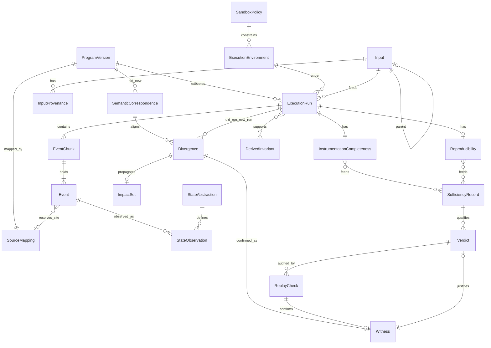

# SBG V7: Data and Evidence Schema (Behavioural Evidence Fabric, schema v1.0.0)

Status: design. No implementation. Companion: `SBG_V7_MODULE_CONTRACTS.md`. Shared brief: `_DESIGN_SPINE.md`.

## 0. Principles and what the V5/V6 code taught us

What exists today: `sbg/extraction/dynamic/tracer.py` produces `ExecutionTrace(program_id, input_repr, events, return_value, exception, stdout, execution_time_ms, coverage, truncated)`; `sbg/v2/execution/runner.py::SandboxRunner` repeats a run N times and reports noise statistics; `sbgv6/observe.py::Observation` wraps these and keeps the V5 `ProgramRecord`; `sbgv6/distance.py::side_evidence` already encodes the right instinct (absence of data is a reason code, never a zero distance).

What the fabric fixes:

| V5/V6 defect | Schema consequence |
|---|---|
| Inputs identified by `input_repr` (a string repr) | Input identity = hash of canonical typed value; repr is display only (SP-11 repr artifact) |
| `return_value: Any` kept as a live object | Values are stored only as `AbstractValue` (type tag + canonical content), never `repr()`/`id()` |
| `truncated: bool` is the only completeness signal | `InstrumentationCompleteness` is a first-class entity with per-kind, per-region coverage |
| Nondeterminism = `std/mean > 0.10` on 5 aggregate features | `Reproducibility` records byte-level event-chain agreement across repeats plus named nondeterminism sources |
| No-data collapses to `UNKNOWN` with ad hoc `reasons` strings | Closed reason-code enum on every verdict; INSUFFICIENT is a first-class outcome |
| Features recomputed from live objects, provenance lost | Derived records name producer module, version, and input IDs; raw layer is never mutated |
| Pair labels came from the mutation generator | `Verdict` never stores a label; labels live in a separate `GroundTruthLabel` namespace owned by subsystem K and are not readable by A-J |

## 1. Layers and ID conventions

Three layers, enforced by table/namespace, not by convention:

1. **RAW** (append-only, content-addressed, produced only by B/A/C): `ProgramVersion`, `ExecutionEnvironment`, `Input`, `ExecutionRun`, `EventChunk` (holding `Event`s), `SourceMapping`, `InstrumentationCompleteness`, `Reproducibility`, `SandboxPolicy`.
2. **DERIVED** (append-only, deterministic functions of RAW or other DERIVED; each carries `producer`): `StateObservation` (abstraction of raw values), `DerivedInvariant`, `SemanticCorrespondence`, `Divergence`/`Witness`, `ImpactSet`, `SufficiencyRecord`.
3. **DECISION** (append-only): `Verdict`, `ReplayCheck`, `Supersession`.

ID format: `<kind>:<algo>:<hex>` e.g. `run:sha256:9f3a...`. All IDs are `sha256` of the canonical serialisation (section 3) of the record's *identity fields* (listed per entity as "ID basis"). Hashing the identity fields only means re-ingesting the same fact is idempotent (same ID, no duplicate). Non-identity fields (timestamps, host, wall-clock durations) are in a `meta` block excluded from the ID basis.

Common header (every record):

| field | type | notes |
|---|---|---|
| `id` | string | content-addressed, see ID basis |
| `schema` | string | `sbg.<entity>/<semver>` e.g. `sbg.run/1.0.0` |
| `layer` | enum `RAW\|DERIVED\|DECISION` | |
| `producer` | object `{module, module_version, code_hash, params_hash}` | mandatory for DERIVED/DECISION; for RAW names the capture module |
| `inputs` | array of IDs | records consumed (empty for RAW roots) |
| `meta` | object | not hashed: created_at, host, wall_ms |

## 2. Entities

Notation: `?` optional, `[]` array, `ID<X>` = reference by ID. Types are JSON-schema-style (`string`, `int`, `number`, `bool`, `enum`, `object`).

### 2.1 ProgramVersion (RAW)
ID basis: `content_hash`, `language`, `entry` (so the same source with a different entry is a different analysable unit).

| field | type | notes |
|---|---|---|
| `content_hash` | string | sha256 of the source bytes (normalised newlines only; no other normalisation) |
| `language` | enum `python\|java\|c` | only `python` has an adapter |
| `files` | array `{path, blob}` | multi-file support; `blob` is a CAS reference |
| `entry` | object `{symbol, signature, discovery}` | `discovery` in {declared, priority_name, structural, manual}; V8 entry-policy outcomes (`ambiguous_entry_point`) are recorded here, not dropped |
| `lineage` | object `{pair_role: old\|new, pair_id, vcs_ref?}` | pairs are by reference, so a program may appear in many pairs |
| `build_status` | enum `ok\|syntax_error\|import_error\|no_entry\|unsupported_signature\|ambiguous_entry` | mirrors `FAILURE_KINDS` of `experiments/final/extraction.py` |

### 2.2 ExecutionEnvironment (RAW)
ID basis: all fields. Two runs are comparable only if environments agree on every field not listed in the comparison's `allowed_env_diff`.

| field | type | notes |
|---|---|---|
| `interpreter` | object `{name, version, impl, build_id}` | e.g. CPython 3.12.x; `sys.flags` digest |
| `deps` | array `{name, version, hash}` | resolved lockfile; empty = stdlib only |
| `os` | object `{kernel, libc, arch}` | |
| `seeds` | object `{python_hashseed:int, random_seed:int, numpy_seed?:int, urandom_stream_seed:int}` | all explicit, never ambient |
| `clock` | object `{mode: frozen\|virtual_tick\|real, epoch_ns:int, tick_ns:int}` | default `virtual_tick`: deterministic monotone advance per call |
| `randomness` | object `{mode: seeded\|virtualised\|real, patched: [string]}` | names of patched sources (`random`, `os.urandom`, `uuid`, `secrets`) |
| `locale_tz` | object `{tz:"UTC", lang:"C"}` | |
| `fs_view` | object `{mode: empty_tmp\|readonly_snapshot, snapshot_hash?}` | |
| `network` | enum `denied` | other values are forbidden by policy for evidence runs |
| `threads` | enum `single_only\|unsupported` | concurrent programs are not observed, flagged `unsupported_concurrency` |
| `sandbox_policy` | ID<SandboxPolicy> | |

### 2.3 SandboxPolicy (RAW, referenced by environment)
| field | type | notes |
|---|---|---|
| `isolation` | enum `process_rlimit\|process_seccomp\|container\|microvm` | tiers defined in the module contract for B |
| `limits` | object `{cpu_s, wall_s, mem_bytes, nofile, nproc, fsize_bytes, stack_bytes, max_events, max_event_bytes, max_stdout_bytes}` | |
| `net` | enum `denied_ns\|denied_seccomp\|denied_profile\|denied_container` | |
| `fs` | object `{root: tmp_private, writable: [path], readonly: [path]}` | |
| `syscall_filter` | string? | name/hash of the seccomp allowlist |
| `kill_policy` | enum `sigkill_process_group` | the V6 "immortal worker thread" failure cannot recur |
| `escape_detection` | array string | audit-hook classes recorded (detection only, not a security boundary) |

### 2.4 Input (RAW)
ID basis: `value_hash` only (identity = content hash). Provenance is attached as a separate `InputProvenance` edge so the same value reached by two routes is one Input with two provenance records.

| field | type | notes |
|---|---|---|
| `value_hash` | string | sha256 of canonical typed value (section 3.3) |
| `value` | blob ref | canonical-serialised typed value; arbitrary Python objects are stored only if they have a registered canonical codec, otherwise the Input is rejected (`unserialisable_input`) |
| `type_sig` | string | structural type, e.g. `list[int]` |
| `size` | object `{bytes, elems}` | |

InputProvenance (RAW edge):

| field | type | notes |
|---|---|---|
| `input` | ID<Input> | |
| `kind` | enum `replay\|generated\|mutated\|property_based\|concolic\|seed_corpus` | |
| `generator` | object `{name, version, strategy}` | e.g. `structure_aware_list_gen` |
| `generator_seed` | int | with `generator` makes `generated` inputs regenerable |
| `parent` | ID<Input>? | for `mutated` |
| `mutation` | object? `{operator, site}` | |
| `target` | object? `{region_id, branch_id, reason}` | for directed scheduling and concolic |
| `solver` | object? `{name, version, constraints_hash}` | concolic only |
| `source_pair` | ID? | the pair whose exploration produced it (scheduling only; **never** a label) |

### 2.5 ExecutionRun (RAW)
ID basis: `program`, `input`, `environment`, `capture_level`, `repeat_index`.

| field | type | notes |
|---|---|---|
| `program` | ID<ProgramVersion> | |
| `input` | ID<Input> | |
| `environment` | ID<ExecutionEnvironment> | |
| `capture_level` | enum `L0\|L1\|L2\|L3` | L0 outcome only; L1 +call/return; L2 +branch/line/data in focus regions; L3 full line trace |
| `repeat_index` | int | 0 is the primary run |
| `outcome` | object | `{status: returned\|raised\|timeout\|oom\|killed\|crashed\|truncated, return: AbstractValue?, exception: {type, msg_hash, site}?, stdout_hash, stderr_hash, exit_signal?}` |
| `event_count` | int | |
| `chunks` | array of ID<EventChunk> | ordered |
| `chain_root` | string | Merkle root over chunk hashes (replay check anchor) |
| `usage` | object `{cpu_ms, wall_ms, peak_rss, events}` | in `meta`, not hashed |
| `completeness` | ID<InstrumentationCompleteness> | |
| `reproducibility` | ID<Reproducibility>? | set after repeats |

### 2.6 EventChunk and Event (RAW)
Events are stored in chunks of at most 4096 events (CAS blob, zstd over canonical JSON Lines). `EventChunk` ID = hash of the chunk's canonical bytes; it records `{run, first_seq, count, prev_chunk_hash}`, forming a hash chain.

Event (logical record inside a chunk):

| field | type | notes |
|---|---|---|
| `seq` | int | 0-based per run, dense |
| `kind` | enum | see below |
| `frame` | int | call-stack depth id (deterministic counter of calls, not an address) |
| `site` | object `{file_idx, line, col?, func_sym}` | resolved through `SourceMapping` |
| `payload` | object | kind-specific, below |
| `payload_hash` | string | sha256 of canonical payload (excluding `seq`, `frame` ids); equal `payload_hash` across runs means "same observable behaviour", which is what alignment compares |
| `event_id` | string | sha256(`run_id`, `seq`, `kind`, `site`, `payload_hash`); never stored per event on disk, derived on read (saves ~32 B per event) |

Kinds and payloads:

| kind | payload |
|---|---|
| `call` | `{callee_sym, args: [AbstractValue], call_site, depth}` |
| `return` | `{callee_sym, value: AbstractValue}` |
| `branch` | `{branch_id, taken: bool\|int, cond_hash?}` (branch_id from SourceMapping, stable across versions only via correspondence) |
| `line` | `{line}` (only at L3, or within focus regions at L2) |
| `exception` | `{type, msg_hash, raised_at, caught_at?}` |
| `state_obs` | `{abstraction: ID<StateAbstraction>, points_to: scope, digest, value?: AbstractValue}` pointer to a StateObservation |
| `data_def` | `{var, scope, value_digest}` |
| `data_use` | `{var, scope, def_seq?, value_digest}` (def_seq is the reaching def when known; enables dependence propagation in H) |
| `side_effect` | `{effect: stdout\|stderr\|file_write\|env_write\|global_write\|attr_write, target_hash, data_hash}` |
| `external_call` | `{module, func, args_hash, result: AbstractValue\|exception, virtualised: bool}` (time, random, io; `virtualised=true` means answered by the determinism layer) |
| `resource` | `{metric: allocs\|steps\|depth\|bytes, value, threshold_hit: bool}` |
| `truncation` | `{reason: max_events\|timeout\|oom\|depth, at_seq}` (explicit, so completeness is derivable) |

AbstractValue (used everywhere values appear): `{t: type_tag, d: canonical_digest, s?: small_inline_value, size?: int, lossy: bool}`. Rules: ints/bools/str/bytes/None inline if short (<= 64 B), else digest; floats as IEEE-754 hex; containers as ordered structure with element digests (sets sorted by element digest); objects as `{t: qualified_class, d: digest of canonicalised __dict__ restricted to depth 3}`; `repr()` and `id()` are never inputs. `lossy=true` when depth or size cut-offs were applied.

### 2.7 StateObservation (DERIVED or RAW-at-capture)
An abstraction applied to a raw state snapshot at a program point. Kept DERIVED because abstractions can be re-run on the raw `data_def` / `value` stream; only capture-time snapshots (function entry/exit args, globals touched) are RAW events.

| field | type | notes |
|---|---|---|
| `id` | | basis: run, seq, abstraction |
| `run`, `seq` | | location |
| `abstraction` | ID<StateAbstraction> | |
| `precision` | object `{level: exact\|structural\|relational\|interval\|type_only, lossy: bool, error_bound?: number}` | |
| `value` | object | abstract state, e.g. `{len: [3,3], sorted: true, mult_hash: ...}` |

StateAbstraction (DERIVED registry): `{name, version, definition_hash, domain, soundness: over\|under\|heuristic, applies_to}`. Soundness is declared so H does not report "no difference" when the abstraction cannot see the difference.

### 2.8 SourceMapping (RAW from C)
ID basis: `program`, `tool_version`.

| field | type | notes |
|---|---|---|
| `program` | ID<ProgramVersion> | |
| `functions` | array `{sym, file_idx, line_span, ast_hash, sig_hash}` | |
| `blocks` | array `{block_id, line_span, ast_path, succ: [block_id]}` | CFG at basic-block granularity |
| `branches` | array `{branch_id, block_id, kind: if\|loop\|bool_op\|ternary\|except\|comprehension}` | |
| `ast_hash_tree` | blob ref | Merkle hashes of AST subtrees for matching |
| `parse_status` | enum `ok\|partial\|failed` | |

### 2.9 InstrumentationCompleteness (RAW)
Answers "what could this run have shown us?". Never a single boolean.

| field | type | notes |
|---|---|---|
| `run` | ID<ExecutionRun> | |
| `kinds_captured` | array enum | event kinds enabled |
| `kinds_dropped` | object kind -> count | dropped due to caps |
| `truncated` | object `{is: bool, reason?, at_seq?}` | |
| `region_coverage` | object `{focus_region_ids: [..], lines_hit: [..], branches_hit: [{branch_id, taken_set}], focus_hit_fraction: number}` | focus = changed region from C (see ImpactSet) |
| `blind_spots` | array `{kind: native_call\|c_extension\|threads\|subprocess\|eval_exec\|monkeypatch\|generator_resume, count}` | known sources of unobserved behaviour; `native_call` rows come from audit hooks |
| `virtualised_calls` | int | calls answered by the determinism layer |
| `level_achieved` | enum L0..L3 | may be less than requested |

### 2.10 Reproducibility (RAW)
Basis: program, input, environment, repeat set.

| field | type | notes |
|---|---|---|
| `repeats` | int | number of repeat runs (>= 2 for any run used in a verdict) |
| `chain_agreement` | number in [0,1] | fraction of repeats whose `chain_root` equals the primary's |
| `first_disagreement` | object? `{repeat, seq, kind_a, kind_b}` | by chunk bisection |
| `outcome_agreement` | bool | outcomes equal across repeats |
| `nondeterminism` | array `{source: time\|random\|hash_order\|threads\|fs\|net\|address\|unknown, evidence_seq?}` | attributed when determinable |
| `class` | enum `deterministic\|outcome_stable_trace_unstable\|unstable\|unknown` | |
| `masked_by_virtualisation` | array string | which sources were controlled (so a "deterministic" run is deterministic *under* control) |

### 2.11 DerivedInvariant (DERIVED, optional E)
| field | type | notes |
|---|---|---|
| `program` | ID<ProgramVersion> | |
| `scope` | object `{func_sym, point: entry\|exit\|loop_head, }` | |
| `template` | string | from a closed template set (e.g. `x<=y`, `len(a)==len(b)`, `sorted(a)`, `x in [lo,hi]`) |
| `support` | object `{runs: [ID], n_obs: int, n_violations: 0}` | observed in these runs, never "proved" |
| `confidence` | number | e.g. one-sided binomial bound from `n_obs` |
| `producer` | | mandatory |

### 2.12 SemanticCorrespondence (DERIVED, from G)
A mapping between old and new program elements, with evidence of why.

| field | type | notes |
|---|---|---|
| `old`, `new` | ID<ProgramVersion> | |
| `pairs` | array `{old_elem, new_elem, level: function\|block\|branch\|event_class, status: matched\|modified\|added\|removed, score, basis: [static_ast\|dynamic_anchor\|signature\|manual], anchors: [{old_event_id, new_event_id}]}` | |
| `unaligned_fraction` | number | |
| `method` | object | name, version, params hash |
| `uncertainty` | number | e.g. fraction of matches decided by score margin < tau |

### 2.13 Divergence and Witness (DERIVED, from H)
| field | type | notes |
|---|---|---|
| `id` | | basis: old_run, new_run, correspondence, locus |
| `old_run`, `new_run` | ID<ExecutionRun> | same Input, same environment (enforced) |
| `input` | ID<Input> | the witness input |
| `kind` | enum `outcome\|exception\|side_effect\|control\|call\|state\|data_dependence\|resource` | the strongest view that differs |
| `first_divergence` | object `{old_seq, new_seq, old_event_id, new_event_id, view, old_site, new_site}` | earliest aligned event pair whose `payload_hash` differs |
| `masked` | bool | true if control/state differs internally but `outcome` is equal (the quantity the spine's scientific question cares about) |
| `attribution` | object `{changed_region?, distance_in_events_from_changed_region}` | |
| `alignment_trust` | number | the divergence is only as trustworthy as the correspondence at the locus |
| `explanation_class` | enum `value_diff\|branch_flip\|extra_call\|missing_call\|exception_diff\|effect_diff\|length_diff` | |

Witness (a Divergence qualifies as a Witness iff replay-confirmed):

| field | type | notes |
|---|---|---|
| `divergence` | ID<Divergence> | |
| `replay_check` | ID<ReplayCheck> | both sides re-executed, same first-divergence reproduced, `agree=true` |
| `minimised_input` | ID<Input>? | optional delta-debugged input (provenance `mutated`) |
| `repro_cmd` | object | the exact (program hash, input hash, environment id) triple; no free-text command |

### 2.14 ImpactSet (DERIVED, from H)
| field | type | notes |
|---|---|---|
| `divergence` | ID<Divergence> | |
| `method` | enum `dynamic_dependence_forward` | observed dependency only |
| `reached` | object `{events: count, outputs: [output_ref], state_vars: [..], functions: [..], branches: [..]}` | what depends (via `data_def`/`data_use`, branch conditions) on the first divergent value |
| `reaches_outcome` | bool | |
| `truncated_by` | enum? `event_cap\|dependence_blind_spot` | |
| `label` | const `observed_dependency_not_causal_proof` | printed in every report |

### 2.15 SufficiencyRecord (DERIVED, from I)
Per (old, new, scope) scope = a function or the entry unit.

| field | type | notes |
|---|---|---|
| `scope` | object `{func_syms, changed_region_ids}` | |
| `activation` | object `{changed_regions_total, reached_old, reached_new, reached_both, fraction_both}` | from completeness `region_coverage` |
| `branch_coverage_changed` | object `{covered, total, both_directions_fraction}` | for changed branches |
| `state_coverage` | object `{abstraction, distinct_states_seen, saturation_estimate}` | saturation: new distinct states per 10 new inputs (a stopping rule, empirical not guaranteed) |
| `input_diversity` | object `{n_inputs, n_distinct_outcomes, provenance_mix}` | |
| `budget` | object `{spent: {inputs, cpu_s, events}, cap: {...}, exhausted: bool}` | |
| `reproducibility_floor` | number | min `chain_agreement` over contributing runs |
| `level` | enum `S0\|S1\|S2\|S3` | S0: changed region never reached by both; S1: reached, few inputs; S2: reached, both branch directions where applicable, budget met; S3: S2 + state saturation + formal tier agrees (if run) |
| `limits_noted` | array reason codes | e.g. `blind_spot:c_extension`, `unobserved_exception_paths` |

### 2.16 Verdict (DECISION, from I)
| field | type | notes |
|---|---|---|
| `id` | | basis: old, new, scope, evidence_chain hash, decision_policy version |
| `old`, `new` | ID<ProgramVersion> | |
| `scope` | object | |
| `value` | enum `DIVERGENT\|NO_DIVERGENCE_OBSERVED\|INSUFFICIENT` | `EQUIVALENT` does not exist in this enum; the formal tier produces `FormalResult` records referenced as evidence |
| `reason_code` | enum | closed list below |
| `confidence` | object `{kind, value, basis}` | see below |
| `uncertainty` | object `{aleatoric_nondet: number, coverage_gap: number, alignment: number}` | components stay separate, not fused to one scalar |
| `sufficiency` | ID<SufficiencyRecord> | mandatory for all three values |
| `witness` | ID<Witness>? | required iff `DIVERGENT` |
| `evidence_chain` | array ordered `{id, role}` | must resolve, see section 8 |
| `decision_policy` | object `{name, version, thresholds_hash}` | thresholds frozen before evaluation |
| `prediction` | ID<PredictionRecord>? | only if J enabled; never changes `value` |

Confidence semantics: `DIVERGENT` confidence = replay-confirmed witness (`kind: replay_confirmed`, value 1.0 conditional on environment; lowered, with `kind: nondet_adjusted`, when Reproducibility class is `outcome_stable_trace_unstable`). `NO_DIVERGENCE_OBSERVED` confidence is not a probability of equivalence: it is the sufficiency level plus an optional bound `P(undetected divergence region mass)` only when the input sampler has a stated distribution (`kind: sampling_bound`, else `kind: none`). `INSUFFICIENT` has `confidence.kind = none`.

Reason codes (closed enum, extend by minor version): DIVERGENT: `outcome_differs`, `exception_differs`, `side_effect_differs`, `internal_only_difference` (masked). NO_DIVERGENCE_OBSERVED: `observed_same_at_S1`, `..._S2`, `..._S3`. INSUFFICIENT: `changed_region_not_activated`, `nondeterministic`, `budget_exhausted_s0`, `unsupported_signature`, `no_inputs`, `unobservable_outcome`, `alignment_failed`, `blind_spot_dominant`, `capture_truncated`, `import_error`, `ambiguous_entry`, `unsafe_program`.

### 2.17 ReplayCheck (DECISION)
| field | type | notes |
|---|---|---|
| `target_run` | ID<ExecutionRun> | |
| `replay_run` | ID<ExecutionRun> | fresh run of the same (program, input, environment) |
| `agree` | bool | `chain_root` equal |
| `first_mismatch` | object? `{seq, kind_a, kind_b, cause: nondeterminism\|env_drift\|tracer_version\|unknown}` | |

### 2.18 Supporting: FormalResult (optional tier), PredictionRecord (J), GroundTruthLabel (K only), Supersession
FormalResult: `{old, new, scope, method: bounded_symbolic|regression_verification, bound, status: equivalent_up_to_bound|counterexample|unknown, counterexample?: ID<Input>, solver, time_ms}`; `equivalent_up_to_bound` is the only way a report may use the word "equivalent", always with its bound. PredictionRecord: `{model_id, model_version, features_hash, score, calibrated: bool, trained_on_hash}`. GroundTruthLabel: `{pair, label, source, label_function_hash, shortcut_flags}`; lives in a separate store `labels/` that A-J cannot import (enforced in L). Supersession: `{old_record, new_record, reason}`: how an erroneous record is superseded without deletion.

## 3. Identity, canonical serialisation, determinism of IDs

### 3.1 Canonical serialisation
JSON canonical form (RFC 8785 style): UTF-8, keys sorted by code point, no insignificant whitespace, integers in decimal, no `+`, no leading zeros; floats never as decimal: IEEE-754 binary64 as 16-hex-digit string tagged `{"f":"3ff0000000000000"}`; NaN canonicalised to one bit pattern, `-0.0` kept distinct from `0.0`; bytes as base64url without padding tagged `{"b":..}`; sets and frozensets as arrays sorted by element canonical hash; dicts with non-string keys as arrays of `[key,value]` sorted by key hash; unicode strings NFC-normalised for IDs only (original kept in blobs). Absent optional fields are omitted, never `null` (so adding an optional field in a minor version does not change old IDs).

### 3.2 Hash basis
`sha256` over `schema_name + "\n" + canonical(identity_fields)`. Algorithm prefix in the ID allows a later switch (`blake3`) without rewriting old records: old IDs stay valid, new IDs use the new prefix, readers accept both.

### 3.3 Input identity
`value_hash = sha256("sbg.input/1\n" + canonical(typed_value))` where typed value = `{t: type_tag, v: structure}`. Two inputs equal iff equal hash. This fixes the "QuixBugs 36 pairs have no inputs" class by making inputs first-class and enumerable per program, and defeats repr-based ID collisions.

### 3.4 Event identity
Within a run: `(run_id, seq)`. Across runs: `payload_hash` + site. `event_id = sha256(run_id, seq, kind, site, payload_hash)`. The `payload_hash` deliberately excludes `seq`, `frame`, and absolute `site.line` (line shifts between versions would otherwise make every event differ); the site is compared via `SemanticCorrespondence`, not by raw line. Floats, addresses, and timestamps never enter `payload_hash`; timings are `meta`.

### 3.5 Run chain
`chunk_hash_i = sha256(prev_chunk_hash || canonical_bytes(chunk_i))`, `chain_root = chunk_hash_last`. Divergence between two chains localises to the first differing chunk in O(chunks) and then by in-chunk scan.

## 4. Immutability and layering rules

1. Append-only: no UPDATE/DELETE on any RAW/DERIVED/DECISION table; the SQLite database enforces this with triggers that raise on UPDATE/DELETE; compaction writes a new store and swaps by manifest.
2. RAW is written only by subsystems A, B, C (and K for imported benchmark pairs as `ProgramVersion`). DERIVED is written by E, F-projections, G, H, I; every DERIVED record must carry `producer` and `inputs`, and the ingest gate rejects records whose `inputs` do not resolve or whose `producer.code_hash` is not in the registered module manifest (L).
3. Derived records are pure functions of `inputs` + `producer.params_hash`. The gate supports a *recompute check*: re-run the producer on the inputs; the output hash must equal. This is the from-raw reproduction check of V6 (2392/2392) turned into a standing invariant.
4. Errors are corrected by Supersession; superseded records remain readable and are flagged in views.
5. Labels never enter the fabric (see 2.18); `Input.provenance.source_pair` is scheduling metadata only. A leakage check in K scans DERIVED/DECISION records for any field derived from a label.
6. Redaction: blobs may be tombstoned for licensing/size (hash retained, content gone); any Verdict depending on a tombstoned blob is flagged `evidence_unavailable`, not deleted.

## 5. Schema versioning and evolution

- Each entity schema has semver `MAJOR.MINOR.PATCH` in `schema`.
- MINOR: add optional fields, add enum values, add reason codes. Old readers ignore unknown optional fields but **must** treat an unknown enum value as `unknown` and downgrade any decision that depends on it to INSUFFICIENT.
- MAJOR: removal/rename/semantic change/new ID basis. Readers **must reject** records of a major they do not support (hard error, not best effort).
- PATCH: documentation/validation clarifications only.
- ID-affecting changes are always MAJOR (the ID basis is part of the contract).
- Migration: a migration is a registered pure function `vN -> vN+1` over a record, emitting a *new* record (new ID, `inputs=[old]`, `producer=migration`); old records are kept. RAW blobs are never rewritten, so event hash chains remain valid across migrations; only index/derived layers are regenerated.
- Compatibility matrix is stored in `manifest.json` (store-level) with the set of schema majors present; opening a store with an unsupported major fails.
- Schema registry: JSON Schema files are themselves content-addressed and referenced from the manifest.

## 6. Storage design

Chosen: **content-addressed blob store + single-file SQLite index (WAL)**, with Parquet export for analysis.

| component | content | rationale |
|---|---|---|
| `cas/ab/cdef...` | immutable blobs: sources, canonical Input values, event chunks (zstd JSONL), SourceMapping trees | dedup of repeated programs/inputs (596 duplicate groups in V6 data = 1713/2392 pairs; dedup is real, not hypothetical); blob hash = integrity check; trivially rsync-able |
| `index.sqlite` | all entity records as rows (JSON column + extracted indexed columns), ID resolution, edges (`inputs`), manifest | stdlib on Python and available in Java/C; single file; transactional append; no server; deterministic dump; adequate to ~10^8 rows |
| `exports/*.parquet` | flattened events/divergences for columnar analytics | analysis only, regenerable, not truth |

Alternatives considered: (a) pure files + JSON manifests: no transactional integrity, slow joins; (b) DuckDB/Parquet as primary: excellent scans but weak for per-record append/ID lookup, adds a dependency, and Parquet writers are not byte-deterministic across versions, harming content addressing; (c) Postgres/graph DB: operational burden unjustified for a research artefact, harms reproducibility. Events are the volume problem, not entities: they live in CAS chunks, not as SQLite rows; only per-run summaries and indexed anchors (calls, branches with `branch_id`, first/last seq) are rows. Size estimate: L1 capture ~ 50-500 events/run, L3 up to `max_events` (5000 in V6); 10^6 runs x 1k events x ~12 B compressed ~ 12 GB worst case: affordable; L3 is requested only for focus regions.

Indexes (SQLite): `run(program, input, environment, capture_level)` unique; `run(input)`; `input_prov(kind)`, `input_prov(parent)`; `event_anchor(run, kind, site_sym)`; `branch_hit(run, branch_id, taken)`; `divergence(old_run,new_run)`, `divergence(kind, masked)`; `verdict(old,new,scope)`, `verdict(value, reason_code)`; `edge(src)`, `edge(dst)` for chain walks; `producer(module, version)`.

## 7. Replay

**Re-execution from stored evidence.** A run is replayable iff its `ProgramVersion`, `Input`, and `ExecutionEnvironment` (with SandboxPolicy) resolve in CAS and the capture module version is in the registry. Procedure: materialise program blob in an empty private directory; reconstruct environment (interpreter version must match `build_id`, otherwise `cause: env_drift` and the replay is marked `inconclusive`, not `disagree`); seed all controlled sources from `seeds`; execute at the stored `capture_level`; produce a new `ExecutionRun` in a scratch namespace.

**Divergence in replay.** Compare `chain_root`; on mismatch bisect chunks to the first differing event; classify: (1) recorded nondeterminism source present at that seq -> `nondeterminism`; (2) `external_call` with `virtualised=false` -> `env_drift`; (3) tracer version mismatch -> `tracer_version`; (4) else `unknown` and the original run's Reproducibility is downgraded. A Witness requires `ReplayCheck.agree=true` for both old and new runs.

**Event-level replay without execution.** All derived records can be recomputed from the RAW chunks alone (no re-execution); this is the recompute check in section 4.3 and is the cheap, always-on path. Re-execution is the expensive path used for Witness confirmation, audits, and after environment changes.

**Not replayable by design:** runs with `blind_spots` of kind `threads`/`subprocess`/network (they are refused at capture), and runs whose environment `randomness.mode = real`.

## 8. Traceability rule

Every Verdict resolves to evidence by a total, checkable chain:

```
Verdict
 |-- sufficiency -> SufficiencyRecord -> {InstrumentationCompleteness[*], Reproducibility[*], SemanticCorrespondence, Input provenance records}
 |-- witness (iff DIVERGENT) -> Witness -> Divergence -> {old_run, new_run, correspondence}
 |                                      |-> ReplayCheck -> {replay runs}
 |                                      '-> first_divergence event ids -> EventChunk -> CAS blobs
 '-- evidence_chain[*] (ordered; every id resolves; every DERIVED id resolves to its own `inputs` recursively down to RAW)
```
Validator rules (subsystem L, run on every write and in the audit): (T1) every ID in `evidence_chain` exists and its `inputs` recursively terminate in RAW records; (T2) DIVERGENT has a Witness whose ReplayCheck agrees; (T3) NO_DIVERGENCE_OBSERVED and INSUFFICIENT carry a SufficiencyRecord, and NO_DIVERGENCE_OBSERVED's `level >= S1`; (T4) the three-valued `value` is reproducible: recomputing I from the chain yields the same `value` and `reason_code`; (T5) no record in the chain is superseded, or the verdict is flagged; (T6) no label-namespace record is reachable from the chain; (T7) all runs in a comparison share the Input and environment (modulo `allowed_env_diff`).

## 9. Worked examples (concrete JSON)

IDs are truncated to 12 hex digits for readability; real IDs are 64 hex. Scenario: `bucket_index(xs, k)` old vs new, where the new version changes `<` to `<=` in a loop bound. Environment `env:sha256:5e10a7c2d9b4` is CPython 3.12.4, seeds fixed, virtual clock, network denied, rlimit+seccomp.

### 9.1 DIVERGENT

```json
{
  "id": "verdict:sha256:a1f09c33e7d2",
  "schema": "sbg.verdict/1.0.0",
  "layer": "DECISION",
  "producer": {"module": "I.decision", "module_version": "0.1.0", "code_hash": "sha256:7be1...", "params_hash": "sha256:c442..."},
  "inputs": ["witness:sha256:4d7b19e0a5c1", "suff:sha256:0be8a2c1f390"],
  "old": "pv:sha256:11aa00ff2e91", "new": "pv:sha256:22bb11ee3f02",
  "scope": {"func_syms": ["bucket_index"], "changed_region_ids": ["blk:old:7", "blk:new:7"]},
  "value": "DIVERGENT",
  "reason_code": "outcome_differs",
  "confidence": {"kind": "replay_confirmed", "value": 1.0, "basis": "ReplayCheck agree on both sides; reproducibility class deterministic"},
  "uncertainty": {"aleatoric_nondet": 0.0, "coverage_gap": null, "alignment": 0.04},
  "sufficiency": "suff:sha256:0be8a2c1f390",
  "witness": "witness:sha256:4d7b19e0a5c1",
  "evidence_chain": [
    {"id": "input:sha256:c0ffee120a77", "role": "witness_input"},
    {"id": "run:sha256:9f3a51d02b6e",   "role": "old_run"},
    {"id": "run:sha256:9f3a51d02b6f",   "role": "new_run"},
    {"id": "corr:sha256:3e91b7aa1c05",  "role": "correspondence"},
    {"id": "div:sha256:b2c4d8e61f19",   "role": "first_divergence"},
    {"id": "replay:sha256:6a0cd13b88e2","role": "replay_old"},
    {"id": "replay:sha256:6a0cd13b88e3","role": "replay_new"},
    {"id": "repro:sha256:d5f1c0a97721", "role": "reproducibility"},
    {"id": "impact:sha256:e8820fd4c3b6","role": "impact"}
  ],
  "decision_policy": {"name": "witness_first", "version": "1.0.0", "thresholds_hash": "sha256:0f0f..."}
}
```
Supporting records (abridged):
```json
{"id": "div:sha256:b2c4d8e61f19", "schema": "sbg.divergence/1.0.0", "layer": "DERIVED",
 "producer": {"module": "H.divergence", "module_version": "0.1.0"},
 "inputs": ["run:sha256:9f3a51d02b6e", "run:sha256:9f3a51d02b6f", "corr:sha256:3e91b7aa1c05"],
 "old_run": "run:sha256:9f3a51d02b6e", "new_run": "run:sha256:9f3a51d02b6f",
 "input": "input:sha256:c0ffee120a77", "kind": "outcome", "masked": false,
 "first_divergence": {"old_seq": 41, "new_seq": 41, "view": "control",
   "old_site": {"func_sym": "bucket_index", "line": 12}, "new_site": {"func_sym": "bucket_index", "line": 12},
   "old_event_id": "ev:sha256:77c0...", "new_event_id": "ev:sha256:81de..."},
 "attribution": {"changed_region": "blk:new:7", "distance_in_events_from_changed_region": 0},
 "alignment_trust": 0.96, "explanation_class": "branch_flip"}
{"id": "impact:sha256:e8820fd4c3b6", "schema": "sbg.impact/1.0.0", "layer": "DERIVED",
 "divergence": "div:sha256:b2c4d8e61f19", "method": "dynamic_dependence_forward",
 "reached": {"events": 9, "outputs": ["return"], "state_vars": ["i","out"], "functions": ["bucket_index"], "branches": ["br:new:3"]},
 "reaches_outcome": true, "label": "observed_dependency_not_causal_proof"}
{"id": "replay:sha256:6a0cd13b88e3", "schema": "sbg.replaycheck/1.0.0", "layer": "DECISION",
 "target_run": "run:sha256:9f3a51d02b6f", "replay_run": "run:sha256:9f3a51d02b70", "agree": true}
```

### 9.2 NO_DIVERGENCE_OBSERVED
Different pair: a refactor (loop rewritten as comprehension). 214 inputs, changed region reached by both on 207 inputs, both directions of the changed branch, state saturation estimate 0.01, all runs chain-deterministic.

```json
{
  "id": "verdict:sha256:5c77e0a1b3d9", "schema": "sbg.verdict/1.0.0", "layer": "DECISION",
  "producer": {"module": "I.decision", "module_version": "0.1.0"},
  "old": "pv:sha256:31c1aa9042de", "new": "pv:sha256:32d2bb8153ef",
  "scope": {"func_syms": ["normalise"], "changed_region_ids": ["blk:old:3","blk:new:3"]},
  "value": "NO_DIVERGENCE_OBSERVED",
  "reason_code": "observed_same_at_S2",
  "confidence": {"kind": "none", "value": null, "basis": "input sampler has no declared distribution; no sampling bound claimed"},
  "uncertainty": {"aleatoric_nondet": 0.0, "coverage_gap": 0.03, "alignment": 0.0},
  "sufficiency": "suff:sha256:aa91e04c5d12",
  "witness": null,
  "evidence_chain": [
    {"id": "suff:sha256:aa91e04c5d12", "role": "sufficiency"},
    {"id": "corr:sha256:9d41c07b2e60", "role": "correspondence"},
    {"id": "run:sha256:...(214 old runs listed in the SufficiencyRecord)", "role": "runs_ref"}
  ],
  "statement": "No divergence observed in outcome, exceptions, side effects, call and branch views over 214 inputs at sufficiency S2. This is not a claim of equivalence."
}
{"id": "suff:sha256:aa91e04c5d12", "schema": "sbg.sufficiency/1.0.0", "layer": "DERIVED",
 "producer": {"module": "I.sufficiency", "module_version": "0.1.0"},
 "scope": {"func_syms": ["normalise"], "changed_region_ids": ["blk:old:3","blk:new:3"]},
 "activation": {"changed_regions_total": 1, "reached_old": 1, "reached_new": 1, "reached_both": 1, "fraction_both": 0.967},
 "branch_coverage_changed": {"covered": 2, "total": 2, "both_directions_fraction": 1.0},
 "state_coverage": {"abstraction": "abs:struct_v1", "distinct_states_seen": 58, "saturation_estimate": 0.01},
 "input_diversity": {"n_inputs": 214, "n_distinct_outcomes": 61, "provenance_mix": {"replay": 11, "property_based": 120, "generated": 60, "mutated": 23}},
 "budget": {"spent": {"inputs": 214, "cpu_s": 3.1, "events": 88213}, "cap": {"inputs": 300, "cpu_s": 60, "events": 2000000}, "exhausted": false},
 "reproducibility_floor": 1.0, "level": "S2", "limits_noted": []}
```

### 9.3 INSUFFICIENT
Real-world-style pair: the changed region is never reached with any input the generator could produce for the signature; one of the two programs additionally uses wall-clock time.

```json
{
  "id": "verdict:sha256:e03d19b7c8a4", "schema": "sbg.verdict/1.0.0", "layer": "DECISION",
  "producer": {"module": "I.decision", "module_version": "0.1.0"},
  "old": "pv:sha256:41e1cc5266f0", "new": "pv:sha256:42f2dd6377a1",
  "scope": {"func_syms": ["parse_header"], "changed_region_ids": ["blk:new:19"]},
  "value": "INSUFFICIENT",
  "reason_code": "changed_region_not_activated",
  "secondary_reason_codes": ["nondeterministic"],
  "confidence": {"kind": "none", "value": null, "basis": "no activation of changed region"},
  "uncertainty": {"aleatoric_nondet": 0.4, "coverage_gap": 1.0, "alignment": 0.1},
  "sufficiency": "suff:sha256:f7a3350e8b21",
  "witness": null,
  "evidence_chain": [
    {"id": "suff:sha256:f7a3350e8b21", "role": "sufficiency"},
    {"id": "completeness:sha256:1b5c9a77d0e4", "role": "region_coverage_new"},
    {"id": "repro:sha256:c83f2e1d9a60", "role": "reproducibility_new"}
  ],
  "recommended_action": "enlarge exploration toward blk:new:19 (concolic target) or supply an input; do not treat as equal",
  "statement": "Changed region reached on 0 of 87 inputs. New version is nondeterministic (clock) on 35 of 87 inputs even under virtual clock override (an unpatched C-level time source was hit). No claim is made."
}
{"id": "suff:sha256:f7a3350e8b21", "schema": "sbg.sufficiency/1.0.0", "layer": "DERIVED",
 "activation": {"changed_regions_total": 1, "reached_old": 0, "reached_new": 0, "reached_both": 0, "fraction_both": 0.0},
 "branch_coverage_changed": {"covered": 0, "total": 3, "both_directions_fraction": 0.0},
 "state_coverage": {"abstraction": "abs:struct_v1", "distinct_states_seen": 9, "saturation_estimate": 0.0},
 "budget": {"spent": {"inputs": 87, "cpu_s": 60.0, "events": 410233}, "cap": {"inputs": 300, "cpu_s": 60, "events": 2000000}, "exhausted": true},
 "reproducibility_floor": 0.6, "level": "S0", "limits_noted": ["blind_spot:c_extension", "unreached_changed_region"]}
```

## 10. Safe-execution metadata (recorded per run, see B contract)

Every run carries `SandboxPolicy` + `ExecutionEnvironment`. Mandatory recorded facts: isolation tier, each rlimit value, whether the limit tripped (`outcome.status` in `timeout|oom|killed`), kill signal, network mode, filesystem mode, syscall filter hash, audit-hook violations (`blind_spots`), virtualised external calls. A run whose policy is weaker than the pair's declared minimum tier is ingested but flagged `policy_below_minimum` and cannot contribute to a Verdict beyond INSUFFICIENT. Host-level facts (container runtime version, kernel) are in `ExecutionEnvironment.os`.

## 11. ER diagram



## 12. Open issues

- Value-abstraction depth (3) and the 64 B inline limit are guesses; they set `lossy` frequency and must be tuned on a development split before freezing.
- `payload_hash` excluding absolute line numbers is necessary, but class/attribute renames between versions still break equality; G must supply a rename-tolerant mapping and that tolerance must be recorded in the correspondence, or the divergence would be an artefact.
- Saturation estimate is heuristic; S3 must not be marketed as assurance.
