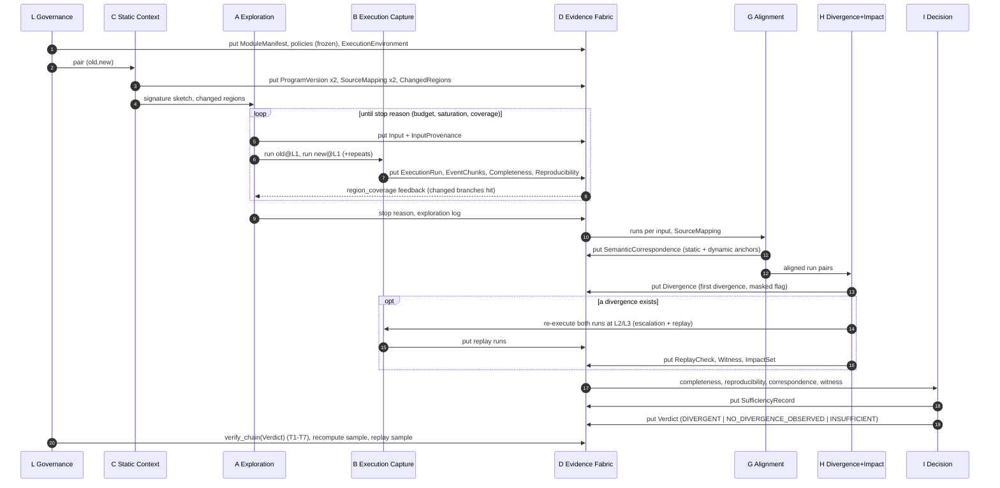

# SBG V7: Module Contracts (subsystems A-L)

Status: design only. Types refer to `SBG_V7_DATA_AND_EVIDENCE_SCHEMA.md` (called "Schema", section numbers `S§`). Brief: `_DESIGN_SPINE.md`.

## 0. Summary of decisions (honest version)

| Sub | Name | Decision | One-line justification |
|---|---|---|---|
| A | Exploration/Discovery | CORE (replay + property-based + changed-region scheduling); concolic = OPTIONAL EXTENSION | V6 failed on observation (BugsInPy 28.5% coverage, 36 QB pairs without inputs, 69 NOT_ACTIVATED); input quality dominates everything downstream |
| B | Execution Capture | CORE, and the largest rewrite | Existing `Tracer`/`SandboxRunner` run in-process on threads; no process isolation, no rlimits, no network denial, immortal timed-out threads |
| C | Static Context | CORE, deliberately minimal | Changed-region/CFG-block/branch IDs are required for activation and alignment; nothing deeper |
| D | Evidence Fabric | CORE | Traceability and replay are the product |
| E | State & Invariant Engine | SPLIT: state abstraction at call/return boundaries = CORE (inside B/D); invariant mining/relational engine = OPTIONAL EXTENSION | V6 `d_A` (invariants) was the weakest-evidenced block; no evidence it adds beyond output diff; keep only the cheap part |
| F | Multi-View Graph Engine | REMOVE as a subsystem; its useful content (call/branch/data-dep sequence projections) is folded into G/H as pure library functions | Graphs are projections of the event log; a separate engine is over-engineering and a second source of truth |
| G | Semantic Alignment | CORE | Divergence is meaningless without correspondence; also the main source of false divergences |
| H | Divergence & Impact | CORE | The product |
| I | Evidence/Uncertainty/Decision | CORE | Three-valued verdict and sufficiency are the scientific contribution |
| J | Behavioural Intelligence & Prediction | OPTIONAL EXTENSION, off by default | V6 learned layer failed the "independent information" claim; may only rank scheduling, never set a verdict |
| K | Validation & Research Harness | CORE | Without it V7 repeats V6 (shortcut-contaminated labels, no pristine holdout) |
| L | Reproducibility & Governance | CORE | Freeze/manifest discipline already worked in V6; extend to schema and traceability gates |

Core = A, B, C, D, G, H, I, K, L plus the E-state-boundary part. That is 9 modules, not 12. Disagreements with the spine are listed in section 14.

Conventions: cost symbols: `n` inputs, `E` events per run, `B` blocks, `R` runs. Every module exposes a pure-data contract (records in, records out); no module imports another module's internals; they communicate only through D.

---

## A. Exploration / Discovery

**Purpose.** Produce a set of `Input`s (S§2.4) for a program pair that maximises the chance of (1) activating the changed region on both versions and (2) exposing differing behaviour, under a fixed budget, without reading labels.

**Inputs.** `ProgramVersion` x2 (S§2.1), `SourceMapping` x2 + changed-region set (from C), signature/type sketch (from C), seed corpus (existing replay inputs: `CANONICAL_INPUTS`, project tests, issue reproducers), `Budget{inputs, cpu_s, events}`, `exploration_seed:int`. Feedback channel: per-run `InstrumentationCompleteness.region_coverage` from D.

**Outputs.** `Input` + `InputProvenance` records (kinds replay/generated/mutated/property_based/concolic), an `ExplorationLog` (RAW-adjacent: schedule decisions, coverage-over-time), and a stop reason from the closed enum {budget, saturation, all_changed_branches_both_ways, unsupported_signature, no_generator}.

**Foundations.**
- Property-based/structure-aware generation over a type sketch (grammar-based, size-ramped; Hypothesis-style shrinking for witness minimisation).
- Coverage-guided differential fuzzing: a scheduler (AFL-style power schedule) with reward = newly covered *changed-region* branches (directed greybox, as in AFLGo: distance to changed blocks on the CFG) plus a tie-breaking reward for new `outcome`-class differences.
- Mutational exploration from replay seeds (bit/field/structure mutations).
- Concolic/symbolic (optional): path-constraint collection on one concrete run, negate a branch condition guarding a changed region, solve with an SMT solver (bounded integer/list/string theories); used only when scheduler stalls on a changed-region branch.
- Stopping rule: saturation of the (changed-branch x direction) set and of the state abstraction (new distinct states per window below threshold); both heuristics, reported not assumed.

**Implementation alternatives.**
1. Pure replay corpus: cheap, reproducible, but is exactly what produced the 36 input-less QuixBugs pairs and the 28.5% BugsInPy coverage.
2. Type-driven property-based generation + random mutation (no feedback): good for pure functions with simple signatures, blind to deep branches.
3. Coverage/distance-guided differential fuzzer (CHOSEN) with replay seeds and property-based generators as seed sources; concolic as an optional escalation.
4. Full symbolic execution first: strong on small units, path explosion and library modelling make it unusable as a default (and the spine already says selective).

Chosen 3 because the V6 failure was observation, the budget is shared with the baseline, and feedback on *changed-region* coverage is the quantity I needs (S§2.15 activation).

**Cost.** `O(n)` runs; `n` set by budget (default 300 inputs, 60 s CPU per pair, matching V6's 60 s program budget). Scheduler overhead O(1) per input; concolic: one SMT query per targeted branch, seconds-scale, capped by time-out.

**Failure modes.**
| Failure | Origin | Mitigation |
|---|---|---|
| Unsupported signature / no generator | V6 `unsupported_signature` 49 on BugsInPy | emit `no_generator`, let I return INSUFFICIENT; never invent a default input; optionally accept a user-supplied generator per project |
| Changed region unreached | V6 69 NOT_ACTIVATED on v8test | directed scheduling; concolic escalation; if still unreached record `S0` |
| Generator fingerprinting leak (V6 GBM 0.972 -> 0.742 leave-type-out) | generators correlate with mutation type | exploration may not see labels or mutation-type metadata; K checks that scheduling features exclude `source_pair` label fields |
| Overfitting inputs to the pair under test | directed search finds inputs that favour divergence | equal-budget baseline in K uses same exploration but compares output only; budget is symmetric |
| Duplicate inputs | 596 duplicate groups | identity = content hash, dedup before execution |

**Validation tests.** (1) Determinism: same `exploration_seed` gives the identical input set (hash of set). (2) Activation uplift: on a development set, directed scheduling reaches changed regions on >= V6 canonical-input baseline at equal budget (a paired test, not a threshold promise). (3) Budget conformance (never exceeds caps). (4) Provenance completeness (every Input has a provenance record, `generated` has a seed). (5) Label-blindness: grep-level import guard plus a K test that shuffles labels and shows identical inputs. (6) Concolic soundness: every concolic input actually satisfies the targeted constraint when replayed (else `solver_mismatch` logged).

**Language-neutral contract vs Python adapter.**
- Neutral: `explore(pair, mapping, budget, seed) -> stream<Input+Provenance>` and `report(coverage_feedback)`; inputs are canonical typed values (S§3.3), language-agnostic if the type vocabulary is shared (int, float, bool, str, bytes, list, map, struct).
- Python adapter: type sketches from annotations/AST/`inspect`; generators for Python containers; `sys.monitoring`-based branch feedback from B.
- Java/C hooks: the generator vocabulary must map to JVM/C types via an adapter-supplied codec (`encode(value) -> canonical`, `decode(canonical) -> native`); coverage feedback via JaCoCo/gcov-like bitmaps converted to `branch_id`s. No promise that the type vocabulary suffices for pointer-rich C or reflective Java.

**Decision: CORE** (concolic: OPTIONAL EXTENSION). Justification above.

---

## B. Execution Capture

**Purpose.** Execute one `(program, input, environment)` safely and deterministically, emit RAW `ExecutionRun` + `EventChunk`s + `InstrumentationCompleteness` + `Reproducibility`. This is the only module that runs untrusted code.

**Inputs.** `ProgramVersion`, `Input`, `ExecutionEnvironment` + `SandboxPolicy` (S§2.2-2.3), `capture_level` (L0-L3), `focus_regions` (from C), `repeats` (default 2; 3 when `outcome_stable_trace_unstable`).

**Outputs.** `ExecutionRun` (S§2.5), chunks (S§2.6), `InstrumentationCompleteness` (S§2.9), `Reproducibility` (S§2.10). Failure is an outcome record, never an exception to the caller: `status in {returned, raised, timeout, oom, killed, crashed, truncated}`, plus `build_status` for load failures (`syntax_error`, `import_error`, ...), reusing `FAILURE_KINDS` from `experiments/final/extraction.py`.

### B.1 Foundations (what is captured and how)
- Tracing: Python `sys.monitoring` (PEP 669, 3.12+) with per-event-kind enable (CALL/PY_RETURN/BRANCH/LINE/RAISE) restricted to code objects of the program under test; fallback `sys.settrace` (what `Tracer` uses today) for <3.12. Reason: monitoring has far lower overhead and can enable LINE only inside focus regions, which is what makes capture levels L2 affordable.
- Capture levels: L0 outcome + side effects only; L1 + call/return with AbstractValues; L2 + branch, and line/data_def/use inside focus regions and N call hops; L3 everything. Default L1 on first pass; escalate to L2/L3 only for inputs that survive to H (re-execution is deterministic, so escalation is cheap and replayable).
- Data def/use at L2: derived from bytecode-level `LOAD_FAST/STORE_FAST` hooks via line events plus local snapshots diffed at line boundaries; no whole-heap tracking. Heap/aliasing precision is declared limited.
- Value capture: canonical AbstractValue (Schema S§2.6); never `repr()`; objects limited to depth 3.

### B.2 Safe execution of untrusted programs (concrete)
Threat model: programs are possibly malformed, non-terminating, memory-hungry, or hostile (benchmark mutants are not malicious, but real repositories and generated variants may delete files, open sockets, fork). Goal: no persistent host effect, no network, bounded resources, killable always. Not a goal: defence against a determined kernel-exploiting adversary at the weakest tier.

Isolation tiers (policy field `isolation`); the pair's minimum tier is a governance setting in L:

| Tier | Mechanism | When |
|---|---|---|
| T1 `process_rlimit` | one **fresh subprocess per run** (fork-exec of a minimal interpreter launcher, not a thread): `setsid`, own process group, scrubbed env, private empty temp cwd, `RLIMIT_CPU`, `RLIMIT_AS`/`RLIMIT_DATA`, `RLIMIT_NOFILE=16`, `RLIMIT_NPROC=0` (or 1), `RLIMIT_FSIZE`, `RLIMIT_CORE=0`, `RLIMIT_STACK`; wall-clock watchdog in the parent that `SIGKILL`s the process group; stdout/stderr through bounded pipes | development on benchmark corpora (macOS and Linux) |
| T2 `process_seccomp` (Linux) | T1 plus `unshare(CLONE_NEWNET\|CLONE_NEWNS\|CLONE_NEWPID\|CLONE_NEWUSER)` (or `bwrap --unshare-all`), read-only bind of interpreter + site-packages, tmpfs workdir, seccomp-bpf allowlist (deny `socket`, `connect`, `ptrace`, `mount`, `execve` after startup, `fork`/`clone` with new process, `kill` other pids, `unlink` outside tmp), `no_new_privs`, capability drop; optionally cgroup v2 `memory.max`, `pids.max`, `cpu.max` | default for any evidence used in a published claim |
| T3 `container` | rootless container (podman/Docker with `--network none --read-only --cap-drop ALL --pids-limit --memory --cpus --security-opt no-new-privileges`) or gVisor `runsc` | untrusted third-party repos (BugsInPy-style real projects with dependency installs) |
| T4 `microvm` | Firecracker/QEMU microVM with snapshot restore | only if hostile code is in scope; out of the V7 baseline |

macOS (the current development host): no seccomp/namespaces; use T1 plus `sandbox-exec` with a deny-network/deny-file-write-outside-tmp profile (deprecated but functional); results from this tier are flagged `policy_below_minimum` for claims and are for development only. Linux CI runs T2.

Hard caps (defaults, frozen in `SandboxPolicy.limits`): per-run CPU 2 s and wall 3 s (V6 used 1 s per trace and 60 s per program; these stay explicit config, not hidden constants); address space 512 MiB; `max_events` 200 000 at L1 (L3: 5000 per focus window, V6's `MAX_EVENTS=5000` is kept for comparability only in the replay-compatibility profile); `max_stdout_bytes` 1 MiB; `nofile` 16; `nproc` 0/1; `fsize` 1 MiB; recursion limit fixed (explicit `sys.setrecursionlimit(1000)`); stack 8 MiB. Timeout means `SIGKILL` of the whole group; a timed-out run leaves **no** residue, fixing the V6 "unkillable worker thread" accumulation (`MAX_TIMEOUTS=2` heuristic becomes unnecessary: nontermination is a per-run outcome, and `nonterminating` is a property assigned from run outcomes in D).
Network denial: T1 relies on socket monkeypatch + audit hook (detection, recorded as `blind_spot`/violation) and macOS profile; T2+ blocks at kernel level; all tiers set `network=denied` in the environment record. Any `socket` audit event sets `Reproducibility.nondeterminism.source=net` and fails the run as `policy_violation`.
Filesystem: read-only program snapshot, private tmpfs, deletion of the tmp dir afterward; writes outside tmp are denied (T2+) or detected (T1 audit hook `open` with write flags, recorded as `side_effect:file_write`).
Subprocess/exec: `os.system`, `subprocess`, `os.fork` denied (T2) or detected+failed (T1 audit hooks raise `PermissionError`), recorded in `blind_spots`.
Audit hooks (`sys.addaudithook`) are used for detection/logging only. They are not a security boundary (a program can disable behaviour by native code), which is why T1 is never allowed to back a public claim for untrusted code.

### B.3 Determinism control (concrete)
- `PYTHONHASHSEED=0` (set in the child env before interpreter start; set iteration order of str/bytes hashes becomes stable); `-X frozen_modules` and `PYTHONDONTWRITEBYTECODE=1`; `TZ=UTC`, `LC_ALL=C`, `PYTHONUTF8=1`; no user site, `-I` isolated mode.
- Seeded RNG: `random.seed(random_seed)` at launch; `numpy.random.seed` if numpy present (version recorded); `random.SystemRandom`, `os.urandom`, `secrets`, `uuid.uuid1/4` patched to a seeded stream and each use logged as `external_call(virtualised=true)`.
- Frozen/virtual clock: `time.time/time_ns/monotonic/perf_counter/process_time`, `datetime.now/utcnow`, and `time.sleep` replaced with a deterministic virtual clock starting at `epoch_ns`, advancing `tick_ns` per call (sleep advances the clock without blocking). Mode `frozen` returns a constant. Each call is logged as `external_call(virtualised=true)`. Native time reads (C extensions) cannot be patched: detected by timing audit hooks where available, otherwise surfaced by repeat-run disagreement (this is the INSUFFICIENT example in Schema S§9.3).
- Threads/async: single-threaded only; `threading.Thread.start` raises under the policy and the program is `unsupported_concurrency` (V6's `conc_producer_consumer` exclusion made principled). `asyncio` runs only with the default event loop under the virtual clock.
- Address/ID nondeterminism: `id()`, default `__repr__` with addresses and `hash(object)` are excluded by the canonical value abstraction; unordered containers are canonicalised.
- Environment variables: whitelist; `os.environ` reads logged.
- Dependency determinism: `ExecutionEnvironment.deps` lockfile hash; runs in different dependency sets are not comparable.
- Verification: every run used in a verdict is repeated (>= 2); `Reproducibility.class` computed from `chain_root` agreement, not from aggregate statistics (`SandboxRunner._compute_noise_floor` used `std/mean > 0.10` on five scalar features, which cannot see order-only or value-only nondeterminism, and V6 treated `nondet` as just a flag on the first two runs).

**Implementation alternatives.**
1. Keep the in-process thread-based `Tracer`/`SandboxRunner`: cheapest, reuses 100% of V6, but no isolation, shared interpreter state across runs (module state, caches, monkeypatches leak between inputs), unkillable threads, no network denial. Rejected for V7 claims; kept as the `v6_compat` profile for regression comparison against V6 numbers.
2. Subprocess per run with rlimits + audit hooks (T1): moderate cost (interpreter start ~20-40 ms; amortisable with a pre-forked template process that `fork`s after importing the tracer, one fork per run, so import state is clean per run). Good for development.
3. Namespace/seccomp (T2) or container (T3): strong isolation, higher startup (tens of ms with `bwrap`, 100-500 ms for containers unless pooled).
4. Record-replay at syscall level (rr/pernosco): full determinism, but Linux/x86-only, heavy, and Python-level events are not first-class.

Chosen: pre-forked-template subprocess per run with T1 baseline and T2 required for claims; T3 for third-party repositories; keep alternative 1 as a compat profile. Because correctness of cross-version comparison requires that the two versions see identical environments, and thread-based runs cannot guarantee that.

**Cost.** Per run: process start amortised 5-30 ms (forked template) + program time x tracing overhead (monitoring L1 ~1.2-3x, L2 ~3-10x, L3 ~20-50x; estimates, to be measured in K) + serialisation O(E). Repeats double it; L2/L3 only after L1 survives to H. 300 inputs x 2 versions x 2 repeats = 1200 runs at ~50 ms = ~1 minute per pair at L1.

**Failure modes.**
| Failure | Origin | Mitigation |
|---|---|---|
| Nondeterminism excluded 60 BugsInPy programs | `nondeterminism 60` | virtual clock/RNG make many deterministic; remaining recorded with a named source and yield INSUFFICIENT rather than silent drop |
| Import errors (4) / dependency drift | BugsInPy `import 4` | environment record with lockfile; T3 container per project |
| Unsupported signature (49) | entry policy | build_status + A's `no_generator`; not B's job to guess |
| Run state leakage between inputs | in-process threads | fresh process per run |
| `repr`-based values (SP-11 artefact) | repr artefact | AbstractValue canonical forms |
| Truncation silently reducing evidence | `truncated: bool` only | completeness record per kind and region; I reads it |
| Sandbox escape / host harm | threads, no isolation | tiers above |

**Validation tests.** (1) Determinism: 100 repeats of 50 programs on all inputs give `chain_agreement = 1.0` under control; deliberate sources (time, random, set order, id) are detected as nondeterminism when control is turned off (mutation test of the controller). (2) Containment: a corpus of hostile fixtures (fork bomb, `while True`, 10 GB alloc, socket connect, file delete, `os.system`, thread spawn, `sys.exit`, `signal` abuse, recursion) must each yield the right `outcome.status` with host unchanged and no stray processes. (3) Overhead per level measured and published. (4) V6 compatibility: under `v6_compat` profile the new capture reproduces the V6 trace features on a frozen sample (guards against capture drift). (5) Escalation equivalence: L1 run followed by L3 re-run of same input has identical L1 projection. (6) Tier parity: same chain roots on T1 and T2 for deterministic programs.

**Language-neutral contract vs Python adapter.**
- Neutral: `run(program_ref, input_ref, env_ref, policy_ref, level, focus) -> RunBundle{run, chunks, completeness, reproducibility}`; event kinds (S§2.6) and the determinism requirement list (virtualise time, randomness, env, fs, net; single thread).
- Python adapter: `sys.monitoring`, `sys.addaudithook`, template-fork launcher, patches for `random/time/uuid/os.urandom`.
- Java hook: JVMTI/ByteBuddy agent emitting the same event kinds; `-XX:` fixed seeds, `java.time.Clock` injection, `SecurityManager` replacement (deprecated) hence container isolation T3 by default. C hook: `ptrace`/DynamoRIO/`-fsanitize-coverage` for branch events, `LD_PRELOAD` shims for `time`, `rand`, `getrandom`, seccomp. Whether the event vocabulary captures enough for these languages is unproven; only the contract (records, determinism rules) is promised.

**Decision: CORE.**

---

## C. Static Context

**Purpose.** Provide the minimum static structure the rest needs: functions, signatures, basic-block CFG with stable IDs, branch IDs, AST subtree hashes, and the **changed-region set** between versions. Nothing else (no points-to, no type inference beyond annotations).

**Inputs.** `ProgramVersion` x2. **Outputs.** `SourceMapping` x2 (S§2.8), `ChangedRegions{old_blocks, new_blocks, kind: edit|move|rename|add|del, confidence}`, `SignatureSketch` for A.

**Foundations.** AST parsing; basic-block CFG construction from the AST (Python `ast` + own CFG builder, or `bytecode` module); tree differencing (GumTree-style top-down hash match then bottom-up dice matching; or `difflib` line diff + AST normalisation); Merkle AST hashes.

**Alternatives.** 1. Line diff only (`F.changed_lines` in V6): trivial, wrong under reformatting/moves. 2. GumTree-like AST diff (CHOSEN): robust to formatting and many refactors, ~O(n^2) worst case but fine at function scale. 3. Full semantic diff with symbolic normalisation: costly, speculative.

**Cost.** `O(size)` to `O(size^2)` per pair; milliseconds for benchmark programs.

**Failure modes.** Over-large changed regions (whole-function rewrites) make activation trivially true: record `region_size_fraction` so I can discount (ties to V6 edit-size shortcut: edit size alone gives AUROC 0.771 DEV; changed-region size is a feature of *scope*, not evidence). Parse failures on syntactically broken mutants (V6 `syntax_error`): emit `parse_status=failed`, downstream INSUFFICIENT. Moves/renames mis-detected as add+del: expressed in `ChangedRegions.kind` with confidence, not hidden.

**Validation tests.** Round-trip: blocks cover all executable lines; stable IDs under whitespace/comment edits; synthetic mutation set with known changed regions recovers them (precision/recall); property: `diff(P,P)` is empty; cross-check line coverage events map to a block (no orphan events).

**Language contract vs adapter.** Neutral: `SourceMapping`/`ChangedRegions` schema with `block_id`, `branch_id`. Python: `ast`. Java: JavaParser/Spoon, javac bytecode CFG. C: clang AST/LLVM CFG. Block granularity must be consistent between C and B's coverage reports; each adapter owns that consistency.

**Decision: CORE (minimal).**

---

## D. Evidence Fabric

**Purpose.** Persist, index, validate, and serve all records; enforce immutability, identity, layering, traceability; provide replay primitives.

**Inputs.** Any record from A, B, C, E-I (producers) via `put(record)`; queries. **Outputs.** `get(id)`, `walk(id, direction)`, `query(filter)`, `verify_chain(verdict_id)`, `replay(run_id) -> ReplayCheck`, `export_parquet(selection)`.

**Foundations.** Content addressing (Merkle DAG; Git-like); append-only log; canonical serialisation (RFC 8785-style); hash chains for event streams; relational index over IDs.

**Alternatives.** (1) CAS + SQLite (CHOSEN, Schema S§6): stdlib, single file, transactional, deterministic. (2) Parquet/DuckDB primary: fast scans, nondeterministic writers, poor point lookup. (3) JSONL files per run: simplest, but no integrity/indices; breaks at scale. (4) Postgres/graph DB: operational burden. (5) Git as store: attractive immutability, bad for millions of small objects.

**Cost.** Ingest `O(E)` per run (canonicalise + hash + zstd), ~1-5 MB/s per core in Python; lookups `O(log N)`; chain verification `O(chain)`. Storage estimate in Schema S§6.

**Failure modes.** Store bloat from L3 events (mitigate: tiered capture, TTL on L3 chunks with hash retained, recompute from replay); hash mismatch across Python versions (canonical form uses integers/hex floats only); mixed schema majors (reader rejects); label leakage (label store separate); dangling references after tombstone (flagged). Ties to V6: raw traces were held as live Python objects (`Observation.runs`) and lost on process exit; only derived features were frozen, so audit required re-extraction.

**Validation tests.** Idempotent ingest (same record twice -> same ID, one row); append-only trigger test (UPDATE/DELETE raise); canonical-serialisation test vectors cross-checked by an independent implementation (e.g. a small Rust/Go or second Python implementation); chain tamper detection; round trip of all schema examples; recompute check for every DERIVED record on a sample; T1-T7 traceability validator (Schema S§8) over all verdicts; fuzz the reader with unknown major versions -> must reject.

**Language contract vs adapter.** Fully language-neutral (JSON Schema + canonical rules + SQLite DDL). Adapters (Python/Java/C) only emit records. Cross-language ID agreement is a testable property (same record, same ID in two implementations).

**Decision: CORE.**

---

## E. State and Invariant Engine

**Purpose.** (E1) define and apply `StateAbstraction`s to values/snapshots producing `StateObservation`s (S§2.7). (E2) mine simple likely-invariants over observations (`DerivedInvariant`, S§2.11) for use in comparison.

**Inputs.** Event chunks (call/return/state_obs/data_def), abstraction registry. **Outputs.** `StateObservation`s; optionally `DerivedInvariant`s; per-abstraction soundness metadata.

**Foundations.** Abstract interpretation vocabulary (type-only, interval, structural `len/sorted/multiset-hash`, relational pairs `x<=y`); Daikon-style template instantiation with confidence by observation counts; Hoare-style pre/post at function boundaries.

**Alternatives.** (1) Boundary-only exact digests (arguments, return values, touched globals): cheap, precise, no generalisation. (2) Add structural abstractions at boundaries (CHOSEN for E1). (3) Daikon-style invariant mining over many templates (E2): produces `d_A`-like signals; high false-positive rate with few observations. (4) Full state-transition-system with abstracted states (V5 `StateTransitionGenome` style) — heavy, depends on abstraction choice that was never validated independently.

**Cost.** E1 `O(E)`; E2 `O(templates x observations)` ~ minutes per pair at thousands of observations.

**Honest assessment: is E over-engineering?** Partly. The spine's scientific question (does internal state add beyond outputs?) needs *some* internal-state observation; the minimum is function-boundary AbstractValues and structural abstractions, which are captured by B anyway at L1. The invariant-mining half has no V6 evidence of value (V6's `d_A` invariant block was one of three trace blocks inside a score whose independent-information claim failed: NOT SUPPORTED). Therefore E1 is CORE (it is just the value abstraction and structural digest registry, a library inside B/D), E2 is an OPTIONAL EXTENSION enabled only after K shows a paired gain over output+call/branch divergence at equal budget.

**Failure modes.** Abstraction too coarse masks real difference (declared `soundness` lets I discount); too fine creates spurious divergences (e.g. float noise): abstraction precision recorded; invariants overfit small input sets (confidence from counts; never reported as proven); repr artefacts avoided by canonical values.

**Validation tests.** Abstraction monotonicity (finer abstraction never merges states the coarser separates); invariant mining recall on planted invariants; false-positive rate on identical-program pairs (must be 0 divergences from E on `diff(P,P)` across seeds); ablation in K: remove E and measure change.

**Language contract vs adapter.** Neutral: abstraction registry interface `abstract(AbstractValue) -> value` and the schema. Python: object canonicalisation via `__dict__`/`__slots__`; Java: reflection codec; C: struct layouts via DWARF. Heap-shape abstraction for pointer-rich C is not promised.

**Decision: E1 CORE (as part of B/D value layer); E2 OPTIONAL EXTENSION.**

---

## F. Multi-View Graph Engine

**Purpose (as in the spine).** Derive control-flow, call, data-dependence, and state-transition views from the event log.

**Inputs/outputs.** Event chunks + SourceMapping -> view objects (ordered sequences / graphs) consumed by G and H.

**Foundations.** Dynamic call tree, dynamic CFG trace (basic-block sequences), dynamic dependence graph via def/use events (Korel/Laski dynamic slicing), Mealy/LTS over abstracted states.

**Alternatives.** (1) Separate persistent graph engine (graph DB, per-view stores): flexible, duplicates truth, adds indexing/identity problems. (2) On-demand pure functions `project(chunks, view) -> sequence/graph` with memoisation by `(run, view, version)` (CHOSEN, as a library under G/H). (3) No views, compare raw event streams: simple but alignment on raw lines is brittle.

**Cost.** Projection `O(E)`; dependence graph `O(E)` with last-def table; LTS `O(E log S)`.

**Honest assessment.** A *stored*, *queryable* graph engine is not needed: the views are deterministic projections of the log (the spine itself says so), V6's value came from a handful of aggregate token/JSD features, and the key V6 lesson is that the added representation did not beat conventional features. Therefore F is **REMOVED as a subsystem**; three projection functions (call sequence, branch-id sequence, def-use edges) become part of G/H, each a pure function covered by tests. State-transition-system views are deferred to the E2 extension. Any graph persisted is a DERIVED record with `producer`, never a separate store.

**Failure modes (if built anyway).** Second source of truth; projection versions drifting; combinatorial view comparison increasing false divergences (multiple comparisons: more views = more chances to report spurious "first divergence"; I must treat view count in its error accounting).

**Validation tests (for the retained projections).** Determinism, `project(P)=project(P)` across repeats, round-trip against the event log (every projected element traces to an event id).

**Language contract vs adapter.** Projections are language neutral over events; nothing adapter-specific.

**Decision: REMOVE as a subsystem (keep 3 projection functions inside G/H). Justification: it adds a layer without adding evidence.**

---

## G. Semantic Alignment

**Purpose.** Establish correspondence between old and new elements (functions, blocks, branches) and between old/new event streams so that H compares like with like.

**Inputs.** `SourceMapping` x2, `ChangedRegions` (C), event projections of the paired runs on the same input (call sequence, branch-id sequence, outcomes). **Outputs.** `SemanticCorrespondence` (S§2.12) per pair (static) and per run pair (dynamic anchor refinement), with `unaligned_fraction` and `uncertainty`.

**Foundations.** (a) Static: AST/CFG matching (GumTree-style), signature and name similarity, Hungarian/greedy assignment with score threshold. (b) Dynamic anchors: unambiguous shared events (calls to unchanged library functions with equal AbstractValue args, outputs, external calls) as anchor points. (c) Sequence alignment between event streams: Needleman-Wunsch/Myers diff with costs from correspondence (matched-site mismatch cost 0, unmatched sites gap cost), restricted to anchored windows to avoid `O(E^2)`.

**Alternatives.** (1) Pure static matching, then positional comparison: cheap, brittle under insertions. (2) Pure dynamic sequence alignment (DTW/NW over raw events): sensitive to loop-count changes. (3) Hybrid static-matching seeded by dynamic anchors, then windowed sequence alignment (CHOSEN, as in the spine). (4) Learned embeddings/GNN alignment: no, spine forbids the dependency, and unvalidated.

**Cost.** Static `O(B^2)` worst, small; dynamic `O(E x w)` with window `w` (~ 64), i.e. near-linear.

**Failure modes.** Mis-alignment creates false divergences or hides real ones: alignment trust propagates (`alignment_trust` in S§2.13); renamed/moved functions: matched by body hash; loop unrolling/vectorisation changes event counts: aligned at block-class level with loop-iteration abstraction, otherwise unaligned fraction increases and I downgrades; generator-induced renames in the benchmark (label is a pure function of the mutation generator): G must not use mutation metadata. SP-8 (47 pairs non-behaviour-preserving) shows even the labels do not guarantee semantics: G has no ground truth, so its error rate is validated by planted-alignment tests only.

**Validation tests.** Identity: `align(P,P)` is perfect; known refactorings (rename var, reorder independent statements, extract function, loop to comprehension) aligned within declared tolerance; adversarial noise (random events inserted) bounded degradation; correspondence stability across seeds; checks that unaligned fraction rises under large edits (calibration). Compared against plain `difflib` line alignment as a baseline.

**Language contract vs adapter.** Neutral: correspondence schema, anchor definition (events with equal `payload_hash` and unique per window), cost model. Python: AST matching. Java/C: adapter supplies `ast_hash_tree`; renames across classes/translation units need adapter-level symbol resolution. No claim that the Python matcher generalises.

**Decision: CORE.**

---

## H. Divergence and Impact

**Purpose.** For a pair of runs (same Input, same environment), find the **first divergence**, classify it per view, mark whether it is masked (internal but not in outcome), confirm by replay as a `Witness`, and compute an `ImpactSet` by forward dynamic dependence.

**Inputs.** Run pair + `SemanticCorrespondence` + projections (call/branch/def-use) + `Reproducibility`. **Outputs.** `Divergence`, `Witness` (after `ReplayCheck`), `ImpactSet` (S§2.13-2.14).

**Foundations.** First-divergence on aligned streams (earliest aligned pair with unequal `payload_hash`); hierarchy of views (outcome > exception > side-effect > call > branch > state > data), where lower-priority differences are reported as `masked=true` when higher views agree; dynamic forward slicing over `data_def/use` and branch control dependence from the first divergent value; witness minimisation by delta debugging on the Input (ddmin) keeping the same first-divergence class.

**Alternatives.** (1) Output-equality only (the baseline differential test): the thing V7 must beat; cheapest. (2) Aggregate distance between traces (V6 JSD blocks): losing against conventional features; rejected as the core. (3) First-divergence on aligned multi-view trace + replay witness (CHOSEN). (4) Full relational/regression verification: optional formal tier, small units only.

**Cost.** Divergence `O(E)` after alignment; impact `O(E)`; minimisation `O(n log n)` re-executions of the single input structure (each a cheap B run).

**Failure modes.** Spurious divergences from nondeterminism (V6 60 unobservable): require repeat agreement before a divergence qualifies; if the old/new pair disagrees only in a nondeterministic event, record `nondeterministic_divergence` and downgrade; alignment-induced false divergences (G); "masked" differences may be benign refactors, not bugs (SP-11 repr artefact and SP-8 non-preserving labels show label-pair noise: 357/1332 changed pairs show no output difference, 61 unactivated, 180 masked internally, 116 unresolved): H reports *observed behavioural difference*, not defect; impact is dependence, not causality; incomplete def/use at L2 leaves `truncated_by: dependence_blind_spot`.

**Validation tests.** Planted-divergence suite with known first-divergence site (measure localisation distance); null suite (identical, semantically-equal rewrites) false-divergence rate under nondeterminism-controlled replay; replay confirmation rate (should be 1.0 for deterministic programs, otherwise a bug); minimisation preserves divergence class; impact set precision/recall vs ground-truth slicing on small programs; paired comparison to output-equality baseline at equal budget (the headline experiment; K owns).

**Language contract vs adapter.** Neutral: divergence/impact schema and the view priority order; algorithms operate on event records. Python adapter supplies def/use fidelity. Java/C: def/use events require instrumentation depth that may be infeasible for C (aliasing); contract allows `ImpactSet` to be absent with `reason: no_defuse`.

**Decision: CORE.**

---

## I. Evidence, Uncertainty, Decision

**Purpose.** Compute `SufficiencyRecord`, choose the three-valued `Verdict` by a frozen policy, report uncertainty components, and enforce selective prediction (abstain rather than guess).

**Inputs.** All evidence for a pair: completeness, reproducibility, correspondence, divergences/witnesses, formal results (optional), prediction record (optional J, advisory only). **Outputs.** `SufficiencyRecord` (S§2.15), `Verdict` (S§2.16) with reason code and evidence chain.

**Foundations.** Decision rules (policy `witness_first`):
1. If a replay-confirmed Witness exists -> `DIVERGENT` (reason by view; `internal_only_difference` if masked).
2. Else compute sufficiency level S0-S3 from activation, branch/direction coverage on changed branches, state saturation, budget, reproducibility floor, alignment uncertainty.
3. If level >= S1 and no blind-spot dominance and floor >= tau_repro -> `NO_DIVERGENCE_OBSERVED` (reason carries the level).
4. Else `INSUFFICIENT` with the primary reason code and secondary codes.
Uncertainty components are kept separate (nondeterminism, coverage gap, alignment). Statistics: coverage-gap uses a Good-Turing/Chao style estimate of unseen-branch mass for reporting only; no probability of equivalence is claimed; when the sampler distribution is declared, a one-sided bound `1-(1-eps)^n` style (rule-of-three) can be reported under the independence assumption, labelled as such. Selective prediction: risk-coverage curves (abstention), calibration by reliability diagrams for any scored component; conformal-style abstention if J scores are present.

**Alternatives.** (1) Single scalar score with threshold (V6 style): fuses unlike uncertainty; V6 conf = `usable*(0.5+0.5*min(1,alpha/ALPHA0))` was ad hoc. (2) Rule-based three-valued with frozen thresholds (CHOSEN): auditable, no labels needed, honest. (3) Bayesian model of divergence probability: requires priors/ground truth that do not exist (scarce noisy real-bug ground truth). (4) Learned selective classifier (J): optional.

**Cost.** `O(#runs)` aggregation; negligible.

**Failure modes.** Threshold gaming (tuned on the evaluation data): thresholds frozen with hashes before evaluation, tuned only on a development split (V6 freeze discipline); coverage-heavy INSUFFICIENT rate making the system useless: reported as first-class metric (coverage at fixed precision); false assurance at S2 (V6 had 357/1332 changed pairs with no output difference and 116 unresolved: the sufficiency levels must be validated against planted-divergence pairs: what fraction of planted divergences are missed at each level?); mislabeled mixing of `NO_DIVERGENCE_OBSERVED` with "equivalent" in downstream use (enum design prevents).

**Validation tests.** Policy determinism (same chain -> same verdict); T1-T7 traceability; monotonicity (more evidence never turns DIVERGENT into NO_DIVERGENCE_OBSERVED, since witnesses are only added); miss rate per sufficiency level on planted-divergence pairs (the key calibration: report the empirical miss rate at S1/S2/S3, with program-cluster bootstrap CIs, not a claimed guarantee); abstention-risk curve; sensitivity to threshold perturbation.

**Language contract vs adapter.** Fully neutral (operates on records).

**Decision: CORE.**

---

## J. Behavioural Intelligence and Prediction

**Purpose.** Optional learned layer: (J1) predict where to schedule exploration (rank changed branches/regions likely to diverge); (J2) predict divergence/defect probability as an advisory score.

**Inputs.** Derived features from records (never labels in A-J at inference); training store in K's label namespace. **Outputs.** `PredictionRecord`s (S§2.18), advisory only.

**Foundations.** Gradient boosting or logistic regression on interpretable features (edit size, changed-region size, activation, depth of first divergence, view flags, V6 blocks as baseline features); calibration (isotonic/Platt); selective classification.

**Alternatives.** (1) None (witness-only system): honest and simple. (2) LR/GBM on features (V6 C0g): V6 reached 0.51-0.85 AUROC and lost to conventional features on BugsInPy/QuixBugs; shortcut-prone (generator fingerprinting 0.972 -> 0.742 leave-type-out; V6 alone leave-type-out ~0.52). (3) GNN/LLM models: forbidden dependency by the spine and unvalidated.

**Cost.** Training seconds-minutes; inference negligible.

**Failure modes.** Learning the generator or edit size instead of behaviour (V6); label function purity (label = mutation generator); duplicate leakage (596 groups): all handled by K's splits, not by J; calibration drift out of distribution; reviewers reading the score as a verdict. J may influence A's schedule priority only; it may not alter `Verdict.value`.

**Validation tests.** Leave-mutation-type-out and leave-project-out AUROC vs edit-size-only, token-distance, V5, V6, output-differential baselines; paired comparison with program-cluster bootstrap and permutation tests; calibration error; ablation showing J is not needed for the witness path.

**Language contract vs adapter.** Neutral features over records; models are retrained per language adapter with no transfer claim.

**Decision: OPTIONAL EXTENSION, off by default.** The scientific claim of V7 must stand without it; enable only if K shows a gain over the strongest conventional + output-differential baseline.

---

## K. Validation and Research Harness

**Purpose.** Make claims testable: build benchmarks with controlled ground truth, run V7 and baselines under equal budgets, compute pre-declared statistics, and detect shortcuts and leakage.

**Inputs.** Pair corpora (V5/V6 benchmarks as **non-pristine development data**, QuixBugs, BugsInPy, planted-divergence suites, equivalence-preserving rewrite suites, new held-out data collected after the design freeze), baselines. **Outputs.** Labels store (separate), experiment manifests, result tables with CIs, shortcut audit reports, pre-registration documents.

**Foundations.** Equal-budget comparisons (same inputs/CPU/events); baselines: output-differential testing, coverage-guided differential fuzzing, conventional features (edit size, token/AST distance, exec volume), V5, V6; metrics: detection rate vs budget (time-to-first-divergence), masked-divergence yield (divergences visible internally before/without outcome difference), false-assurance rate at each sufficiency level, INSUFFICIENT rate and coverage-at-precision, AUROC only for J. Statistics: program-cluster bootstrap, permutation tests, paired designs, leave-mutation-type-out and leave-project-out splits, duplicate-group-aware splitting (596 groups), preregistered hypotheses and thresholds; planted-bug generation with *independently verified* behaviour (differential oracle plus reference solution), including semantically-equivalent controls to estimate false-divergence rate. Pristine holdout: constructed after freeze from sources not seen in design (not V5/V6 data).

**Alternatives.** (1) Reuse V5/V6 benchmark and labels: contaminated (label = generator function, SP-8/SP-11 issues, no pristine holdout); only for regression/dev. (2) New planted + real-bug suite with oracle verification (CHOSEN). (3) Only real bug datasets (BugsInPy, Defects4J-like): realistic but scarce, noisy, and V6 saw 28.5% coverage on BugsInPy.

**Cost.** Dominated by execution: pairs x inputs x versions x repeats; budget sweeps multiply by ~5; typically CPU-hours to a few days on a workstation; statistical computation negligible.

**Failure modes.** Shortcut metrics (edit-size reversed 0.771 DEV/0.847 BugsInPy/0.325 QuixBugs), generator fingerprinting, duplicate leakage, label noise, unreported abstention: addressed by splits, mandatory baseline table, reporting abstention and coverage with every number; the NOT SUPPORTED outcome of the V6 independence claim must be a possible outcome of V7 too; "no pristine holdout" mislabel: K refuses to use the word "pristine" for data seen in design.

**Validation tests (of the harness itself).** Label-shuffle test (V7 verdicts unchanged since they never read labels; J metrics drop to chance); duplicate-group leak check; budget equalisation audit (same input counts and CPU for V7 and baselines); reproduction from raw (V6's 2392/2392 identical check repeated for V7); statistical power calculation preregistered; seed sweep stability of conclusions.

**Language contract vs adapter.** Harness is language neutral; per-language benchmark curation is separate work and results are reported per language.

**Decision: CORE.**

---

## L. Reproducibility and Governance

**Purpose.** Freeze/manifest discipline, module version registry, schema gate, traceability validator, label isolation, policy conformance, audit/replay scheduling, release hashing.

**Inputs.** Source tree, module manifest, thresholds/policies, store manifest. **Outputs.** `ModuleManifest{module, version, code_hash, params_hash}`, freeze records (hash of code+thresholds+corpus lists before evaluation), audit reports (T1-T7, recompute checks, replay sample, sandbox-tier compliance), reproduction script outputs.

**Foundations.** Content hashes, manifests, pre-registration with timestamps, hermetic builds (lockfiles, pinned interpreter), deterministic reproduction (re-derive DERIVED/DECISION from RAW and compare hashes), import-guard tests for label isolation.

**Alternatives.** (1) Ad hoc scripts + README (V5-style): drifted. (2) V6 freeze/manifest/hash discipline extended (CHOSEN): proven (2392/2392 identical). (3) Heavy MLOps/workflow tooling (DVC, MLflow): unneeded dependency; may be an export target.

**Cost.** Hash/manifest negligible; audit replay sampled (default 5% runs, 100% of Witnesses); recompute check seconds-minutes per thousand records.

**Failure modes.** Freeze performed after peeking; module changed without version bump (code_hash gate rejects); environment drift between audits (env record); thresholds tuned on test (thresholds_hash in verdict); label leakage into A-J; "pristine" misuse.

**Validation tests.** Tamper test (modify a record -> gate fails); module-change test (change code without manifest update -> ingest rejects); end-to-end reproduction from raw yields identical verdict hashes; label-isolation import-guard test; freeze-before-evaluation timestamp ordering check.

**Language contract vs adapter.** Neutral; per-adapter manifests (interpreter, JDK, compiler versions).

**Decision: CORE.**

---

## 13. End-to-end comparison, module interaction

## 14. Dependency table

Allowed dependency = "reads records from"; no module may call another's internals; cycles in this table are forbidden (A depends on B only through D feedback records and on B's `run` API).

| Module | Reads (records / services) | Writes | Depends on modules |
|---|---|---|---|
| A | SourceMapping, ChangedRegions, Completeness (feedback) | Input, InputProvenance, ExplorationLog | C, D, B (run API) |
| B | ProgramVersion, Input, Environment, Policy | ExecutionRun, EventChunk, Completeness, Reproducibility | D (store), L (policy) |
| C | ProgramVersion | SourceMapping, ChangedRegions | D |
| D | all | all (gatekeeper) | none (leaf) |
| E (E1 core, E2 opt) | EventChunk | StateObservation, DerivedInvariant | D |
| F (removed) | n/a: 3 projection functions in G/H | n/a | n/a |
| G | SourceMapping, ChangedRegions, runs, projections | SemanticCorrespondence | C (via D), B outputs (via D) |
| H | runs, correspondence, Reproducibility | Divergence, Witness, ImpactSet, ReplayCheck | G, B (replay), D |
| I | Completeness, Reproducibility, Correspondence, Divergence/Witness, FormalResult, PredictionRecord | SufficiencyRecord, Verdict | H, G, D (J optional) |
| J (opt) | DERIVED features | PredictionRecord | D, K (labels at training only) |
| K | everything + labels | experiments, Labels store | all (read-only), L |
| L | manifests, store | freezes, audits | D |

## 15. Disagreements with / refinements of the spine

1. **F demoted/removed.** The spine lists F as a core module; the projection functions are needed but a subsystem is not. Keeping it invites a second truth store and multiplies views (and thus spurious first-divergences).
2. **E split.** State abstraction is core (cheap, inside value capture); invariant mining is optional, because nothing in V6 shows it adds independent information.
3. **Existing sandbox is not reusable for claims.** The spine lists "sandboxed tracer/runner" as reusable. Reading `sbg/extraction/dynamic/tracer.py` and `sbg/v2/execution/runner.py`: runs are in-process worker threads under `sys.settrace`, no rlimits, no process or network isolation, timed-out threads are left alive, `SandboxRunner` noise detection is `std/mean > 0.10` on five aggregates. The *tracing semantics* and failure taxonomy are reusable (as the `v6_compat` profile); the isolation layer must be rebuilt (B.2).
4. **"Immutable full event log as ground truth" needs tiers.** Full L3 logs are expensive; capture is tiered with explicit completeness records, and replay regenerates deeper tiers on demand.
5. **NO_DIVERGENCE_OBSERVED never carries a probability of equivalence** unless a sampling distribution is declared; the sufficiency level S0-S3 is an empirically *calibrated* ordinal (miss rate measured on planted divergences), not a guarantee.
6. **Labels are structurally excluded** from A-I (separate store plus import guard), going beyond "no labels".
7. **Core count:** 9 core modules (A, B, C, D, G, H, I, K, L) plus E1.
