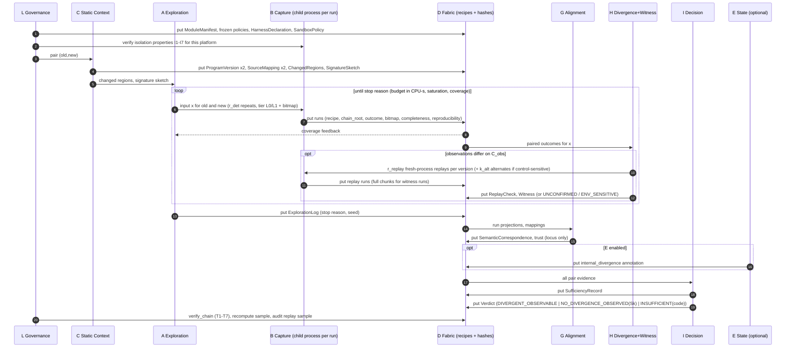

# SBG V7 P0: Reconciled Module Contracts (A-L)

Status: design only. Authority: `P0_BINDING_DECISIONS.md` (D1-D11). Verdict, sufficiency, witness and replay semantics: `P0_VERDICT_AND_SUFFICIENCY_SPECIFICATION.md` ("SPEC"); this file cites it and restates no thresholds. Original content carried over from `SBG_V7_MODULE_CONTRACTS.md` ("ORIG-C") and `SBG_V7_DATA_AND_EVIDENCE_SCHEMA.md` ("SCHEMA", `S§`). Contradiction IDs refer to `P0_CROSS_DOCUMENT_CONTRADICTION_MATRIX.md` (MATRIX); RT = `P0_ARCHITECTURE_RED_TEAM_REPORT.md`; ISO = `P0_EXECUTION_ISOLATION_VERIFICATION.md`.

## 0. Summary of decisions

| Sub | Name | Status | Decision basis |
|---|---|---|---|
| A | Exploration / Discovery | **CORE** (concolic optional extension, off by default) | D5, D7, D11 |
| B | Execution Capture | **CORE**, rebuilt for isolation per D10 | D5, D10 |
| C | Static Context | **CORE**, minimal | D5 |
| D | Evidence Fabric | **CORE**, stores replay recipes plus hashed event streams | D5 |
| E | State abstraction and invariant mining | **OPTIONAL** extension, V7-A pilot only; disabled by default | D2, D5, D6 |
| F | Multi-view graph engine | **REMOVED** as a subsystem; three projection functions live inside G and H | D5 |
| G | Semantic Alignment | **CORE** | D5 |
| H | Divergence and Witness (impact optional) | **CORE** | D1, D5 |
| I | Evidence, Uncertainty, Decision | **CORE**; sole writer of `Verdict`; implements SPEC | D1, D3 |
| J | Behavioural Intelligence and Prediction | **OPTIONAL**, off by default; never touches a verdict | D5 |
| K | Validation and Research Harness | **CORE** | D6-D9, D11 |
| L | Reproducibility and Governance | **CORE** | D5, D9 |

Core = A, B, C, D, G, H, I, K, L (9 modules). E is optional and F is absent. The cheap canonical value layer (`AbstractValue` canonicalisation, normaliser N) belongs to **B/D**, not E, because the observed-channel comparison needs it independent of the optional module (Changes table row 2).

General conventions (carried from ORIG-C section 0): modules exchange only pure-data records through D; no module imports another's internals; cycles in the dependency table are forbidden; every produced record carries `producer`, `inputs`, and the new `evidence_class` / `status` fields (Changes row 18).

Budget unit for every module: **CPU-seconds summed over all processes, including all V7 overhead** (tracing, hashing, replay, alignment, static analysis), with executions as a secondary column (D7; MATRIX B-01). Default per-pair cap is fixed from P1 measurement, not from V6's 60 s (MATRIX B-02).

---

## 1. Cross-cutting definitions

### 1.1 Capture tiers (B and D)

Each tier states what is captured and what completeness is recorded. Completeness is always an `InstrumentationCompleteness` record, never a boolean.

| Tier | Captured | Used for | Completeness recorded |
|---|---|---|---|
| **L0** | terminal outcome only: return `AbstractValue`, exception (type, normalised message), exit status, declared side effects (stdout, sandbox tmp content, argument mutation, global writes), plus a **changed-region coverage bitmap** (branch ids and directions hit) | the observed channels of SPEC 2.1 and activation; the default tier for exploration (bitmap added per MATRIX EV-07) | `kinds_captured`, truncation, bitmap coverage, blind spots, `level_achieved` |
| **L1** | L0 plus call/return events with `AbstractValue` arguments and results | first-pass exploration where call context is wanted; alignment anchors | as L0 plus `kinds_dropped` counts |
| **L2** | L1 plus branch events and line / data_def / data_use events **inside focus regions** and N call hops | witness runs, audit sample, internal-annotation pilot (E), S3 | per-region line and branch coverage, `focus_hit_fraction` |
| **L3** | everything up to `max_events`; full line trace | debugging and escalation only | as L2 |

Rules: (a) escalation is by deterministic re-execution of the same `(program, input, environment)`; the L1 projection of an L3 re-run must equal the original L1 record (ORIG-C B validation 5). (b) The tier requested may exceed the tier achieved; `level_achieved` is recorded and SPEC floors read it. (c) The observed channels (return, exception, side effects) are captured at **every** tier, so `DIVERGENT_OBSERVABLE` never depends on tier.

### 1.2 Isolation profile (B, per D10)

The existing runner (`sbg/v2/execution/runner.py`) and tracer (`sbg/extraction/dynamic/tracer.py`) are **not acceptable for any V7 claim** and survive only as the `v6_compat` profile. ISO verified the reasons: program runs in a thread in the host process (R1), a timed-out thread keeps burning CPU (R2, R3), no rlimits (R4), child processes survive (R5), network is not denied by design (R6), filesystem unconfined (R7), `sys.settrace(None)` evades tracing silently (R8d), `os._exit` kills the host (R8e), BaseException misreported as timeout (R8c), and CPython 3.9 aborts on deep recursion (R8b).

V7 capture requires **all** of the following; each is a P1 acceptance check (D10: "each property must pass an experimental check in P1"):

| # | Property | Mechanism | P0 evidence status |
|---|---|---|---|
| I1 | fresh **child process per run** (never a thread; pre-forked template only if shown to give clean per-run state) | `subprocess` with interpreter pinned to CPython 3.13, `-I`, scrubbed environment, private empty temp cwd; fork-after-BLAS/OpenMP-import forbidden | not yet built; I1 design verified as sufficient by ISO R1, R3, R8b, R8e |
| I2 | resource limits | `setrlimit` CPU, FSIZE, NPROC, NOFILE, CORE=0 in the child before exec of user code; parent polls RSS (macOS has no working `RLIMIT_AS`, ISO R4); `RLIMIT_AS`/cgroup memory on Linux | `RLIMIT_CPU` enforcement (SIGXCPU) and memory limit **not exercised** in P0 |
| I3 | process-group kill | `start_new_session=True`; parent `killpg(SIGKILL)` on timeout and on exit; Linux additionally `PR_SET_PDEATHSIG` or PID namespace | design only; ISO R5 shows the failure mode |
| I4 | tracing outside user-code reach, tamper detection | `sys.monitoring` (PEP 669, tool id owned by the launcher) or an external tracer; after the run compare hook identity and flag a run whose event count collapses without an exception as `trace_tampered` (which sets capture incomplete); until demonstrated tamper-proof, V7 claims are restricted to non-adversarial corpora (ISO R8d, recommendation 6) | `sys.settrace(None)` evasion **confirmed to succeed silently** against the old tracer; new tracer untested |
| I5 | network denial | macOS: `sandbox-exec` profile with `(deny network*)`; Linux: container `--network none` or network namespace | **only `sandbox-exec` network and out-of-temp write denial was observed to work in P0**; Docker daemon was not running, container probes **untested** |
| I6 | filesystem write confinement | macOS `sandbox-exec` `(deny file-write* (require-not (subpath TMP)))`; Linux read-only bind of repo and interpreter plus tmpfs scratch (`--read-only --tmpfs /tmp`) | `sandbox-exec` write denial observed; Linux untested |
| I7 | exact failure semantics | record exit code and signal as `killed_wall`, `killed_mem`, `crashed(signal)`, `exited(code)`, `base_exception`, `policy_violation`; never fold into "TimeoutError" | design; fixes ISO R8c |

Platform policy (resolves MATRIX M-04, M-08): untrusted third-party repositories run only under Linux container isolation (I5/I6 via container); native macOS runs are restricted to synthetic or benchmark suites inside the `sandbox-exec` profile and are flagged `policy_below_minimum` for claims. A property that has not passed its P1 check must not be assumed; a pair whose runs used an unverified property gets `INSUFFICIENT(sandbox_failure)` (SPEC B3). The in-process audit-hook mechanism of ORIG-C B.2 T1 (socket monkeypatch, `sys.addaudithook`) is retained only as **detection and logging**, never as a security boundary.

Tier names T1-T4 of ORIG-C B.2 are replaced by this profile (Changes row 9).

### 1.3 Replay-recipe storage (D, per D5)

The fabric stores, by default, a **replay recipe plus a hashed event stream**, not the event log:

| Stored by default per run | Size class |
|---|---|
| `{program hash, input hash, environment id, capture tier, repeat index, outcome (`AbstractValue` etc.), `chain_root` computed incrementally inside the child, changed-region coverage bitmap, completeness summary}` | about 300 B per run (RT Q7) |
| **Full event chunks** | stored only for (a) witness runs and their replays, (b) a 5% audit sample (ORIG-C L), (c) runs escalated to L2/L3 |
| Everything else | **regenerated by deterministic replay** from the recipe; event-level DERIVED records are recomputed from regenerated chunks |

Constraints: the chain hash excludes run id and `repeat_index` so repeats of a deterministic run agree (MATRIX EV-13); hashing is done in the child with C-level hashing, canonical JSON only for stored chunks (RT Q7 item 4); ingest and hashing are charged to the CPU-second budget (D7); the per-pair storage bound and the dedup behaviour are **set from a P1 measurement**, not from the 12-60 B/event figures (EVID section 4). A `NO_DIVERGENCE_OBSERVED` verdict references its contributing runs through a **run-set Merkle root** plus per-input rows (MATRIX EV-11).

### 1.4 Evidence taxonomy hooks (D4)

Every record carries `evidence_class` in {observation, derived, inferred, proof} and optional `status` in {missing, invalid, uncertain} (EVID section 2). Mapping of this file's principal records:

| Record | Class | Producer |
|---|---|---|
| `ExecutionRun`, `EventChunk`, `InstrumentationCompleteness`, `Reproducibility`, `ReplayCheck` | observation | B (replay checks written by H via B) |
| `ChangedRegions`, `SourceMapping` | derived | C (diff algorithm and version recorded) |
| `SemanticCorrespondence`, divergence `locus`, `ImpactSet` | inferred | G, H |
| `Witness` (the difference) | derived on observation, locus inferred | H |
| `SufficiencyRecord` | derived, status uncertain | I |
| `Verdict` | derived (policy applied) with the status of its claim (SPEC section 7) | I |
| `FormalResult` | proof | optional formal tier |

---

## A. Exploration / Discovery

**Purpose.** Produce a set of canonical `Input`s for a pair that maximises the chance of (1) activating every changed unit in both versions that contain it and (2) exposing observable differences, within the CPU-second budget, without reading labels or benchmark identity.

**Typed inputs.**
- `ProgramVersion` x2; `ChangedRegions` and `SignatureSketch` from C; seed corpus (existing replay inputs, project tests, issue reproducers); `Budget{cpu_s, executions, events}`; `exploration_seed: int` (pre-declared, D11); `HarnessDeclaration`.
- Feedback (via D): per-run changed-region coverage bitmap and `InstrumentationCompleteness.region_coverage`.

**Typed outputs.**
- `Input` + `InputProvenance` {kind in replay, generated, mutated, property_based, concolic, seed_corpus}; `ExplorationLog` (schedule decisions, coverage over time, **new schema entity**, MATRIX EV-05); stop reason from the closed enum {budget, saturation, all_changed_branches_both_ways, domain_exhausted, unsupported_signature, no_generator}.
- For signature-incompatible scopes: inputs generated from each side's signature for the API-break probe (SPEC 8.1).

**Dependencies.** C (changed regions, signature sketch), B (run API), D (records and feedback).

**Responsibilities.**
- Type-driven property-based generation; coverage-guided differential fuzzing with reward = newly covered changed-region (branch, direction) pairs and distance on the CFG to changed blocks; mutational exploration from replay seeds; optional concolic escalation when the scheduler stalls on a changed-region branch.
- Identity of inputs = content hash; dedup before execution.
- **Equal-footing rule (D11):** exploration may use the changed-region map (static, label-free) but never labels, benchmark identity or other pairs' outcomes; tuning of hyperparameters uses the development set only; seeds pre-declared. Exploration is also run **diff-blind** for the like-for-like baselines (D7).
- Emit the stop reason and, for S3 corroboration (SPEC 6.3), run a second differently configured explorer within the same total budget when S3 is being attempted.
- Replays, repeats and escalations it requests are charged to the budget.

**Non-responsibilities.** Does not decide verdicts, sufficiency or witness validity; does not run code (B does); does not read labels, docstrings or comments of the new version beyond what the diff-derived region information provides (RT Q5 resolution 5 recommended stripping new-version docstrings from the explorer's view; adopted as a recommendation, not binding); never invents a default input for an unsupported signature.

**Failure modes.**

| Failure | Mitigation |
|---|---|
| Unsupported signature / no generator | emit `no_generator`; I returns `INSUFFICIENT(unsupported_signature)`; optional per-project user generator |
| Changed region unreached | directed scheduling, concolic escalation; if still unreached, I returns `INSUFFICIENT(changed_region_not_activated)` with the list of unhit units |
| Generator fingerprinting / label leakage (V6 GBM 0.972 to 0.742 leave-type-out) | A may not see labels or mutation-type metadata; import guard plus label-shuffle test |
| Information asymmetry with baselines (RT Q5a) | baselines B1-B2 receive the same diff-derived information or V7 is also run diff-blind (D7) |
| Input vocabulary too narrow for real object arguments (RT Q12) | input representation by constructor recipe or fixture reference with a version-neutral codec; supported type set published with an eligibility report |
| Budget overrun by overhead | caps enforced in CPU-seconds including overhead |

**Validation tests.** (1) Determinism: same `exploration_seed` gives an identical input-set hash. (2) Budget conformance, in CPU-seconds including overhead. (3) Provenance completeness. (4) Label blindness: grep-level import guard plus a test that shuffles labels and shows identical inputs. (5) Activation uplift on the development set (paired test, K3 per D9; not a threshold promise here). (6) Concolic soundness: each concolic input satisfies its target constraint on replay, else `solver_mismatch` logged. (7) Diff-blind mode produces no access to `ChangedRegions` (import-guard test).

---

## B. Execution Capture

**Purpose.** Execute one `(program, input, environment)` safely and deterministically and emit `ExecutionRun`, event chunks (per tier and storage rules), `InstrumentationCompleteness` and `Reproducibility`. The only module that runs untrusted code.

**Typed inputs.** `ProgramVersion`, `Input`, `ExecutionEnvironment` + `SandboxPolicy` (isolation profile of section 1.2), `capture_tier` in L0-L3, `focus_regions` (from C), `repeats` (default `r_det` from SPEC 5.1), `control_profile` (seeds, clock, thread pinning; and alternate settings for control-sensitive checks, SPEC 4.4).

**Typed outputs.**
- `RunBundle{ExecutionRun, chunks (per section 1.3), InstrumentationCompleteness, Reproducibility}`.
- `ExecutionRun.outcome.status` in {returned, raised, exited, crashed, killed_wall, killed_mem, timeout, oom, truncated, policy_violation, base_exception}; failure is an outcome record, never an exception to the caller. `build_status` in {ok, syntax_error, import_error, no_entry, unsupported_signature, ambiguous_entry}. Termination reasons follow I7 of section 1.2.
- Observed-channel record (return `AbstractValue`, exception type and normalised message, side-effect digests) at **every** tier, with normaliser id.
- `trace_tampered` and `policy_violation` flags (feed SPEC B3, B7).

**Dependencies.** D (store), L (policy and manifests); C for focus regions (via D).

**Responsibilities.**
- Fresh-process isolation, limits, process-group kill, network denial, write confinement (section 1.2).
- Determinism controls (carried from ORIG-C B.3): Python hash seed fixed, seeded RNG, virtualised clock and entropy sources (each use logged as `external_call(virtualised=true)`), single thread, `TZ=UTC`, `LC_ALL=C`, whitelisted env, plus **native BLAS/OpenMP threads pinned** (RT Q9 item 3), virtualisation installed before import in every template (RT Q9 item 4).
- Repeats and fresh-process replays on request; compute `Reproducibility` from observation and chain agreement; record which sources were controlled (`masked_by_virtualisation`) and any `external_call` of RNG/clock kind for the control-sensitivity rule (SPEC 4.4).
- Canonical `AbstractValue` capture and normaliser N (moved here from E1; never `repr()`/`id()`; objects to depth 3; `lossy` flag).
- Compute `chain_root` incrementally in the child; changed-region coverage bitmap at every tier.

**Non-responsibilities.** Does not compare versions, decide divergence, or judge nondeterminism class beyond recording agreement; does not generate inputs; does not guess entry points; does not store full event logs by default (D); does not apply tolerance or equality (H via SPEC 2.2-2.4).

**Failure modes.**

| Failure | Origin | Mitigation |
|---|---|---|
| Untrusted code escapes or harms host | in-process threads | isolation profile; hostile fixture suite as a zero-tolerance gate |
| Tracer evasion | `sys.settrace(None)` | tamper detection (I4); non-adversarial restriction until proven |
| Nondeterminism excluded 60 BugsInPy programs | virtual clock/RNG incomplete | named source recorded; SPEC B4/B5; never silently dropped |
| Fixed-seed control hides refactor-induced RNG/clock-order changes (RT Q9) | control is not behaviour-preserving across versions | control-sensitivity rule SPEC 4.4 |
| Import cost makes process-per-run expensive (pandas-class 0.5-1.5 s) | RT Q12 | pre-forked template only if template-vs-cold-start equivalence is verified; otherwise count the cost against budget for V7 **and** baselines |
| macOS `RLIMIT_AS` not enforced | ISO R4 | RSS watchdog in parent; Linux cgroup |
| Python minor version differences | 3.9 aborts on recursion; `sys.monitoring` needs 3.12+ | CPython 3.13 pinned; `settrace` path is a separate, separately budgeted profile (RT Q12 item 3) |

**Per-run limits and overhead.** Not fixed here: candidate sets are ORIG-C (CPU 2 s, wall 3 s, 512 MiB, `max_events` 200 000 at L1), EP section 9 (10 s CPU basis), ROADMAP (event cap 1 000 000). Proposal from MATRIX M-07: claims tier uses EP's 10 s CPU basis, fast tier uses ORIG-C's 2 s; tracing overhead budgets from ROADMAP (<= 5x call/branch level, <= 25x line level median), measured in P1 (K2). Marked open.

**Validation tests.**
1. Containment suite (hostile fixtures: fork bomb, `while True`, large allocation, socket connect, file delete, `os.system`, thread spawn, `sys.exit`, `os._exit`, `signal` abuse, deep recursion, `settrace(None)` evasion, `BaseException` subclasses): each yields the right `outcome.status`, host unchanged, **no stray processes** (checked with `ps`), **zero escapes**. This is a hard gate (MATRIX M-05).
2. Each isolation property I1-I7 has its own pass/fail experimental check on each supported platform (D10).
3. Determinism: repeats of a program set give `chain_agreement = 1.0` under control; deliberate sources (time, random, set order, `id`) are detected when control is off (mutation test of the controller).
4. Escalation equivalence (L1 projection of L3 re-run equals the original).
5. `v6_compat` profile reproduces the V6 trace features on a frozen sample.
6. Overhead per tier measured and published.
7. Tamper test: a program that calls `sys.settrace(None)` or replaces the hook is flagged, not silently undercounted.
8. Observed-channel stability: the observed-channel record is identical across L0-L3 re-runs of the same input.

---

## C. Static Context

**Purpose.** Provide the minimum static structure: functions, signatures, basic-block CFG with stable ids, branch ids with directions, AST subtree hashes, and the **changed-region set** between versions. Nothing deeper (no points-to, no type inference beyond annotations).

**Typed inputs.** `ProgramVersion` x2.

**Typed outputs.** `SourceMapping` x2 (derived, with diff/matcher algorithm and version recorded; MATRIX EV-05 item 3); `ChangedRegions{old_blocks, new_blocks, kind in edit|move|rename|add|del, confidence, region_size_fraction, unmodelled: [reason]}` (**new schema entity**); `SignatureSketch` for A; `parse_status`.

**Dependencies.** D.

**Responsibilities.** AST parsing; CFG construction; GumTree-style tree differencing (hash match then dice matching) with line diff as fallback; changed units weighted by changed predicates and statements rather than blocks (RT Q6 resolution); **detect unmodelled changes** (C-extension sources, data files, config, dependency versions, runtime identity) and emit `unmodelled_change` rather than an empty region (SPEC 8.2); signature compatibility classification feeding SPEC 8.1; scope-lifting candidates.

**Non-responsibilities.** No behavioural claims; no execution; no verdicts; does not decide activation (D and I do).

**Failure modes.** Over-large regions make activation trivially true (record `region_size_fraction`; C reports it, I does not floor on it, K checks verdict-versus-label conditional on edit-size tertiles, RT Q5b); parse failure on broken mutants (`parse_status=failed`, downstream INSUFFICIENT); move/rename mis-detected as add+delete (expressed in `kind` and `confidence`); textual-locality assumption false for dependency and native changes (explicit `unmodelled_change`).

**Validation tests.** Blocks cover all executable lines; stable ids under whitespace/comment edits; `diff(P, P)` is empty; synthetic mutation set with known changed regions recovers them (precision and recall); coverage events map to a block (no orphan events); renames/moves classified with confidence; unmodelled-change fixtures (config-only, dependency bump, C-extension edit) never yield an empty region; the diagnostic "witness-outside-R rate" is computable on the development set (SPEC 8.2).

---

## D. Evidence Fabric

**Purpose.** Persist, index, validate and serve all records; enforce immutability, identity, layering and traceability; provide replay primitives.

**Typed inputs.** Any record from A, B, C, G, H, I (and E, J, K when enabled) via `put(record)`; queries.

**Typed outputs.** `get(id)`, `walk(id, direction)`, `query(filter)`, `verify_chain(verdict_id)`, `replay(run_recipe) -> ReplayCheck` (executed through B), `export_parquet(selection)`.

**Dependencies.** None (leaf service); L supplies manifests.

**Responsibilities.**
- Content-addressed CAS plus single-file SQLite index (ORIG-C D, SCHEMA section 6), append-only with triggers, RFC 8785-style canonical serialisation, hash chains over chunks.
- **Replay-recipe storage per section 1.3** (D5): recipes and hashed streams by default; full chunks only for witness runs, a 5% audit sample and escalated runs; regenerate on demand.
- Chain hash excludes run id and `repeat_index` (MATRIX EV-13); `ReplayCheck.agree` is defined at outcome and observations, with whole-chain agreement stored separately (MATRIX EV-03; SPEC 4.2).
- Common header gains `evidence_class` and `status`; new entities: `ChangedRegions`, `ExplorationLog`, `HarnessDeclaration`, `RunSetRoot`, `BuildStatus` evidence role, `ModuleManifest`/freeze records, evaluation-side entities owned by K (`AdjudicationRecord`, `HoldoutCommitment`, `ScoringRecord`, baseline verdicts) (MATRIX EV-05, V-05; EVID section 5).
- Traceability validator T1-T7 (SCHEMA 8) amended per SPEC section 7: T1 uses the run-set root; T3 requires `NO_DIVERGENCE_OBSERVED` level >= S1 and allows a degenerate `SufficiencyRecord` for run-less INSUFFICIENT; verdict enum is the three values of SPEC 1.2.
- Label namespace separated and unreadable by A-J.

**Non-responsibilities.** No analysis, no verdicts, no scoring; does not interpret evidence; never mutates a record (supersession only).

**Failure modes.** Store bloat (the recipe default, TTL on audit chunks); hash mismatch across interpreter versions (canonical form uses integers and hex floats only); mixed schema majors (reader rejects); dangling references after tombstone (`evidence_unavailable`); label leakage (separate store, import guard); replay env drift (replay marked `inconclusive`, not `disagree`).

**Validation tests.** Idempotent ingest; append-only trigger test; canonical-serialisation test vectors cross-checked by a second implementation; chain tamper detection; chain agreement across repeats of a deterministic run is 1.0 (guards EV-13); recompute check of every DERIVED record on a sample; T1-T7 over all verdicts; reader rejects unknown major; storage and ingest measured in P1 and bounds frozen from the measurement; regenerated events from a recipe equal the stored chain root.

---

## E. State abstraction and invariant mining (OPTIONAL)

**Purpose.** For the V7-A pilot only (D6): apply `StateAbstraction`s to values/snapshots producing `StateObservation`s; optionally mine simple likely invariants; compute the advisory `internal_divergence` annotation (SPEC section 10).

**Typed inputs.** L2 event chunks (call/return/`state_obs`/`data_def`), abstraction registry, alignment trust from G.

**Typed outputs.** `StateObservation`, `StateAbstraction` registry records with declared `soundness` (over, under, heuristic), optional `DerivedInvariant`, and the annotation `internal_divergence in {none, observed, unknown}` attached to NO_DIVERGENCE_OBSERVED / INSUFFICIENT verdicts.

**Dependencies.** D, B (L2 capture), G (alignment trust).

**Responsibilities.** Disabled by default; when enabled, produce the annotation only. Abstraction registry, declared precision, refinement monotonicity (finer never merges states a coarser separates).

**Non-responsibilities.** Does **not** supply the canonical value layer or normaliser (B/D); does **not** affect `Verdict.value`, S-level, reason code, floors or scoring (D2); no confirmatory hypothesis depends on it; its truth class `INTERNAL_ONLY` is not used as a gate.

**Failure modes.** Too coarse hides differences; too fine creates spurious differences (float noise, representation artefacts); asymmetric instrumentation produces false internal differences (RT Q11 item 3, so `unknown`); invariants overfit small input sets; abstraction choice is itself the truth definition (RT Q3), hence confinement to the pilot.

**Validation tests.** Pilot only: authored-by-construction mutants with an independent reference state-dump tool; `diff(P, P)` yields zero annotations across seeds; monotonicity of abstractions; annotation absent when E disabled; the annotation never changes a verdict (differential test with E on and off over a fixed corpus must give identical verdict values and reason codes).

---

## F. Multi-view graph engine (REMOVED)

No subsystem. The three projection functions (call sequence, branch-id sequence, def-use edges) are pure library functions inside G and H, memoised by `(run, view, version)`, each covered by determinism and round-trip tests (every projected element traces to an event id). Any persisted view is a DERIVED record with a `producer`, never a separate store. Gates and the protocol ablate the **projection library**, not a subsystem F (MATRIX M-01). Requirement R-14 is re-scoped to "G/H projections include return and exception nodes".

---

## G. Semantic Alignment

**Purpose.** Establish static correspondence between old and new elements and, only where needed, event-level alignment between paired runs so that H can compute the witness locus and E can compute the optional annotation. **G does not gate `DIVERGENT_OBSERVABLE`** (SPEC 2.6, 8.3).

**Typed inputs.** `SourceMapping` x2, `ChangedRegions`, projections of paired runs on the same input (call sequence, branch-id sequence, outcomes) from L1/L2 chunks.

**Typed outputs.** `SemanticCorrespondence` (inferred) with `unaligned_fraction`, `uncertainty`, per-site `alignment_trust`, `amb`; a trust verdict per locus (`adequate | below_threshold`).

**Dependencies.** C (via D), B outputs (via D).

**Responsibilities.**
- Static matching (GumTree-style, signature and name similarity, assignment with score threshold).
- Dynamic anchors defined as `(kind, call-stack context after phi, callee identity)` **outside the changed region**; external-event payload equality is allowed only for channels **not** in `C_obs`; **anchors never use the compared payload** (MATRIX EV-06; MATH 5.2; binding rationale: avoids circularity). This replaces ORIG-C G (b) and the "equal `payload_hash`" anchor definition.
- Windowed sequence alignment between event streams.
- Report ambiguity `amb`; gate on it (do not treat as a probability, RT Q10 item 5).
- Report `unlocalised` when trust is below the pre-registered threshold (SPEC 8.3).

**Non-responsibilities.** No verdict; no divergence classification; no label or mutation-metadata use; does not decide scope alignment or signature compatibility (C and SPEC 8.1).

**Failure modes.** Misalignment creating false internal differences or hiding real ones (mitigated: internal views are not a verdict channel); loop-count changes (aligned at block-class level with iteration abstraction, else unaligned fraction rises); refactors that extract/inline (trust drops, annotation `unknown`); alignment accuracy has no ground truth beyond planted-alignment tests and the adjudicated refactor corpus.

**Validation tests.** Identity `align(P, P)` perfect; known refactors (rename, reorder independent statements, extract function, loop to comprehension) aligned within tolerance; adversarial noise bounded; stability across seeds; unaligned fraction rises under large edits; comparison with `difflib` alignment; **anchor circularity test**: anchors computed with compared payload masked equal anchors computed normally; the trust-threshold indicator (node-level F1 < 0.90) measured on gold pairs (ROADMAP G2, development target, UNVALIDATED).

---

## H. Divergence and Witness (impact optional)

**Purpose.** For each input, compare the paired runs on the observed channels (SPEC section 2), run the replay-confirmation protocol (SPEC 4.2, 4.4) and produce `Witness` records; optionally compute `locus` (inferred) and `ImpactSet`.

**Typed inputs.** Paired `RunBundle`s on the same `Input` and environment, `HarnessDeclaration`, `Reproducibility`, `SemanticCorrespondence` (for locus only), replay service from B.

**Typed outputs.** `Divergence` (kinds in priority order `outcome > exception > side_effect > api`; the earlier `control/call/state/data_dependence/resource` kinds are no longer verdict kinds and survive only as internal-annotation evidence), per-input outcome `o(x)` in {CONFIRMED_DIFF, UNCONFIRMED_DIFF, ENV_SENSITIVE_DIFF, SAME, QUARANTINED, LIMIT_ASYMMETRIC, NO_RUN(reason)}, `ReplayCheck` per replay, `Witness`, optional `locus`/`unlocalised`, optional `ImpactSet` (inferred, observed dependency only, never causal; `absent` allowed).

**Dependencies.** B (replay), G (locus), D.

**Responsibilities.** Implement type-aware equality, float tolerance policy and exception equivalence classes of SPEC 2.2-2.4; implement the replay protocol (`r_replay`, early exit, env-drift guard, control-sensitive alternates); classify per-input outcomes; optional witness minimisation (minimised input must itself replay-confirm); API-break probe for incompatible signatures (SPEC 8.1).

**Non-responsibilities.** Does not decide the verdict (I); does not judge defect or intent; does not use internal views to create `DIVERGENT_OBSERVABLE`; never calls user-defined equality; does not compute sufficiency.

**Failure modes.** Spurious divergence from nondeterminism (replay protocol, quarantine); control-induced confirmed false divergence (control-sensitivity rule); float and normaliser artefacts (declared in `H`); alignment-induced false locus (locus optional); resource-only differences (never a channel); lossy comparisons (recorded `equal_lossy`).

**Validation tests.** Planted-divergence suite with known first-divergence site (localisation distance measured separately from verdict correctness); null suite (identical and semantically equal rewrites) false-`DIVERGENT_OBSERVABLE` rate under nondeterminism-controlled replay (soundness targets: GATES rows 1-3 per-row values; ROADMAP values are development targets, MATRIX X-08); replay confirmation rate 1.0 on deterministic programs; injected nondeterminism flagged; control-sensitivity fixtures (refactor that changes RNG draw count must not give `DIVERGENT_OBSERVABLE`); type-aware equality fixtures (`1` vs `1.0`, `True` vs `1`, list vs tuple); exception class fixtures (subclass, message-only); the counter-examples of SPEC section 13 as regression tests.

---

## I. Evidence, Uncertainty, Decision

**Purpose.** Compute `SufficiencyRecord`, apply SPEC section 3.3 to produce the three-valued `Verdict`, and enforce abstention. **The only writer of `Verdict`.**

**Typed inputs.** All records for a pair: `HarnessDeclaration`, `ChangedRegions`, per-input outcomes and `Witness`/`ReplayCheck` from H, `Reproducibility` and `InstrumentationCompleteness` from B, `ExplorationLog` from A, build/sandbox status from B, optional `FormalResult`, optional `internal_divergence` from E, optional `PredictionRecord` from J (advisory, never read for the value).

**Typed outputs.** `SufficiencyRecord` (factor vector F1-F4, level, `r_empty`, unhit units, run-set root, stop reason, `activation_status`); `Verdict{value in DIVERGENT_OBSERVABLE | NO_DIVERGENCE_OBSERVED | INSUFFICIENT, level (S1-S3 for NDO), primary and secondary reason codes (SPEC section 9), evidence_chain, harness declaration id, decision policy id and thresholds hash, optional internal_divergence}`.

**Dependencies.** H, G, B, A, C, D (via records); E, J optional.

**Responsibilities.** Evaluate eligibility, B1-B9 and floors exactly as SPEC 3.3 and 6.3; pessimistic defaults for missing fields; carry uncertainty components separately (nondeterminism, coverage gap, alignment); never emit an equivalence word; never attach a probability of equivalence (a sampling bound only under a stated sampler, labelled as such); record thresholds hash frozen before evaluation.

**Non-responsibilities.** Does not execute code, align, generate inputs or read labels; does not score its own verdicts; does not use E's annotation or J's score to change the value; scalar sufficiency score is **not** computed (SPEC 6.1).

**Failure modes.** Threshold gaming (thresholds frozen with hashes; tuned only on development); high abstention (coverage reported as a first-class metric with every number); false assurance at S2 (calibration per level); mixing NO_DIVERGENCE_OBSERVED with "equivalent" downstream (enum and prohibited-conclusion text); non-monotone verdicts under more exploration (documented, SPEC Proposition 2).

**Validation tests.** Policy determinism (same chain gives the same verdict); decision-table conformance over a generated cross-product of evidence states (mutual exclusivity and exhaustiveness executed, SPEC Proposition 1); monotonicity (adding evidence never turns `DIVERGENT_OBSERVABLE` into another value except through supersession); T1-T7; S-level nesting test (floors_3 implies floors_2 implies floors_1); abstention-risk curve; sensitivity to threshold perturbation; all SPEC section 13 worked examples as golden tests.

---

## J. Behavioural Intelligence and Prediction (OPTIONAL, off by default)

**Purpose.** Optional learned layer: rank exploration targets or produce an advisory score.

**Typed inputs.** Derived features from records (never labels at inference); training labels only through K's namespace. **Typed outputs.** `PredictionRecord{model_id, version, features_hash, score, calibrated, trained_on_hash}`, advisory.

**Dependencies.** D, K (labels at training only).

**Responsibilities.** May influence A's schedule priority only. **Non-responsibilities.** May not alter `Verdict.value`, level or reason; no GNN/LLM dependency. **Failure modes.** learning the generator or edit size instead of behaviour; label purity; duplicate leakage (596 groups); calibration drift. **Validation tests.** leave-mutation-type-out and leave-project-out AUROC versus edit-size, token-distance, V5, V6 and output-differential baselines with program-cluster bootstrap; ablation showing the witness path does not need J; margin for any J claim as in the gate document, on at least two sealed holdouts (MATRIX X-12).

---

## K. Validation and Research Harness

**Purpose.** Make claims testable: build benchmarks with independent truth, run V7 and baselines under equal budgets, compute pre-declared statistics, detect shortcuts and leakage.

**Typed inputs.** Pair corpora (V5/V6 data as non-pristine development data; real projects with post-T0 commits; authored mutants with independent oracles; refactor suites), baselines, all records read-only, labels (separate store).

**Typed outputs.** Labels store, experiment manifests, adjudication, holdout commitments, scoring records (custodian-signed), result tables with cluster-aware CIs, shortcut and leakage audit reports, pre-registration documents, K1-K5 gate reports.

**Dependencies.** All modules read-only via D; L.

**Responsibilities (reconciled with D6-D9, D11).**
- Scope: V7-B is primary (sufficiency-aware witness-based differential comparison with adaptive exploration). V7-A (internal-state value) is an optional gated pilot (<= 12 weeks, effect of interest +10pp, authored suites with independent truth), attempted only after V7-B shows headroom; never a precondition for V7-B success.
- **Baselines like-for-like (D7):** B1 (same-budget differential testing) and B2 (coverage-guided differential fuzzing) receive the same diff-derived region information when V7's explorer uses it, or V7 is also run diff-blind; sufficiency-based abstention is applied to baselines equally; false assurance is defined identically for all systems (an abstaining system makes no assurance claim; "implicit pass" prohibited). Budget unit CPU-seconds including all V7 overhead; the holdout cost estimate (292-875 CPU-hours) is budgeted explicitly.
- **Truth classes:** Div, Eq-B (refactor commit plus passing suite plus adjudicator, or exhaustive bounded domain with the domain recorded; **fuzz-negative alone yields Undecided**, MATRIX X-03), Undecided. `INTERNAL_ONLY` is not a truth class for any confirmatory test (D2); it appears only in the exploratory pilot.
- **Statistics (D8):** confirmatory superiority only at effect of interest +10pp (about 60 projects, about 240-320 independent divergent pairs); +5pp exploratory; -2pp non-inferiority dropped; H7 estimation-only; H8b not confirmatory. Sizes are simulation results under assumed discordance and ICC, re-run on development estimates before sealing.
- **Gates K1-K5 (D9) and numbering G0-G8** exactly as in the binding decisions; outcome classes PROCEED, PIVOT (to V7-B / V7-B'), STOP.
- Verdict metrics: `DIVERGENT_OBSERVABLE` on a truth-Div pair is a true positive regardless of annotation; `NO_DIVERGENCE_OBSERVED` on truth-Div is a false assurance; `INSUFFICIENT` is an abstention; sufficiency is scored only for NO_DIVERGENCE_OBSERVED (SPEC 6.4).
- Shortcut controls: verdict and sufficiency versus label within edit-size tertiles; shortcut probe threshold per MATRIX X-09 resolution.

**Non-responsibilities.** Never tunes V7 on sealed data; never lets labels reach A-J; does not weaken thresholds to make experiments pass; does not define verdict semantics (SPEC does).

**Failure modes.** Shortcut metrics (edit-size AUROC), generator fingerprinting, duplicate leakage, label noise, unreported abstention, truth-harness ceiling (heavier truth budget than any arm; DIVERGENT on Eq-B with an oracle-confirmed replay-valid witness is a label correction, RT Q13(d)), underpowered claims (reported as exploratory), adjudication effort underestimated (MATRIX E-01).

**Validation tests (of the harness).** Label-shuffle test; duplicate-group leak check; budget equalisation audit (CPU-seconds, including overhead, equal for V7 and baselines); diff-information parity audit; reproduction from raw (verdict hashes identical on re-derivation); power calculation re-run on development estimates; seed-sweep stability; sealed-holdout hash commitment precedes unseal.

---

## L. Reproducibility and Governance

**Purpose.** Freeze and manifest discipline, module version registry, schema gate, traceability validator, label isolation, policy conformance, audit/replay scheduling, release hashing.

**Typed inputs.** Source tree, module manifests, thresholds and policies, store manifest. **Typed outputs.** `ModuleManifest{module, version, code_hash, params_hash}` (**new schema entity**), freeze records, audit reports (T1-T7, recompute, replay sample, **isolation-property compliance per D10**), reproduction outputs.

**Dependencies.** D.

**Responsibilities.** Hash and manifest everything; pre-registration with timestamps (hash-commit of project list and pair ids at G0, label seal at the end of adjudication, MATRIX X-14); import guards for label isolation; reject ingest for modules without manifest; audit sampling (default 5% of runs, 100% of witnesses); hostile-suite containment criterion as a zero-tolerance sub-gate of G1 (MATRIX M-05); each isolation property of section 1.2 recorded as verified/unverified per platform and per run policy.

**Non-responsibilities.** No analysis or verdicts; does not run exploration.

**Failure modes.** Freeze after peeking; module changed without version bump; environment drift; thresholds tuned on test (thresholds hash in verdict); label leakage; "pristine" misuse.

**Validation tests.** Tamper test; module-change test; end-to-end reproduction yields identical verdict hashes; label-isolation import-guard test; freeze-before-evaluation timestamp ordering; policy-conformance test that a run with an unverified isolation property cannot back a claim.

---

## 2. Dependency table

"Reads" = records or services consumed. A dependency is by record exchange through D except where a run or replay API is named. No cycles.

| Module | Status | Reads | Writes | Depends on |
|---|---|---|---|---|
| A | core | `ChangedRegions`, `SignatureSketch`, coverage bitmaps (feedback), `HarnessDeclaration` | `Input`, `InputProvenance`, `ExplorationLog` | C, D, B (run API) |
| B | core | `ProgramVersion`, `Input`, `ExecutionEnvironment`, `SandboxPolicy`, focus regions | `ExecutionRun`, chunks (per 1.3), `InstrumentationCompleteness`, `Reproducibility`, replay runs | D, L (policy) |
| C | core | `ProgramVersion` x2 | `SourceMapping`, `ChangedRegions`, `SignatureSketch` | D |
| D | core | all | all (gatekeeper) | none (leaf) |
| E | optional | L2 chunks, alignment trust | `StateObservation`, `StateAbstraction`, `DerivedInvariant`, annotation | D, B, G |
| F | removed | n/a | n/a | n/a (projections inside G/H) |
| G | core | `SourceMapping`, `ChangedRegions`, run projections | `SemanticCorrespondence`, trust per locus | C (via D), B (via D) |
| H | core | run pairs, `HarnessDeclaration`, `Reproducibility`, `SemanticCorrespondence` | `Divergence`, per-input `o(x)`, `ReplayCheck`, `Witness`, optional `ImpactSet` | B (replay), G, D |
| I | core | all pair evidence, optional E/J/formal records | `SufficiencyRecord`, `Verdict` | H, G, B, A, C, D (J, E optional) |
| J | optional | derived features | `PredictionRecord` | D, K (training labels) |
| K | core | everything read-only + labels | labels, experiments, adjudication, holdout commitments, scoring records | all (read-only), L |
| L | core | manifests, store | freezes, audits, isolation compliance reports | D |

---

## 3. End-to-end sequence

---

## 4. Changes from original

Original = `SBG_V7_MODULE_CONTRACTS.md` (ORIG-C) unless stated.

| # | Modification | Reason | Contradiction IDs / decision |
|---|---|---|---|
| 1 | F stays removed; gates and protocol ablate the projection library, not a subsystem; R-14 re-scoped | GATES/EP still gated a module F; MASTER and ORIG-C removed it | M-01; D5 |
| 2 | E1 (state abstraction at boundaries) moved from CORE to optional E; the canonical `AbstractValue` layer and normaliser N moved into B/D | D5 makes E optional for the V7-A pilot; observed-channel comparison needs the value layer regardless | M-02; D5, D2 |
| 3 | Core count stays 9 (A, B, C, D, G, H, I, K, L) but without the "plus E1" qualifier | consequence of row 2 | M-02; D5 |
| 4 | I emits exactly three verdicts; `DIVERGENT` renamed `DIVERGENT_OBSERVABLE`; `internal_only_difference` reason removed; "masked" flag on Divergence replaced by the optional annotation | single closed verdict set; internal-only is not a verdict | V-01, V-02, V-03; D1, D2 |
| 5 | I's decision rules (`witness_first`, S0-S3 text) replaced by SPEC section 3.3 and 6; scalar sufficiency not computed; S0 never with NO_DIVERGENCE_OBSERVED | four incompatible S definitions; plateau rewards weak explorers | S-01, S-02, S-04, S-05; D3 |
| 6 | Reason codes replaced by SPEC section 9 closed enum with emitters; adds `flaky_witness`, `env_sensitive`, `resource_limit`, `unmodelled_change`, `tool_error`; drops `LOW_STATE_COVERAGE`, `internal_only_difference` | three vocabularies; missing codes | V-06 |
| 7 | Capture tiers rewritten as L0-L3 with explicit completeness; coverage bitmap at every tier; observed channels at every tier | directed exploration and S2 need branch hits at first pass; L1 had none | EV-07; D5 |
| 8 | B default repeats 2 replaced by SPEC `r_det`=3 and `r_replay`=5 | four values (2, 3, 5) in originals | M-06 |
| 9 | Isolation tiers T1-T4 replaced by the I1-I7 profile (fresh child, setrlimit, process-group kill, tracing outside reach with tamper detection, network denial, write confinement; sandbox-exec on macOS, container `--network none` on Linux); existing runner demoted to `v6_compat`; each property needs a P1 check; untrusted repos only in Linux containers | ISO verified R1-R8 failures; D10; contradiction between ORIG-C (native T1) and ROADMAP/RISK (containers only) | M-04, M-05, M-08; D10 |
| 10 | Thread ban and fixed `RLIMIT_AS` hard defaults replaced by per-project profiles; native BLAS/OpenMP threads pinned; virtualisation installed before import | RT Q9 and Q12 (threads, 512 MiB, native sources) | RT Q9, Q12 |
| 11 | Per-run limits and tracing-overhead figures left explicitly open with candidate sets and a proposal | 3 s vs 10 s, 5k/200k/1M events, 1.2-3x vs <= 5x vs <= 20x | M-07, M-07b |
| 12 | Budget unit CPU-seconds including all V7 overhead in every module; default 300 inputs / 60 s CPU dropped; default set from P1 measurement | ROADMAP, ORIG-C and SCHEMA used different units; capture alone consumed the 60 s | B-01, B-02, B-03; D7 |
| 13 | D stores replay recipes plus hashed streams by default; full chunks only for witness, audit sample, escalations; run-set Merkle root; chain hash excludes run id and repeat index; storage bounds frozen from P1 measurement | 10-50x storage overrun at ROADMAP scale; chain agreement unreachable | EV-11, EV-13, B-04; D5; RT Q7 |
| 14 | `ReplayCheck.agree` defined at outcome and observations, whole-chain agreement reported separately | trace-unstable witnesses were unreachable | EV-03 |
| 15 | New entities: `ChangedRegions`, `ExplorationLog`, `HarnessDeclaration`, `ModuleManifest`, freeze records, evaluation entities | missing provenance for activation, input set, harness choices | EV-05, V-05, EV-10 |
| 16 | G anchors redefined: context and external events outside the changed region, never compared payload; G no longer gates the observable verdict | anchoring on equal payload reintroduced circularity; output channel is alignment-free | EV-06; RT Q10 |
| 17 | H: verdict kinds restricted to outcome/exception/side_effect/api; API-break probe; type-aware equality, float tolerance default 0, exception equivalence classes; ImpactSet optional | boundary of the observation channels; signature-changing fixes were silently abstentions | V-05, EV-09, EV-10, M-03; RT Q8 C5 |
| 18 | Every record gains `evidence_class` and `status`; `FormalResult` gains `exhaustive_domain`; `BOUNDED_EQUIVALENCE_PROVEN` separated from verdicts | no document defined the seven classes | EV-01, EV-02, V-04; D4 |
| 19 | A: equal-footing rule (changed-region map allowed, never labels; development-only tuning; pre-declared seeds); diff-blind run for baseline parity; second explorer for S3; concolic stays optional | information asymmetry with baselines; label leakage | RT Q5; D7, D11 |
| 20 | C: `ChangedRegions` entity, unmodelled-change detection, weights by predicates/statements, matcher version recorded | silent "unchanged" on dependency/config/native diffs | EV-05; RT Q6, Q11 |
| 21 | K: baselines like-for-like; truth classes without INTERNAL_ONLY; Eq-B not by fuzz-negative; statistics per D8; gates K1-K5 and G0-G8 per D9; V7-A as gated pilot; scoring rules | contradictory gates, power, truth circularity | X-01, X-02, X-03, X-04, X-05, X-10, K-01..K-04, G-01, G-02; D2, D6-D9 |
| 22 | L: containment as zero-tolerance sub-gate; isolation-property compliance audit; seal timing (hash-commit at G0, label seal after adjudication) | RISK called containment the only hard gate but GATES lacked it; three seal points | M-05, X-14, G-02; D10 |
| 23 | J unchanged (optional, off by default, never alters a verdict) | already consistent | X-12 (margin cited, not restated) |
| 24 | Dependency table and sequence diagram updated for E optional, F absent, replay through B, `HarnessDeclaration`, isolation verification step | consistency with rows above | M-01, M-02 |

## 5. Open items carried by this file

| Id | Item |
|---|---|
| C-O1 | Per-run limits, default per-pair budget, event caps, storage and ingest bounds: await P1 measurement (MATRIX M-07, B-02, B-04). |
| C-O2 | Isolation properties I2 (CPU/memory enforcement), I3 (Linux), I5 and I6 (container path), I4 (tamper-proof tracing) are unverified; only `sandbox-exec` network and write denial worked in P0 (ISO). Until verified, claims are restricted to non-adversarial corpora and `sandbox_failure` applies. |
| C-O3 | Input representation for object arguments (RT Q12 item 2) is unspecified beyond the principle; needs the feasibility spike. |
| C-O4 | SPEC open issues O1-O7 apply to H and I (API-break reading, `r_empty`, quarantine rule, S3 corroboration, resource-limit asymmetry). |
