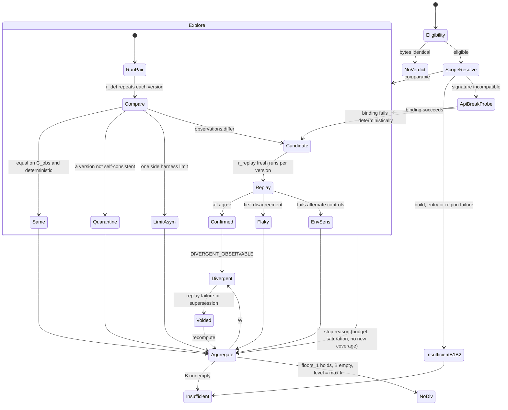

# SBG V7 P0: Verdict and Sufficiency Specification (single canonical definition)

Status: normative for all V7 documents. Authority: `P0_BINDING_DECISIONS.md` (D1-D11); where this file and that file disagree, that file wins. Other documents cite this file and never restate thresholds (D3).

Short names: MATH = `SBG_V7_MATHEMATICAL_SPECIFICATION.md`, CONTRACTS = `SBG_V7_MODULE_CONTRACTS.md`, SCHEMA = `SBG_V7_DATA_AND_EVIDENCE_SCHEMA.md`, EP = `SBG_V7_EXPERIMENTAL_PROTOCOL.md`, GATES = `SBG_V7_VALIDATION_AND_ACCEPTANCE_GATES.md`, ROADMAP = `SBG_V7_IMPLEMENTATION_ROADMAP.md`, RT = `P0_ARCHITECTURE_RED_TEAM_REPORT.md` (Q-numbers), MATRIX = `P0_CROSS_DOCUMENT_CONTRADICTION_MATRIX.md` (row IDs V-, S-, EV-, M-, B-, X-, K-, G-), ISO = `P0_EXECUTION_ISOLATION_VERIFICATION.md`, EVID = `P0_EVIDENCE_TAXONOMY_AND_SCHEMA_AUDIT.md`.

Marking convention used throughout:
- **[ORIG: file section]** value or rule preserved from an original document.
- **[UNVALIDATED]** a default that has no calibration yet; it may change only through the development split (D3), never on test data.
- **[INVENTED]** introduced in this reconciliation because the originals leave a hole; always also UNVALIDATED. Each is listed in section 14.

---

## 1. Scope and vocabulary

1.1 The unit of decision is a **pair** `p = (V1, V2)` of program versions, evaluated for a **scope** `s` (entry point) over an **explored input set** `X_n`, under a **harness declaration** `H` (section 2.5). A **verdict identity** is the tuple `(pair, scope, H, seed policy, decision policy version)`. Verdicts are only comparable under the same identity (MATH 3.5; MATRIX V-05; RT Q8 item 4). The adaptive explorer makes a verdict a function of the run, so FAR and Det are defined per pre-declared seed and reported across seeds (RT Q8 C8; D11).

1.2 There are exactly three verdict values (D1). No other value, label or rendering may be used as an outcome: `EQUIVALENT`, `SAME`, `PASS`, `VERIFIED`, `SAFE`, `implicit pass` are prohibited (MATRIX V-03).

| Value | One-line meaning |
|---|---|
| `DIVERGENT_OBSERVABLE` | At least one replay-confirmed witness: on one input, the two versions produced different observations on an observed channel, in runs shown deterministic. |
| `NO_DIVERGENCE_OBSERVED(S1\|S2\|S3)` | No confirmed witness, comparison valid, sufficiency at least S1. A statement about what was looked at, never about equivalence. |
| `INSUFFICIENT(reason_code)` | No confirmed witness, and the evidence cannot support a no-divergence statement. Carries one primary and zero or more secondary reason codes. |

1.3 Two things are not verdicts: (a) **ineligible pairs** (section 3.1: byte-identical sources, deps and runtime) receive no verdict and are excluded from all metrics as `ineligible:identical`; (b) the **`internal_divergence` annotation** (section 10).

1.4 `BOUNDED_EQUIVALENCE_PROVEN` is a separately named FORMAL CLAIM, not a verdict value (D1; section 11).

---

## 2. Observation boundary

### 2.1 Channels (what can make a verdict `DIVERGENT_OBSERVABLE`)

Only the **observed channels** `C_obs` can: **return value**, **exception** (type and message class), and **declared side effects**. Everything else is outside the boundary.

| Channel | Observed as | In `C_obs` by default | Source |
|---|---|---|---|
| `ret` | Terminal return value of the scope call, as a canonical typed value (2.2) | yes | MATH 5.5 `ob_ret`; D1 |
| `exc` | Outermost uncaught exception of the scope call: fully qualified type, normalised message (2.4) | yes | MATH 5.5 `ob_exc`; D1 |
| `side:stdout` | Bytes written to stdout by the call, after normaliser N | yes | MATH 5.5 `ob_side` |
| `side:file` | Final content of the private sandbox temp area: set of (relative path, content hash) | yes | MATH 5.5; CONTRACTS B.2 fs |
| `side:argmut` | Post-call canonical digest of each argument (in-place mutation) | yes | MATH 5.5 (arguments mutated in place) |
| `side:global` | Post-call digest of module globals written by the call | yes | MATH 5.5 (globals) |
| `side:stderr` | stderr bytes | **no** (tracebacks embed paths and line numbers that shift between versions) **[INVENTED default, UNVALIDATED]** | MATRIX V-05 |
| `resource` (performance, step counts, memory) | | **never** (performance-only change is not divergence; EP rubric; RT Q8 C6). Not a verdict channel. | MATRIX EV-09 |
| internal state, call sequence, branch sequence, data dependence | | **never** a verdict channel (D2); they feed only the advisory annotation (section 10) | D2 |
| logical time, wall time, `repeat_index`, run IDs, line numbers | | never compared | MATH 2.1; SCHEMA 3.4 |

Channels outside the harness's instrumented set for a scope cannot be claimed (CHANNEL_BLIND, MATH 5.5). If a declared channel is not instrumentable for this scope, the **comparison runs on the intersection of channels observed in both versions** and the scope is recorded as channel-restricted; if that intersection contains no non-degenerate channel the verdict is `INSUFFICIENT(unobservable_outcome)` (RT Q11 item 1; MATH 6.5).

### 2.2 Equality relation (type-aware)

Two observations on a channel are **equal** iff their canonical forms are identical after normaliser N. The canonical form is the `AbstractValue` of SCHEMA 2.6/3.1 (`{t: type_tag, d: canonical_digest, s?, size?, lossy}`); user-defined `__eq__`, `__hash__`, `__repr__` are never called (avoids side effects and repr artefacts).

| Rule | Decision |
|---|---|
| Type tag is part of identity | `1` vs `1.0`, `True` vs `1`, `"a"` vs `b"a"`, `[1]` vs `(1,)`, `list` vs `deque` are **different** observations. A change of result type is observable. |
| Integers, strings, bytes, None | exact |
| Floats | IEEE-754 binary64 bit pattern (SCHEMA 3.1); all NaNs equal each other; `-0.0` differs from `0.0`; see tolerance policy 2.3 |
| Sets, frozensets | unordered (sorted by element canonical hash) |
| Mappings | **key-order-insensitive by default**; harness may declare `ordered_mapping=true` **[INVENTED default, UNVALIDATED]**. Rationale: refactors reorder insertion; order sensitivity is an explicit, recorded option. |
| Sequences | order-sensitive |
| Objects | `{qualified class, digest of canonicalised __dict__/__slots__ to depth 3}` (SCHEMA 2.6); addresses, `id()`, default repr strings removed by N |
| Lossy observations (`lossy=true`: depth or size cut-off) | **differing** digests are a real difference (the retained part differs). **Equal** digests are weaker evidence: they are recorded as `equal_lossy` and count against instrumentation completeness (section 6, S2 floor). |
| Unserialisable value on a channel | channel is non-degenerate-blind for that input: input contributes `NO_RUN(unobservable_outcome)`, never "equal" |

Normaliser N is a declared, versioned artefact in `H`; it may remove only representation artefacts (addresses, ids, default reprs, masked timestamps from the virtualised clock) and nothing behavioural (assumption A5, MATH 9). A normaliser change is a new verdict identity.

### 2.3 Float tolerance policy

Default: **tolerance 0 (exact binary64)**. This is a convention, not a numeric threshold; no default tolerance value is proposed because the originals give none (MATH 3.2 `eps_f` "declared"; MATRIX EV-10) and inventing one would be arbitrary.

If a scope declares a tolerance `(rel, abs)` in `H`, then: (a) the comparison is made under that tolerance and the declaration is part of the verdict identity; (b) the exact-equality result is also recorded; (c) an input whose observations are unequal exactly but equal under the declared tolerance is recorded as `tolerance_masked` and is **not** a candidate witness; (d) a verdict issued under a non-zero tolerance must never be merged in metrics with exact-equality verdicts. Reordered float summation in a pure refactor therefore yields `DIVERGENT_OBSERVABLE` under the default and `NO_DIVERGENCE_OBSERVED` under a declared tolerance, and both are honest statements about different identities (MATRIX EV-10).

### 2.4 Exception equivalence classes

Two terminal exceptions are equivalent iff **all** of:
1. same fully qualified exception type (`module.QualName`); a subclass is a **different** type (no subclass coalescing);
2. same message after N (addresses, ids, absolute paths, object reprs stripped), unless `exc_message=ignore` is declared in `H`. Default is `exact_normalised` because D1 places "exception type/message class" inside the boundary. A message-only difference is `kind=exception_message`; under `exc_message=ignore` it is not a candidate (RT Q8 C7: the configuration is part of verdict identity, MATRIX V-05).

Not compared: traceback frames, raise sites, line numbers, `__cause__`/`__context__` chains, `__traceback__`.

Terminal outcome classes and how they compare (per input, per version):

| Class | Meaning | Comparable as witness evidence |
|---|---|---|
| `returned(v)` | normal return | yes |
| `raised(type,msg)` | uncaught exception (including `SystemExit(code)` caught inside the child; BaseException types reported by real type, not as timeout, ISO R8c) | yes |
| `exited(code)` | process called `os._exit`; exit code observed by the parent (ISO R8e) | yes, equal iff same code |
| `crashed(signal)` | fatal signal not sent by the harness (segfault, C-stack abort) | yes, only if reproduced in every replay |
| `limit(kind)` | harness-imposed `timeout`, `oom`, `killed_wall`, `killed_mem`, `truncated` | **never a witness** (depends on the harness limit, not on the program) |

If exactly one side is `limit(*)` and the other is not, the input is `LIMIT_ASYMMETRIC` and forces `INSUFFICIENT(resource_limit)` **[INVENTED reason code]** (section 4); if both sides are `limit(*)` the input is `NO_RUN(limit)` and contributes no comparison evidence. A genuine introduced non-termination is therefore reported as an abstention with the input listed, not as DIVERGENT (open issue O5).

### 2.5 Harness declaration (part of every verdict identity)

`H = (C_obs, N id, float tolerance, ordered_mapping, exc_message, capture tier policy, determinism control profile, repeat counts, replay count, sandbox policy id, S-level floors version)`. Stored as a `HarnessDeclaration` record referenced by every `Witness` and `Verdict` (MATRIX V-05, EV-10). A verdict that does not reference a declaration is invalid evidence.

### 2.6 Alignment relevance to the observation boundary

The observed channels are compared at the **harness boundary** (terminal observations), so `DIVERGENT_OBSERVABLE` does **not** depend on event-level alignment (MATH P2; RT Q10). Alignment matters in exactly three places, each handled in section 8: (i) scope/entry alignment (do both versions expose a comparable entry), (ii) changed-region static alignment (needed for activation, hence for any `NO_DIVERGENCE_OBSERVED`), (iii) event-level dynamic alignment (needed only for the witness locus and the internal annotation).

---

## 3. Pair-level evaluation: eligibility, per-input outcomes, aggregation

### 3.1 Eligibility (precondition, not a verdict)

E0: if `(src, deps, rt)` of V1 and V2 are byte-identical the pair is `ineligible:identical` and no verdict is issued (MATH 6.1; MATRIX S-03). GATES rows 0-2 therefore test "no spurious `DIVERGENT_OBSERVABLE`" on identical or normalisation-identical pairs, not "`NO_DIVERGENCE_OBSERVED` at S2". For a pair whose bytes differ but whose changed-region set is empty after normalisation (comment, whitespace, rename-only), see `r_empty` in 6.2.

### 3.2 Per-input outcome `o(x)`

Each input in `X_n` receives exactly one outcome after both versions have been run `r_det` times (6.1) and any candidate difference has been replayed (4.2):

| `o(x)` | Condition |
|---|---|
| `CONFIRMED_DIFF` | compared-channel observations differ between V1 and V2 and the replay protocol (4.2) confirmed it |
| `UNCONFIRMED_DIFF` | observations differ in the primary runs but replay did not reproduce (flaky) |
| `ENV_SENSITIVE_DIFF` | difference replays under the primary control setting but not under the alternate control settings (4.4) |
| `SAME` | observations equal on all of `C_obs`, both versions deterministic-confirmed on this input |
| `QUARANTINED` | a version is not deterministic-confirmed on a compared channel for this input (5.2) |
| `LIMIT_ASYMMETRIC` | exactly one version ended in `limit(*)` (2.4) |
| `NO_RUN(reason)` | no comparison evidence: build failure, unserialisable input/outcome, both sides `limit(*)`, sandbox/policy failure, tool error |

### 3.3 Aggregation (the precedence rule)

Let `W` = exists `x in X_n` with `o(x) = CONFIRMED_DIFF` (witness set non-empty and not voided). Let `B` = the set of **blocking conditions** B1..B9 of the table below (each computed from recorded fields; a missing field counts as the condition being true).

| Id | Blocking condition (no witness exists) | Primary reason code | Rank (primary choice) |
|---|---|---|---|
| B1 | either version fails to build, import or resolve its entry (`build_status != ok`) | `import_error` (also covers syntax errors) | 1 |
| B2 | scope or changed-region alignment failed or not handled (8.1, 8.2) | `alignment_failed` / `unsupported_signature` / `ambiguous_entry` / `unmodelled_change` | 2 |
| B3 | sandbox policy violated or isolation property not verified for a contributing run | `sandbox_failure` / `unsafe_program` | 3 |
| B4 | any `UNCONFIRMED_DIFF` or `ENV_SENSITIVE_DIFF` | `flaky_witness` / `env_sensitive` | 4 |
| B5 | any `QUARANTINED` input that hit (or may have hit) a changed unit | `nondeterministic` | 5 |
| B6 | any `LIMIT_ASYMMETRIC` input | `resource_limit` | 6 |
| B7 | capture incomplete on a contributing run: truncation, or blind spot intersecting a changed region | `capture_truncated` / `blind_spot_dominant` | 7 |
| B8 | `X_eff` (inputs with `o in {SAME}`) is empty | `no_inputs` / `unobservable_outcome` / `import_error` / `tool_error` | 8 |
| B9 | sufficiency level < S1, i.e. an S1 floor (6.2) fails | `changed_region_not_activated` / `budget_exhausted_s0` | 9 |

The verdict function, evaluated in this fixed order:

```
V(p):
  if ineligible(p):          return NO_VERDICT                       # 3.1, not a verdict
  if W:                      return DIVERGENT_OBSERVABLE             # guard G1
  if B != {}:                return INSUFFICIENT(primary=min-rank(B), secondary=B\primary)   # guard G2
  return NO_DIVERGENCE_OBSERVED(level = max{k in {1,2,3} : floors_k hold})                   # guard G3
```

**Proposition 1 (mutually exclusive and exhaustive over eligible pairs).** Let `G1 = W`, `G2 = not W and B`, `G3 = not W and not B`. (a) Exclusive: any two guards contain contradictory conjuncts (`W` vs `not W`; `B` vs `not B`). (b) Exhaustive: `G1 or G2 or G3 = W or (not W and (B or not B)) = true`. (c) Total: each of `W` and B1..B9 is a Boolean function of recorded fields with a pessimistic default for missing fields, so `V` is defined for every eligible evidence state and no state needs a fourth value. (d) The level in G3 is unique: floors are nested (`floors_3 implies floors_2 implies floors_1`, section 6) and `B9` guarantees `floors_1` holds in G3, so `max{k}` exists and is unique. (e) The precedence 1 > 2 > 3 of D1 is the order of the guards; the choice of *primary* reason inside G2 is the minimum rank in the table, a deterministic tie-break that does not affect the value. QED.

**Proposition 2 (stability).** `DIVERGENT_OBSERVABLE` is monotone in the explored set: if `W` holds for `X_n` and `X_n` is a subset of `X_n'` then `W` holds for `X_n'` (MATH 8.2). `INSUFFICIENT` and `NO_DIVERGENCE_OBSERVED` are not monotone: further exploration can turn either into `DIVERGENT_OBSERVABLE` (and can turn `NO_DIVERGENCE_OBSERVED` into `INSUFFICIENT` by revealing a flaky candidate). The only way a `DIVERGENT_OBSERVABLE` verdict is revoked is **invalid evidence**: a failed audit replay, an environment-drift finding, or a supersession of a record in the witness chain voids that witness (D1). The verdict is then recomputed from the remaining evidence; this is a data-correction event recorded as `Supersession`, not "more exploration".

**Proposition 3 (order independence within a seed).** For a fixed explored set the verdict is independent of the order in which inputs were explored, because `W`, `B` and the floors are set predicates over `X_n`. Order enters only through which inputs the explorer reached, which is why seed policy is part of the identity (1.1).

**Early stopping.** When `W` first holds the explorer may stop (time-to-first-witness is a measured quantity). Sufficiency is then not computed for the verdict (it is not scored for `DIVERGENT_OBSERVABLE`; RT Q8 C1). The `SufficiencyRecord` may be stored descriptively but never read by any metric for this verdict value.

---

## 4. Witness definition and replay-confirmation protocol

### 4.1 Witness

A **witness** is the record `w = (pair, scope, x, H, kinds, obs_old, obs_new, replay_set, locus?)` where:
- `x` is a single canonical input (content hash identity);
- `kinds` is the set of observed channels that differ, in priority order `outcome > exception > side_effect > api` (api is 8.3);
- `obs_old`, `obs_new` are the canonical terminal observations on `C_obs`;
- `replay_set` is the list of fresh-process replay runs (4.2) with their results;
- `locus` is the first-divergence position on the dynamic alignment; it is an **inferred** quantity and optional: `unlocalised` is a valid value (8.4) and its absence never changes the witness's validity.

A witness asserts only: "under `H`, on input `x`, V1 and V2 produced different observations on these channels, reproducibly." It does not assert that V2 is wrong, that the change was unintended, or which line is the cause (MATH 5.8). It never asserts that internal state differs.

### 4.2 Replay-confirmation protocol

A candidate arises when the primary runs of V1 and V2 on `x` (both run with `r_det` repeats, 6.1) produce unequal observations on `C_obs`.

1. **Determinism precondition.** Within the repeats, V1 is self-consistent on `C_obs` (all `r_det` repeats equal) and V2 is self-consistent on `C_obs`. If either is not, the input is `QUARANTINED`, not a candidate (5.2).
2. **Fresh replays.** Run `r_replay` additional **fresh** executions of each version on `x`: new child process per run (D10), same program hash, input hash, environment id, seeds, same capture tier. Replays are charged to the CPU-seconds budget (D7).
3. **Agreement criterion.** Confirmed iff in **all** `r_replay` replays of each version the `C_obs` observation equals that version's primary observation (self-consistency in replay), and the V1 and V2 observations still differ. Agreement is on outcome and observations, **not** on whole-trace hash: whole-chain agreement is reported separately and may fail for outcome-stable, trace-unstable programs without invalidating the witness (MATRIX EV-03).
4. **Early exit.** The first disagreeing replay ends the protocol: `UNCONFIRMED_DIFF`.
5. **Environment-drift guard.** If the replay interpreter `build_id` or tracer version differs from the primary, the replay is `inconclusive`, not `disagree`, and is repeated in a matching environment (SCHEMA 7).
6. **Result.** Confirmed: `o(x) = CONFIRMED_DIFF`, a `ReplayCheck` is stored per replay run, a `Witness` is created. The witness is immutable; it can only be voided by supersession (Proposition 2).

| Parameter | Value | Status |
|---|---|---|
| `r_replay` fresh replays per version | **5** (all must agree: "5/5") | [ORIG: EP section 9; GATES row 11] [UNVALIDATED] ROADMAP P3 uses 3: EP wins (MATRIX M-06) |
| Witness validity target (evaluation, not definition) | WVR >= 0.99, lower 95% >= 0.97, NO-GO below 0.95 | [ORIG: GATES section C.1] [UNVALIDATED] |

### 4.3 Witness minimisation (optional)

Delta-debugging an input while keeping the same `kinds` class is permitted (CONTRACTS H) but the minimised input must itself pass 4.2 before it replaces `x`; otherwise the original `x` stands.

### 4.4 Control-sensitive witnesses

Fixed-seed control makes a pure refactor look deterministic even when the number or order of RNG draws, clock reads or set insertions changed (RT Q9 item 1). If the primary runs of either version, or the changed region or its callees, consult a virtualised source (any `external_call(virtualised=true)` event for RNG, clock, `os.urandom`, `uuid` in the compared call), the candidate is **control-sensitive** and confirmation additionally requires the same difference to reproduce under `k_alt` alternate control settings (different random seed, hash seed, clock origin and tick) on both versions, with each version's own observation invariant across the settings. Failing this the input is `ENV_SENSITIVE_DIFF` and the pair is `INSUFFICIENT(env_sensitive)`.

| Parameter | Value | Status |
|---|---|---|
| `k_alt` alternate control settings | 3 | [ORIG: RT Q9 resolution 1 (proposal, not adopted by any design doc)] [UNVALIDATED] |

---

## 5. Nondeterminism handling

### 5.1 What "deterministic-confirmed" means

A (version, input) is **deterministic-confirmed** iff `r_det` repeats, each in a fresh child process under the declared determinism controls (CONTRACTS B.3, Python hash seed fixed, seeded RNG, virtual clock, single thread, native BLAS/OpenMP threads pinned; RT Q9 item 3), produce equal observations on `C_obs`. Trace-level instability with outcome stability (`outcome_stable_trace_unstable`) is permitted at S1 and S2 but recorded and forbidden at S3 (6.4).

| Parameter | Value | Status |
|---|---|---|
| `r_det` determinism repeats | 3 (stop early at first disagreement) | [ORIG: EP section 9 ">= 3 repeats"; MATRIX M-06 recommended resolution; CONTRACTS B said 2, ROADMAP said 5] [UNVALIDATED] |

### 5.2 Confirmed divergence versus flaky versus quarantined

| Situation | Classification | Effect on pair |
|---|---|---|
| Both versions deterministic-confirmed on `x`, observations differ, 4.2 passes | **confirmed divergence** | `W` true: `DIVERGENT_OBSERVABLE` |
| Both deterministic-confirmed on `x`, observations differ, replay disagrees | **flaky** (`UNCONFIRMED_DIFF`) | B4: `INSUFFICIENT(flaky_witness)` unless some other input gives `W` |
| Difference replays only under primary control setting | **control-sensitive** (`ENV_SENSITIVE_DIFF`) | B4: `INSUFFICIENT(env_sensitive)` |
| A version is not self-consistent on a compared channel for `x` (even before comparison) | **quarantined** (`QUARANTINED`) | `x` contributes no evidence either way. If it hit or may have hit a changed unit: B5 `INSUFFICIENT(nondeterministic)`. If it did not hit any changed unit it is only counted and reported. |

Rationale for B5: a nondeterministic input that exercises changed code is exactly an input about which the pair has no usable evidence; dropping it silently would let the explorer launder `NO_DIVERGENCE_OBSERVED`. Activation unknown (trace unstable so coverage unknown) is treated as "may have hit" (pessimistic). This rule is conservative and its cost is measured at K2 (determinism-confirmed rate; D9); open issue O3.

5.3 A pair is never `DIVERGENT_OBSERVABLE` on the strength of a difference that appears in only some replays. A V1-vs-V1 or V2-vs-V2 disagreement on `C_obs` on the same input is never a witness for anything (MATH 5.8 self-consistency).

5.4 Distributional regressions (V2 returns a different value with probability p) are **unrepresentable** and out of scope (section 13, case E).

---

## 6. Sufficiency S0-S3

### 6.1 Definition principle (D3)

Sufficiency is a **conjunction of floors on separately reported factors**, never a scalar and never the plateau criterion alone. Factors:

| Factor | Symbol | What it measures |
|---|---|---|
| Determinism-confirmed | F1 | share and quality of contributing inputs that are deterministic-confirmed (section 5) |
| Instrumentation completeness | F2 | what the runs could have shown: tier achieved, truncation, blind spots, lossy channels, channel coverage |
| Changed-region activation | F3 | whether and how thoroughly the changed code ran in each version |
| Input-diversity and budget | F4 | how the input set was obtained and how exploration ended |

Levels are nested: `floors_3 implies floors_2 implies floors_1`. `S0` is the **label for "S1 floors not met"**; it is never emitted with `NO_DIVERGENCE_OBSERVED`, only inside an `INSUFFICIENT` record (MATRIX S-02). S-levels are an **empirically calibrated ordinal**, not a probability or a guarantee (CONTRACTS section 15 item 5); the scalar `S = gamma * act^w1 ...` of MATH 6.7 is **not used**; the vector of factors is reported alongside the level (MATH 6.7 last sentence, kept).

Each `NO_DIVERGENCE_OBSERVED(Sk)` record stores: the factor vector, the stop reason, `r_det`, the run-set root (a Merkle root over contributing run IDs plus per-input rows; MATRIX EV-11), `X_eff` size, quarantined count, and the list of unhit changed units.

### 6.2 Shared definitions

- **Changed region R**: set of changed code units (basic blocks, plus pseudo-units for changed dependencies/config where modelled) from C's diff and static matching, covering V1-only and V2-only units; weights default 1 (MATH 6.1).
- **Activation of a unit** `b`: `hit(b)` is true iff a deterministic-confirmed input in `X_eff` executed `b` **in the version that contains it** (a deleted unit can only be hit in V1, an inserted unit only in V2, a modified unit in both). This corrects EP section 1's "on both versions" for one-sided units (MATH 6.2).
- **Pessimistic denominators**: a changed unit that cannot be instrumented counts as unhit; R is never shrunk to the instrumented subset (RT Q11 item 2).
- **Branch/direction coverage** of changed regions: fraction of (changed branch, direction) pairs hit, with denominator the statically reachable directions, computed per version (SCHEMA 2.15 `both_directions_fraction`; EP section 1).
- **`r_empty`**: R empty but bytes differ (rename, comment, whitespace after normalisation). Activation is vacuous: `act_floor` is satisfied by convention and the record carries `r_empty = true`; the level is then limited by the other factors, and the record must not be read as strength **[INVENTED; open issue O2]**. The alternative (treat as ineligible) is recorded as the option to adopt if the development split shows `r_empty` pairs dominate false assurance.

### 6.3 Level tables

**S0 (not a NO_DIVERGENCE level).** Assigned whenever any S1 floor fails. Always accompanies an `INSUFFICIENT` verdict (or a degenerate record for run-less INSUFFICIENT, `level=S0`, zero counts; MATRIX EV-12).

**S1.**

| Aspect | Requirement |
|---|---|
| Required observations | At least one input `x` with `o(x)=SAME` that executed on both versions, deterministic-confirmed, valid for both versions (signature-compatible), with a non-degenerate compared channel |
| Coverage (F3) | **Every** changed unit hit at least once (in the version containing it) by a deterministic-confirmed input [ORIG: EP section 1 S1; ROADMAP section 2 S1] |
| Reproducibility (F1) | `r_det` repeats completed for every contributing input; no quarantined input that may have hit a changed unit |
| Instrumentation completeness (F2) | Tier at least L1 **including the changed-region coverage bitmap** (MATRIX EV-07); no truncation on contributing runs; no blind spot (native call, C extension, subprocess, eval/exec, threads) intersecting a changed unit; harness integrity checks passed (tamper flag clear) |
| Input diversity / budget (F4) | none beyond the single comparable input; provenance mix is reported but not floored because no original document justifies a number (MATRIX S-01) |
| Permitted conclusions | "On `n` explored deterministic inputs, using channels `C_obs` under `H`, every changed unit ran at least once in each version that contains it, and no observable difference was found." |
| Prohibited conclusions | equivalence; "no bug"; "safe to merge"; any probability or confidence of equivalence; any statement about unexecuted inputs, input classes or rare guards (MATH Theorem 2); any statement about internal state |
| Forced INSUFFICIENT | any unit unhit; no usable input; truncation or blind spot in a changed unit; quarantined activating input; unconfirmed/flaky candidate; entry/changed-region alignment failure; sandbox/tool failure; channel-blind scope |

**S2** = S1 **and**:

| Aspect | Requirement |
|---|---|
| Coverage (F3) | Branch/direction coverage of changed regions **>= 0.80** of statically reachable directions, in each version containing them [ORIG: EP section 1 S2, "80% of the statically reachable branches"; SCHEMA 2.15 "both branch directions where applicable" supplies the measured quantity] [UNVALIDATED]. The "state coverage" half of EP's S2 is dropped because the state-abstraction module is optional (D5); S2 uses branch/direction coverage only. |
| Reproducibility (F1) | every contributing input deterministic-confirmed on the compared channels (trace-unstable with outcome-stable is allowed) |
| Instrumentation completeness (F2) | **all declared observed channels instrumented** [ORIG: EP section 1 S2] and no `equal_lossy` comparison on `ret`/`side` channels for any contributing input (2.2) |
| Input diversity / budget (F4) | stop reason recorded (budget, saturation, all-changed-branches-both-ways, domain-exhausted); no extra floor (as S1) |
| Permitted | S1 statements plus: "at least 80% of reachable branch directions in the changed region were exercised in each version" |
| Prohibited | all S1 prohibitions; "branches not exercised behave the same"; reading S2 as a lower bound on divergence-absence probability |
| Forced INSUFFICIENT | everything forcing it at S1; additionally nothing new (failing a S2 floor yields `NO_DIVERGENCE_OBSERVED(S1)`, not `INSUFFICIENT`) |

**S3** = S2 **and**:

| Aspect | Requirement |
|---|---|
| Coverage (F3) | **plateau**: no new changed-region branch/direction coverage in the last 25% of the budget [ORIG: EP section 1 S3; window UNVALIDATED]; the "or new state class" clause of EP is dropped (state module optional) |
| Reproducibility (F1) | every contributing input `deterministic` (not trace-unstable); zero quarantined inputs |
| Instrumentation completeness (F2) | L2 capture of the changed regions on every contributing run; no blind spot of any kind in code reached from the changed region |
| Input diversity / budget (F4) | **corroboration** by a second, differently configured explorer (for example undirected random or replay plus structure-aware only) run within the same total budget that also reaches the plateau with no changed-region direction the first explorer missed **[INVENTED, UNVALIDATED; open issue O4]**. Reason: D3 forbids letting the plateau alone confer S3 because it rewards weak explorers (RT Q4); the corroboration check is the least-new mechanism that makes a weak explorer fail S3. |
| Formal tier | agreement of an optional formal tier is **not** required (MATRIX S-04); a formal result is a separate annotation |
| Permitted | S2 statements plus: "exploration plateaued and an independent explorer found no further changed-region coverage" |
| Prohibited | all S2 prohibitions; "converged"; "behaviourally equivalent"; "no more bugs". S3 is **not** a closer approximation of equivalence; Theorem 2 (MATH 8.4) shows `S3` is compatible with divergent versions |
| Forced INSUFFICIENT | as S1/S2; failing S3 floors yields `NO_DIVERGENCE_OBSERVED(S2)` |

6.4 **Scoring of sufficiency.** `NO_DIVERGENCE_OBSERVED(Sk)` is scored (FAR per level, calibration caps) only for `NO_DIVERGENCE_OBSERVED`; sufficiency is not scored for `DIVERGENT_OBSERVABLE` or `INSUFFICIENT`.

6.5 **Calibration claims (pre-registered, not definitional).** Miss-rate caps `S1 <= 0.35`, `S2 <= 0.20`, `S3 <= 0.10`; ECE `<= 0.05` [ORIG: EP H6, GATES G4] [UNVALIDATED; RT Q13(c) shows they are not estimable at planned sizes, so they remain claims to be tested, never gates that define a level]. Calibration of the ordinal should additionally use planted-fault recall (RT Q4 item 4) on the development split.

---

## 7. Evidence requirements per verdict (D4 classes)

Evidence classes: observation, derived, inferred, proof (primary); missing, invalid, uncertain (status qualifiers) [EVID section 2].

| Verdict | Class of the claim | Required evidence chain (every ID must resolve; validator rules T1-T7, SCHEMA 8, amended) |
|---|---|---|
| `DIVERGENT_OBSERVABLE` | derived-on-observation (the difference) with an inferred locus | `Verdict -> Witness -> {primary run V1, primary run V2, r_det repeats each, 2*r_replay replay runs + ReplayCheck each, HarnessDeclaration, ProgramVersion x2, Input, ExecutionEnvironment, SandboxPolicy}`. Control-sensitive: plus `k_alt` alternate-setting runs. Locus, if present: `SemanticCorrespondence` id and its trust at the locus. |
| `NO_DIVERGENCE_OBSERVED(Sk)` | derived, status `uncertain` | `Verdict -> SufficiencyRecord -> {run-set root and per-input rows, Reproducibility records, InstrumentationCompleteness records, ChangedRegions, ExplorationLog (stop reason, seed), HarnessDeclaration}`. The run set is a Merkle root so T1 can check membership at ROADMAP scale (MATRIX EV-11). |
| `INSUFFICIENT(code)` | status `missing` or `invalid` | `Verdict -> {the record(s) that triggered each blocking condition}` such as `ProgramVersion.build_status`, `ReplayCheck` disagreement, `Reproducibility`, `InstrumentationCompleteness`, `SandboxPolicy` violation record. A degenerate `SufficiencyRecord` (`level=S0`, zero counts) is allowed for run-less cases (MATRIX EV-12). |

Common rules: the verdict stores the `HarnessDeclaration` id, decision policy id and thresholds hash (thresholds frozen before evaluation); no label-namespace record is reachable from the chain (T6); all runs share Input and environment modulo `allowed_env_diff` (T7); a superseded record in the chain flags the verdict (T5); recomputing section 3.3 from the chain reproduces `value` and primary reason (T4).

---

## 8. Alignment failure and signature-change handling

### 8.1 Scope (entry) alignment and signature handling

The entry symbol must be resolved in both versions (C emits `SignatureSketch`). Decision procedure, applied before exploration:

| Case | Handling |
|---|---|
| Entry exists in both; signatures compatible (same arity and parameter names, or added parameters with defaults, or a declared renaming) | comparable; proceed |
| Entry exists in both; signature **incompatible** (added required parameter, removed parameter, renamed without declaration) | **handled as an API-break test, not as an abstention** [INVENTED reconciliation of RT Q8 resolution 3 with D1's "signature/entry mismatch not handled"; open issue O1]: take inputs valid for the version that accepts them (inputs are generated from each side's signature), call the other version with that input. If the call fails at **argument binding** (call-boundary `TypeError` raised before the body executes, detected via `inspect.signature.bind`) deterministically, it is a candidate with `kind=api`, confirmed by the standard replay (4.2), and the pair is `DIVERGENT_OBSERVABLE`. If binding succeeds, comparison proceeds normally. |
| Entry exists in both but the generator cannot build a valid input for the signature (types outside the input vocabulary) | `INSUFFICIENT(unsupported_signature)` emitted by C/A; never invent a default input (CONTRACTS A) |
| Entry symbol missing in one version | scope lifting: retry at the outermost frame whose symbol exists in both; the lifted scope is recorded in the verdict identity (RT Q10 item 2). If none exists: `INSUFFICIENT(unsupported_signature)` with `detail=entry_missing` |
| Multiple candidate entries | `INSUFFICIENT(ambiguous_entry)` |

The API-break witness counts as an observable divergence ("calls valid before are rejected after"), not as a defect claim (MATH L1). Measurement note: signature-changing fixes are no longer excluded from the comparable set, which removes the selection effect of RT Q8 C5.

### 8.2 Changed-region (static) alignment failure

Activation and every `NO_DIVERGENCE_OBSERVED` depend on a changed-region set R produced by C's static matching. If parsing fails, matching confidence is below the pre-registered threshold, or the change is outside Python AST visibility (C extension sources, data files, config, dependency versions) the pair is `INSUFFICIENT` with `alignment_failed` (matching failure) or `unmodelled_change` (non-AST change; never silently "unchanged", RT Q6, Q11 item 3) **[unmodelled_change: INVENTED code from RT Q6]**. This does not apply to `DIVERGENT_OBSERVABLE`, which needs no R.

| Parameter | Value | Status |
|---|---|---|
| Static matching trust threshold | pre-registered on the refactor corpus; the existing indicator is node-level F1 < 0.90 | [ORIG: ROADMAP risk R14 and G2 indicator; RT Q10 resolution 1] [UNVALIDATED] |
| Witness-outside-R rate diagnostic | if > 5% of witnesses lie outside R or its static dependents on development data, activation floors are untrustworthy | [ORIG: RT Q6 resolution; diagnostic, not a gate] [UNVALIDATED] |

### 8.3 Event-level (dynamic) alignment failure

Event alignment is used only for the witness locus and the internal annotation. If dynamic alignment trust at the divergence site is below the trust threshold, or alignment ambiguity `amb > 0` for the locus: the witness stays valid, `locus = unlocalised`, and `internal_divergence = unknown` (section 10). Event-level alignment failure therefore **never changes the verdict value** and never creates a `DIVERGENT_OBSERVABLE` (RT Q8 C4: an extract-function refactor produces no false divergence because internal events are not a verdict channel).

8.4 Alignment anchors are restricted to call context and external events outside R and may not use the payload of the compared channels (MATRIX EV-06; MATH 5.2), so that alignment does not bias toward agreement.

---

## 9. Reason-code enumeration for INSUFFICIENT

Closed enum; extension by minor version only (SCHEMA 5: an unknown code downgrades dependent decisions to INSUFFICIENT). **Emits** = the module that detects the condition and writes the triggering record; **I** applies the policy and is the only writer of the `Verdict`.

| Code | Blocking condition | Emits | Origin / mapping from other vocabularies |
|---|---|---|---|
| `import_error` | B1 | B (build/import), C (parse) | SCHEMA `import_error`; MATH `IMPORT_FAILURE`; EP `IMPORT`. Covers syntax errors. |
| `unsupported_signature` | B2: input not generable, entry missing | C, A | SCHEMA; MATH `UNSUPPORTED_SIGNATURE`; EP `UNDRIVABLE` |
| `ambiguous_entry` | B2 | C | SCHEMA |
| `alignment_failed` | B2: static changed-region matching failed | C (static), G (event level, annotation only) | SCHEMA; MATRIX V-06 |
| `unmodelled_change` | B2: change outside AST visibility | C | RT Q6 [INVENTED] |
| `sandbox_failure` | B3: isolation property violated or unverified | B | MATH `SANDBOX_FAILURE`; ROADMAP "sandbox kill" |
| `unsafe_program` | B3: policy violation (network, fs write outside tmp, subprocess) | B | SCHEMA |
| `flaky_witness` | B4: unconfirmed candidate | H (replay), B | MATH `FLAKY_DIVERGENCE`; EP `FLAKY_WITNESS`; GATES `FLAKY` |
| `env_sensitive` | B4: control-sensitive candidate | H | RT Q9 [INVENTED] |
| `nondeterministic` | B5 | B | SCHEMA; MATH `NONDETERMINISTIC`; EP `NONDET` |
| `resource_limit` | B6: one side hit a harness limit | B | [INVENTED]; derived from SCHEMA run statuses `timeout`/`oom`; EP `TIMEOUT` |
| `capture_truncated` | B7 | B | SCHEMA |
| `blind_spot_dominant` | B7 | B (audit hooks) | SCHEMA; EP `PARTIAL_INSTRUMENTATION` |
| `no_inputs` | B8 | A | SCHEMA; MATH `NO_INPUTS` |
| `unobservable_outcome` | B8: no non-degenerate compared channel | B, I | SCHEMA; MATH `CHANNEL_BLIND`; EP `UNOBSERVED_CHANNEL` |
| `changed_region_not_activated` | B9: an activation floor fails | I (from B/D coverage) | SCHEMA; MATH `NOT_ACTIVATED`; EP/GATES `NOT_ACTIVATED` |
| `budget_exhausted_s0` | B9: budget ended before the S1 floors | A (stop reason), I | SCHEMA; MATH `BUDGET_EXHAUSTED` |
| `tool_error` | any: internal failure of a V7 module (never blamed on the program) | any module | EP `TOOL_ERROR` |

Dropped: MATH `LOW_STATE_COVERAGE` (a failing S2 floor yields `NO_DIVERGENCE_OBSERVED(S1)`, not an abstention); `internal_only_difference` (internal-only difference is not a verdict, D2). Observed-same codes (`observed_same_at_Sx`) are renamed `no_divergence_at_Sx` and carry the level (MATRIX V-03). `activation_status` (activated / not_activated / unknown) is kept as a derived field of `SufficiencyRecord` so the retained V6 taxonomy (FINAL section 3, MATRIX R-10) has a home (MATRIX V-07).

---

## 10. The advisory `internal_divergence` annotation (not a verdict)

| Property | Definition |
|---|---|
| Field | `internal_divergence in {none, observed, unknown}` on a `NO_DIVERGENCE_OBSERVED` or `INSUFFICIENT` verdict (D2) |
| Produced by | the optional state-abstraction module E only. If E is disabled, **the field is absent** (not `none`, not `unknown`). |
| `observed` | on at least one input where `o(x) = SAME` on `C_obs`, the aligned internal views (call, branch, abstracted state) differ under the declared abstraction, with alignment trust at the locus at or above the threshold (8.2) |
| `none` | E enabled, trust adequate, and no internal difference observed on any `SAME` input |
| `unknown` | E enabled but alignment trust below threshold, capture below the tier required by E, or asymmetric instrumentation at the site (old pure-Python loop vs new C call; RT Q11 item 3) |
| On `DIVERGENT_OBSERVABLE` | **not attached**; the witness carries `kinds` and `locus` instead |
| Effect on verdict value, S-level, reason code, thresholds, scoring (H4, H5), floors | **none**. Annotated verdicts are scored by `value` only. |
| Hypotheses depending on it | none (D2): H7/H8 are not confirmatory. Use is confined to the exploratory pilot on authored-by-construction mutants with an independent reference state-dump tool, truth from the independent interface oracle (D2, D6). |
| Evidence class | derived, status `uncertain` |

---

## 11. Formal claim `BOUNDED_EQUIVALENCE_PROVEN`

Not a verdict. Emitted only by the optional formal tier (bounded symbolic, regression verification) or by exhaustive evaluation of a finite declared domain `D` (MATH Theorem 3 premises G1-G4: all of `D` run with no truncation, faithful harness, identical environment, channels observed, verdict `NO_DIVERGENCE_OBSERVED`). Stored as `FormalResult` with `method` including `exhaustive_domain`, the domain `D` and the bound recorded (MATRIX V-04). It is the only place the word "equivalent" may appear, always with its domain, never alters the `Verdict.value`, and is never required for any S-level (MATRIX S-04).

---

## 12. Decision table and state machine

### 12.1 Decision table (evaluate top to bottom; first match wins)

| # | Condition | Result |
|---|---|---|
| 0 | bytes of src, deps, runtime identical | no verdict (`ineligible:identical`) |
| 1 | exists input with `o(x)=CONFIRMED_DIFF` (and not voided) | `DIVERGENT_OBSERVABLE` |
| 2 | B1 | `INSUFFICIENT(import_error)` |
| 3 | B2 | `INSUFFICIENT(alignment_failed / unsupported_signature / ambiguous_entry / unmodelled_change)` |
| 4 | B3 | `INSUFFICIENT(sandbox_failure / unsafe_program)` |
| 5 | B4 | `INSUFFICIENT(flaky_witness / env_sensitive)` |
| 6 | B5 | `INSUFFICIENT(nondeterministic)` |
| 7 | B6 | `INSUFFICIENT(resource_limit)` |
| 8 | B7 | `INSUFFICIENT(capture_truncated / blind_spot_dominant)` |
| 9 | B8 | `INSUFFICIENT(no_inputs / unobservable_outcome / tool_error)` |
| 10 | B9 | `INSUFFICIENT(changed_region_not_activated / budget_exhausted_s0)` |
| 11 | none of the above, floors_3 holds | `NO_DIVERGENCE_OBSERVED(S3)` |
| 12 | none of the above, floors_2 holds, floors_3 not | `NO_DIVERGENCE_OBSERVED(S2)` |
| 13 | none of the above, floors_1 holds only | `NO_DIVERGENCE_OBSERVED(S1)` |

Rows 2-10 record all conditions that hold as secondary codes; the primary is the first row that matches.

### 12.2 State machine



---

## 13. Worked examples

Running scenario: `bucket_index(xs, k)`; V2 changes a loop bound `<` to `<=` (SCHEMA 9). Harness `H`: default `C_obs`, exact floats, `r_det=3`, `r_replay=5`.

**A. `DIVERGENT_OBSERVABLE`.** Input `x=([1,2,3],3)`. V1 returns `2`, V2 raises `IndexError("list index out of range")`. Three repeats each: V1 returns `2` three times, V2 raises the same exception three times (deterministic-confirmed, self-consistent). Observations differ (`outcome` class: returned vs raised). Five fresh-process replays per version all reproduce their primary observation. `o(x)=CONFIRMED_DIFF`, so `W` is true and the verdict is `DIVERGENT_OBSERVABLE`, `kinds={outcome}`. Whether the locus is localised depends on dynamic alignment; if unlocalised the verdict is unchanged. Sufficiency is not computed. Claim permitted: "on this input the versions differ observably". Not claimed: that V2 is wrong.

**B. `NO_DIVERGENCE_OBSERVED(S2)`.** Variant in which V2 only rewrites `i += 1` as `i = i + 1` and the condition `xs[i] < k` as `k > xs[i]` (changed region R: 2 changed blocks, 1 changed branch with two directions). 214 inputs (replay seeds plus generated lists) are run on both versions; every input is deterministic-confirmed and observations are equal on `C_obs`. Every changed unit is hit in both versions (S1 floors hold); both directions of the changed branch are hit (coverage 1.0 >= 0.80), all declared channels are instrumented, nothing is truncated, no `equal_lossy` comparison (S2 floors hold). Plateau and second-explorer corroboration were not demonstrated, so the verdict is `NO_DIVERGENCE_OBSERVED(S2)`. Permitted: "on 214 explored deterministic inputs no observable difference was found and the changed code ran in both versions". Prohibited: "equivalent". (Had V2 also hidden a rare guard such as `k == 123456789` whose block no input reached, the unit would be unhit and the verdict `INSUFFICIENT(changed_region_not_activated)`; had the guard's block been reached by a replay seed, the difference would have been found. A guard that sits inside an already-hit block cannot be seen by any floor: MATH Theorem 2.)

**C. `INSUFFICIENT(changed_region_not_activated)`.** The changed block sits behind `if len(xs) > 1000:`; the explorer's 300 inputs all have `len <= 50`. No candidate difference, all inputs `SAME`, but the changed unit is unhit, so B9 holds and the primary reason is `changed_region_not_activated`; the unhit unit is listed as actionable evidence. `NO_DIVERGENCE_OBSERVED` is forbidden even though every comparison was equal.

**D. Counter-example 1: internal difference on `x1`, observable on `x2`.** Scope has an inserted helper that changes intermediate values on `x1` (outputs equal) and a rare-branch return change on `x2`. Per-input: `o(x1)=SAME` (internal difference exists only in the annotation channel), `o(x2)=CONFIRMED_DIFF`. `W` is true: `DIVERGENT_OBSERVABLE`. The internal difference on `x1` is not a verdict, not attached to this verdict, and exploration order is irrelevant (Proposition 3); the only order effect is whether the explorer reached `x2` (seed policy). If the explorer never reaches `x2`: `NO_DIVERGENCE_OBSERVED(Sk)` with `internal_divergence=observed` if E is enabled and trust is adequate, which is an annotation, scored as `NO_DIVERGENCE_OBSERVED` (a miss if truth is divergent). This resolves RT Q8 C2.

**E. Counter-example 2: nondeterministic divergence.** V1 always returns 0; V2 returns 1 with probability 0.9 under uncontrolled randomness the harness cannot virtualise (native source). Repeats of V2 disagree on `C_obs` with positive probability: V2 not self-consistent, so `x` is `QUARANTINED`. If `x` hit the changed unit, B5 holds: `INSUFFICIENT(nondeterministic)`. If instead one run happened to show 1 vs 0 and the five replays disagree: `UNCONFIRMED_DIFF`, `INSUFFICIENT(flaky_witness)`. The verdict never becomes `DIVERGENT_OBSERVABLE` as a function of replay luck (RT Q8 C3: `0.9^5=0.59` would be a coin flip). If the source is virtualised (seeded RNG) and V2 is deterministic under the seed, the pair is `DIVERGENT_OBSERVABLE` only if the difference also survives the `k_alt=3` alternate-setting replays; if it appears only under the primary seed it is `ENV_SENSITIVE_DIFF`: `INSUFFICIENT(env_sensitive)` (a refactor that changes the number of RNG draws is not reported as a regression).

**F. Counter-example 3: failed alignment.** An extract-function refactor: V2 inserts a call/return pair with no counterpart. `C_obs` terminal observations are equal on every input. Event-level alignment trust at the inserted call is below threshold. Result: `NO_DIVERGENCE_OBSERVED(Sk)` by sufficiency, with `internal_divergence=unknown` (not `observed`), never a false `DIVERGENT_OBSERVABLE` (RT Q8 C4). If instead the static matcher cannot map the changed functions (confidence below threshold, node-level F1 indicator), R is unreliable: `INSUFFICIENT(alignment_failed)`. If observable outputs had differed anywhere, the verdict is `DIVERGENT_OBSERVABLE` regardless of alignment.

**G. Counter-example 4: signature-changing fix.** The fix adds a required parameter `mode`. Inputs valid for V1 (`bucket_index(xs, k)`) are called on V2: binding raises `TypeError` before the body executes, in all `r_det` repeats and all five replays. `kind=api`, confirmed, so `DIVERGENT_OBSERVABLE`. (Under the original MATH 1.2 this was `INSUFFICIENT(UNSUPPORTED_SIGNATURE)` and counted as a miss on a truth-divergent pair: RT Q8 C5.) If the added parameter has a default, binding succeeds and normal comparison proceeds. If the generator cannot produce valid values for the new parameter's type: `INSUFFICIENT(unsupported_signature)`.

**H. Counter-example 5: distributional regression.** V2 changes a sampling routine so that a failure occurs with probability 0.3 instead of 0.01. This is **unrepresentable and out of scope** for V7 verdicts: a single input has no deterministic observation to compare; replay-confirmation requires all replays to agree, so it cannot confirm a probabilistic difference; and a two-sample test over repeated seeds is a different claim class (RT Q8 resolution 5 offered an optional `DIVERGENT_DISTRIBUTIONAL` path; it is **not adopted**, D1). Such pairs are reported as `INSUFFICIENT(nondeterministic)` (or `env_sensitive`) and counted in the abstention report; no sufficiency level, no `NO_DIVERGENCE_OBSERVED`, and no divergence claim is possible. Documentation in every report must state this limit.

**I. Control: tolerance.** Pure refactor reorders a float sum, result differs in the last bit on `x`. Default exact equality: candidate, confirmed: `DIVERGENT_OBSERVABLE` under the default identity. Under a declared tolerance the input is `tolerance_masked`, `SAME`; the two verdicts have different identities and must not be pooled (2.3).

---

## 14. Registry of numeric thresholds and defaults (all UNVALIDATED)

| # | Quantity | Value | Status | Source / justification |
|---|---|---|---|---|
| 1 | `r_det` determinism repeats | 3, early stop at first disagreement | ORIG proposal | EP section 9; MATRIX M-06 (CONTRACTS 2 and ROADMAP 5 rejected) |
| 2 | `r_replay` fresh replays per version | 5 of 5 | ORIG | EP section 9, GATES row 11 |
| 3 | `k_alt` alternate control settings (control-sensitive witnesses) | 3 | ORIG proposal (RT, not in any design doc) | RT Q9 |
| 4 | S2 branch/direction coverage floor | 0.80 of statically reachable directions | ORIG | EP section 1 |
| 5 | S3 plateau window | no new changed-region coverage in last 25% of budget | ORIG | EP section 1 |
| 6 | S3 corroboration by second explorer | 1 additional differently configured explorer, same total budget | **INVENTED** | closes RT Q4 perversity within D3; may be dropped (O4) |
| 7 | S1 floor: all changed units hit once | 100% of changed units (version-aware) | ORIG | EP section 1; MATH 6.2 |
| 8 | Float tolerance | 0 (exact); no default non-zero value | convention, not a threshold | MATH 3.2 gives none |
| 9 | stderr excluded; mapping order-insensitive | defaults | INVENTED conventions | MATRIX V-05, EV-10 |
| 10 | Static matching trust (alignment) | node-level F1 < 0.90 triggers degrade | ORIG indicator | ROADMAP R14/G2 |
| 11 | Witness-outside-R diagnostic | > 5% invalidates activation floors | ORIG proposal | RT Q6 |
| 12 | Calibration caps | S1 0.35, S2 0.20, S3 0.10; ECE 0.05 | ORIG claims | EP H6, GATES G4 (not estimable at planned sizes: RT Q13(c)) |
| 13 | CPU-second budget grid | 10 / 60 / 300 s | ORIG | EP section 7 (D7); default per-pair cap fixed from P1 measurement (MATRIX B-02), not stated here |
| 14 | Per-run limits, event caps, tracing overhead | not restated here | open | MATRIX M-07, M-07b; fixed in `SandboxPolicy` at P1 and cited |
| 15 | WVR target | >= 0.99, lower 95% >= 0.97, NO-GO < 0.95 | ORIG evaluation target | GATES section C.1 |

No other numeric thresholds are defined by this document. Any other document that needs one must cite a row above or add one here.

---

## 15. Open issues recorded by this specification

| Id | Issue | Why unresolved |
|---|---|---|
| O1 | API-break witness (8.1) adopts RT Q8 resolution 3 and is a reading of D1 "signature/entry mismatch not handled"; it makes signature-incompatible fixes `DIVERGENT_OBSERVABLE` | needs the owner of D1 to confirm; alternative is `INSUFFICIENT(unsupported_signature)` |
| O2 | `r_empty` policy (rename/comment-only changes) | no original defines activation for empty R; option to make them ineligible |
| O3 | Quarantine rule B5 may be too conservative | real determinism-confirmed rate unknown until K2 |
| O4 | S3 corroboration clause is invented; S3 may have to be dropped if calibration cannot support it | RT Q13(c): about 38 S3 pairs expected |
| O5 | Introduced non-termination appears as `INSUFFICIENT(resource_limit)` | per-run limits are unresolved (M-07) |
| O6 | Per-run limits, default per-pair budget and event caps | await P1 measurement |
| O7 | Mapping order-insensitivity and stderr exclusion are conventions that affect false-alarm and miss rates | need calibration on development refactor corpus |
