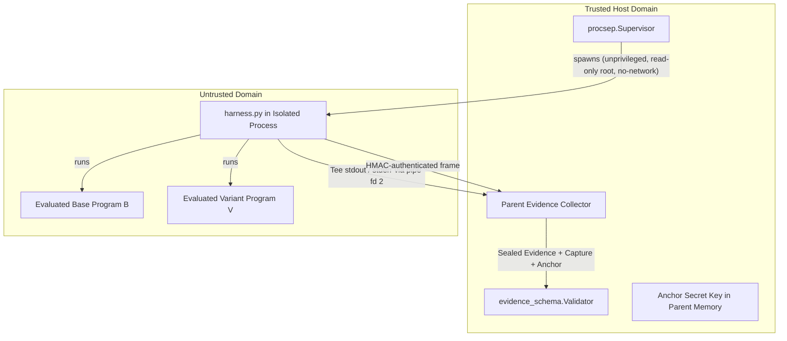

# SBG V8 Security Threat Model & Trust Boundaries

## 1. Scope & Objective

The SBG V8 architecture evaluates semantic behavioral divergence between two software versions (Base $B$ and Variant $V$) under adversarial conditions. The threat model defines what the system guarantees, what it mitigates, and what remains out of scope.

---

## 2. Adversary Model & Capabilities

### Attacker Profiles
1. **Adversarial Evaluated Code (In-Process Attacker)**:
   - Malicious variant code designed to hide divergences, suppress observation records, flood communication channels, or subvert Python runtime state (monkeypatching `sys.stdout`, inspecting stack frames, catching signals, probing `__file__`).
2. **Untrusted Evidence Author / Repository Tamperer (Post-Hoc Attacker)**:
   - Attacker who submits forged `evidence.jsonl`, manipulated `v8_capture.json`, stripped `v8_anchor.json`, altered timing/status metadata, or substituted evidence packages from unrelated programs.
3. **Privileged System Attacker (Out of Scope)**:
   - An adversary possessing root host privileges, container runtime compromise, or access to the out-of-band anchor HMAC secret key.

---

## 3. Trust Boundaries & Defense in Depth

---

## 4. Security Guarantees & Non-Guarantees

| Security Property | Architectural Mechanism | Guarantee Level |
|---|---|---|
| **Independent Output Capture** | Parent-side `Tee` capture via separate pipe (`fd 2`) | **Guaranteed against child monkeypatching** |
| **Evidence Chain Integrity** | SHA-256 Merkle hash chain in `evidence.jsonl` | **Guaranteed against post-hoc tampering** |
| **Metadata Cross-Binding** | `v8_capture.json` binds run timings, nonces, exit codes, and stdout digests | **Guaranteed against selective field modification** |
| **Session & Run Sealing** | HMAC-SHA256 Anchor (`v8_anchor.json`) using parent-held secret key | **Guaranteed against unauthorized directory recomputation** |
| **Pair Identity Binding** | Verification against expected file digests (`expected_sources`) | **Guaranteed against cross-pair substitution** |
| **Host System Protection** | Rootless Podman, Bubblewrap namespaces, cgroups v2, no-network | **Guaranteed host isolation** |
| **In-Process Module Name Probing** | Variant probing its own filename (`__file__`) | **Residual Limitation (Identified & Documented)** |
